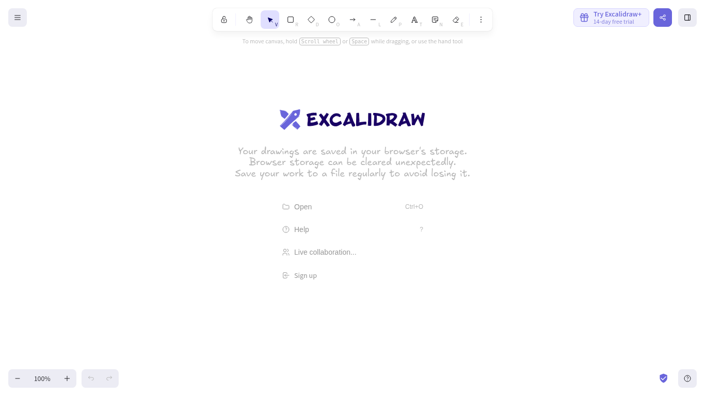
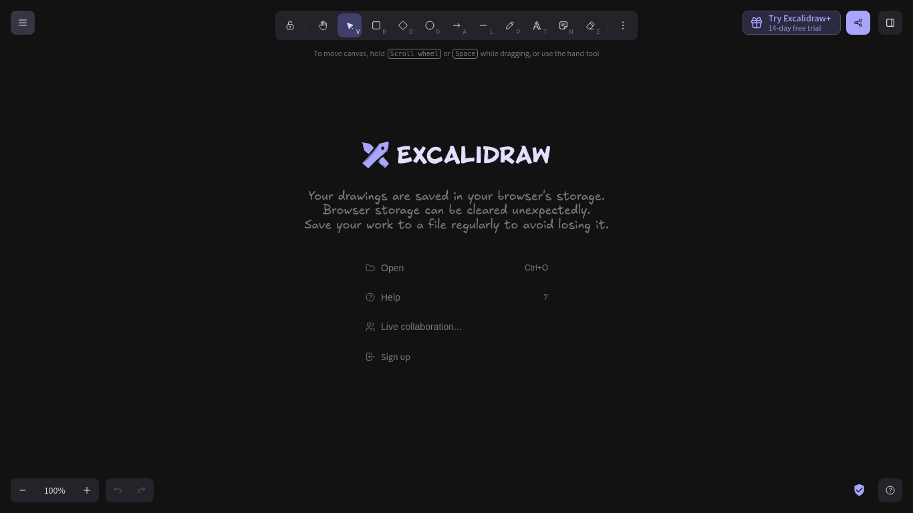
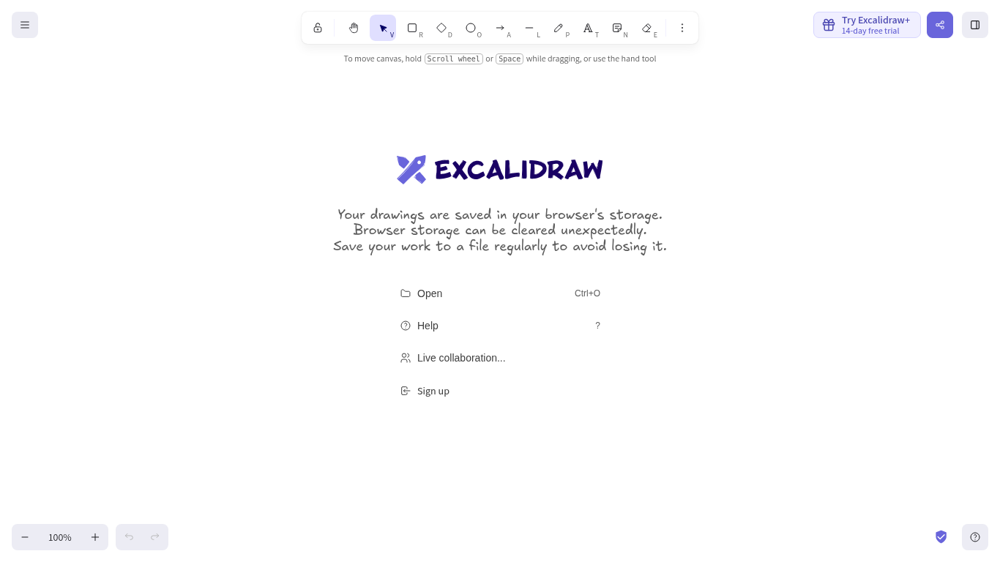

# Oportunidades de melhoria e ação executada

Esta página lista as oportunidades de melhoria das métricas com nota 0,
prioriza essas oportunidades, explica qual foi executada e mostra o efeito
medido.

## Oportunidades de melhoria

Toda métrica com nota 0 vira oportunidade, mesmo quando a média da questão é
maior ([seção 3 do roteiro](roteiro.md#3-criterios-de-julgamento)):

| Métrica / evidência | Problema | Impacto | Recomendação |
| --- | --- | --- | --- |
| [S-M1](../resultados/seguranca/s-m1.md) | 1 de 6 tipos de evento da colaboração vai sem cifra (o nome no pedido de seguir) | Exposição do nome ao operador do servidor de sala; não demonstra leitura por terceiros sob HTTPS/WSS. | Enviar o pedido de seguir pelo canal cifrado ou mandar só o `socketId` |
| [S-M3](../resultados/seguranca/s-m3.md) | Link de colaboração sem senha, expiração nem revogação | Quem possui o link e a chave pode entrar; dificulta limitar duração e retirar acesso. | Oferecer senha separada do link, expiração e revogação validadas pelo servidor |
| [S-M4](../resultados/seguranca/s-m4.md) | Cena, arquivos e biblioteca ficam sem cifra no navegador | Conteúdo permanece legível a quem acesse o armazenamento do navegador; não prova acesso remoto indevido. | Avisar do salvamento local e permitir limpar ou não persistir; cifrar com chave do usuário num modo protegido |
| [S-M7](../resultados/seguranca/s-m7.md) | Nenhuma das 7 ações tem autor registrado | Impede atribuir as sete ações observadas a um autor verificável. | Registrar ação, participante, horário e operação numa trilha persistente |
| [S-M8](../resultados/seguranca/s-m8.md) | Não há histórico de versões, só desfazer e refazer | Dificulta investigar e restaurar alterações com autoria; comparação paga não concluída. | Guardar versões com data, autor e opção de restaurar |
| [S-M10](../resultados/seguranca/s-m10.md) | Um participante assumiu o nome de outro sem bloqueio | Nomes iguais confundem a atribuição das ações; a identidade não é verificada. | Oferecer identidade autenticada; sem login, distinguir nomes repetidos por identificador visível, sem apresentá-lo como autenticação |
| [S-M11](../resultados/seguranca/s-m11.md) | 5 vulnerabilidades altas nas dependências | Risco potencial nas versões instaladas; exploração e presença no bundle não demonstradas. | Atualizar `nanoid` e `socket.io-parser` e repetir a auditoria |
| [S-M12](../resultados/seguranca/s-m12.md) | Advisory aplicável sem correção publicada | Permanece risco potencial na importação descrita no aviso, sujeito à revisão da análise estática. | Acompanhar a correção e verificar de novo a importação de cenas |
| [F-M7](../resultados/flexibilidade/f-m7.md) | Só 24 de 42 funções do draw.io | Usuários vindos do draw.io perdem funções avançadas; impacto sobre produtividade ainda não medido. | Priorizar tabelas, swimlanes e importação de arquivos `.drawio` |
| [CI-M5](../resultados/capacidade-interacao/ci-m5.md) | Só 5 de 8 tarefas de iniciantes concluídas sem ajuda (62,5%) | Na T5, iniciantes passaram do tempo, não concluíram ou perguntaram à facilitadora, e ninguém recorreu à ajuda da ferramenta. | Mostrar o nome da forma ao passar o mouse e no primeiro uso, e destacar a ajuda na tela de boas-vindas |
| [CI-M14](../resultados/capacidade-interacao/ci-m14.md) | Tema e zoom não entram no desfazer | Desfazer não restaura tema/zoom e pode atingir edição anterior. | Deixar claro o que o histórico cobre e manter controles para restaurar tema e zoom |
| [CI-M17](../resultados/capacidade-interacao/ci-m17.md) | 23,3% das ações dos iniciantes e do perfil C foram erradas | Retrabalho nas primeiras tarefas, concentrado em quem nunca usou a ferramenta (47,1% em P03); contagem de uma pessoa. | Analisar nas gravações os tipos de erro mais comuns e reforçar o retorno visual de seleção e de ferramenta ativa |
| [CI-M18](../resultados/capacidade-interacao/ci-m18.md) | Só 8 de 18 mensagens de erro explicam o problema e a saída | Orientação documental insuficiente para recuperar falhas; compreensão real não foi medida. | Incluir o motivo provável e uma ação (por exemplo, "Use PNG, JPEG ou SVG") |
| [CI-M22](../resultados/capacidade-interacao/ci-m22.md) | 6 violações da WCAG 2.2 (A e AA) | Barreiras de zoom, nome e semântica dificultam navegação e uso assistivo nos estados testados. | Permitir zoom no `viewport`, nomear o botão do menu e corrigir papéis e rótulos ARIA |
| [CI-M24](../resultados/capacidade-interacao/ci-m24.md) | O leitor de tela anuncia 1 de 9 elementos desenhados | A maior parte do desenho fica indisponível ao NVDA/Edge testado. | Expor os elementos numa estrutura acessível e anunciar seleção e mudanças |
| [CI-M25](../resultados/capacidade-interacao/ci-m25.md) | 11 de 19 combinações de texto abaixo de 4,5:1 | Textos de apoio e atalhos podem ficar difíceis de ler, especialmente para baixa visão. | Escurecer os cinzas usados em texto até 4,5:1 e não usar `opacity` nos atalhos |

São **16 oportunidades, uma por métrica com nota 0** (8 de Segurança,
1 de Flexibilidade e 7 de Capacidade de interação). As páginas vinculadas na primeira
coluna contêm o registro original, procedimento e evidência reproduzível.
A CI-M8, não medida, não entra nesta lista. Os achados adicionais
com notas 1 ou 2 permanecem em [Achados](resultados.md#achados), sem alterar essa contagem.
A prioridade inicial de Segurança é recomendação de triagem; as barreiras
assistivas também restringem o uso, sem uma pontuação de prioridade inventada.

## Priorização

Cada oportunidade foi classificada pelo impacto no propósito da avaliação, pelo
esforço da correção e pela possibilidade de medir o resultado com o mesmo
método da coleta.

| Prioridade | Métricas (nota 0) | Impacto | Esforço | Dá para medir o efeito agora? |
| :-: | --- | --- | --- | --- |
| **1** | [CI-M25](../resultados/capacidade-interacao/ci-m25.md) contraste e [CI-M22](../resultados/capacidade-interacao/ci-m22.md) violações da WCAG | Alto: O6 é o pior objetivo de Capacidade de interação (31,3%) e bloqueia a decisão de uso pedagógico; os textos apagados são justamente os que orientam quem está começando | Baixo: cores do tema e atributos de HTML | Sim, com o mesmo script da coleta |
| 2 | [CI-M18](../resultados/capacidade-interacao/ci-m18.md) mensagens de erro | Médio | Médio: reescrever 10 mensagens | Só com usuários (compreensão) |
| 3 | [CI-M24](../resultados/capacidade-interacao/ci-m24.md) leitor de tela | Alto | Alto: estrutura acessível paralela ao canvas | Sim, mas exige o desenvolvimento antes |
| 4 | [S-M1](../resultados/seguranca/s-m1.md), [S-M3](../resultados/seguranca/s-m3.md), [S-M4](../resultados/seguranca/s-m4.md), [S-M7](../resultados/seguranca/s-m7.md), [S-M8](../resultados/seguranca/s-m8.md), [S-M10](../resultados/seguranca/s-m10.md) | Alto para diagramas sensíveis | Alto: mudam o servidor de colaboração, autenticação e armazenamento | Não no prazo |
| 5 | [S-M11](../resultados/seguranca/s-m11.md), [S-M12](../resultados/seguranca/s-m12.md) dependências | Médio | Médio: atualizar pacotes e testar regressões; um aviso não tem correção publicada | Sim, com nova auditoria |
| 6 | [F-M7](../resultados/flexibilidade/f-m7.md), [CI-M14](../resultados/capacidade-interacao/ci-m14.md), [CI-M5](../resultados/capacidade-interacao/ci-m5.md), [CI-M17](../resultados/capacidade-interacao/ci-m17.md) | Médio | Alto (novas funções) ou exigem novas sessões com participantes | Não no prazo |

A prioridade 1 foi escolhida porque junta o maior efeito sobre o objetivo mais
fraco ao menor esforço, e porque o resultado pode ser medido de novo, com o
mesmo script e no mesmo ambiente, para comparar antes e depois.

## Ação executada: contraste e acessibilidade da interface

**Tipo:** modificação de código no Excalidraw, a partir do commit `e7b5346`,
na branch
[`melhoria/acessibilidade-38`](https://github.com/FCTE-Qualidade-de-Software-1/2026-2_T02_ADA_LOVELACE/tree/melhoria/acessibilidade-38).
A `main` mantém `aplicacao/` como foi avaliado, para que as coletas possam ser
refeitas sobre a mesma versão.

**O que mudou** (registro completo e diff na
[evidência](https://github.com/FCTE-Qualidade-de-Software-1/2026-2_T02_ADA_LOVELACE/blob/main/evidencias/melhoria/acao-melhoria-acessibilidade.md)):

- **Contraste (CI-M25).** Os textos de apoio, as letras de atalho, a dica de
  navegação, os atalhos do menu e o botão do Excalidraw+ passaram a usar tons
  do próprio tema com pelo menos 4,5:1: `#5c5c5c` sobre branco no modo claro
  (6,7:1) e `#999999` sobre o fundo escuro (5,5:1 a 6,6:1). Os atalhos do menu
  deixaram de ser apagados com `opacity: 0.5`.
- **Zoom do navegador (CI-M22, V1).** O `<meta name="viewport">` deixou de
  bloquear o zoom (`maximum-scale=1` e `user-scalable=no`).
- **Nomes acessíveis (CI-M22, V2, V5 e V6).** O botão do menu ganhou nome
  ("Menu"), e o botão de zoom e os links do Discord e do X passaram a ter um
  nome que contém o texto visível.

**Como foi medido.** O build de produção foi gerado antes e depois das
mudanças, e o mesmo script da coleta original
(`scripts/ci_m22_m25_acessibilidade.cjs`, com axe-core e Lighthouse) foi rodado
nos dois, no mesmo computador e no mesmo dia. O "antes" reproduziu exatamente
as 19 combinações e as 6 violações registradas em 13/11.

## Resultado

| Métrica | Antes | Depois | Nota antes | Nota depois |
| --- | --- | --- | :-: | :-: |
| CI-M25 · contraste ≥ 4,5:1 | 8 de 19 combinações (42,1%) | 16 de 16 (100%) | 0 | **2** |
| CI-M22 · violações A e AA | 6 | 2 | 0 | **1** |
| Lighthouse, acessibilidade | 87/100 | 100/100 | — | — |

Com essas duas notas, a CI-Q9 passaria de 0,25 para 1,00 e o O6 de 31,3% para
50,0% (parcialmente atendido). A CI-M24 (leitor de tela) continua com nota 0,
e por isso o uso com leitor de tela segue não recomendado.

| | Modo claro | Modo escuro |
| --- | --- | --- |
| Antes |  |  |
| Depois |  |  |

*Telas iniciais nos modos claro e escuro, antes e depois da correção. Fonte:
script `ci_m22_m25_acessibilidade.cjs`, 22/11/2026.*

## Limitações

- As notas oficiais da avaliação continuam as do commit `e7b5346`. O "depois"
  mede uma cópia modificada, não uma versão publicada do Excalidraw.
- O recorte é o mesmo da coleta: tela inicial, seleção e menu, nos dois modos.
- Duas violações continuam: o gatilho do seletor de fonte (V3) e o papel do
  menu principal (V4), que exigem mudar a estrutura dos componentes.
- O zoom liberado não foi testado em aparelho real, e a mudança visual não foi
  avaliada com usuários.
- A correção ainda não foi proposta ao projeto Excalidraw. Ela pode ser enviada
  como contribuição, com o diff da evidência.
