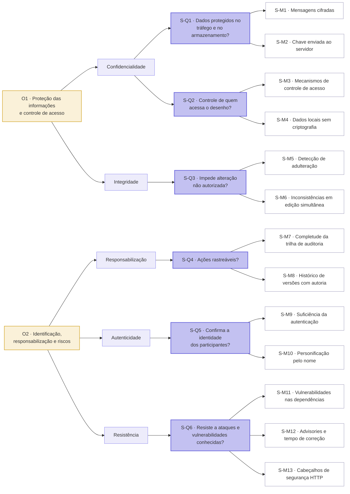
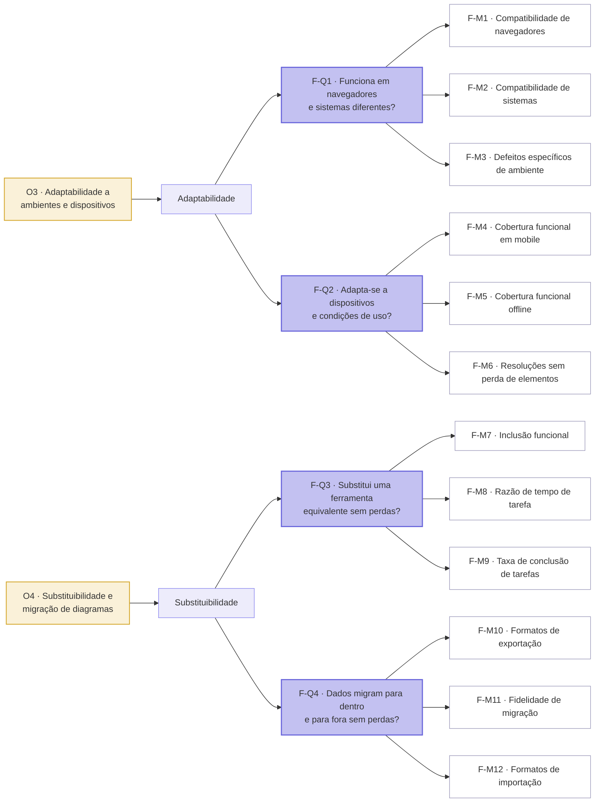
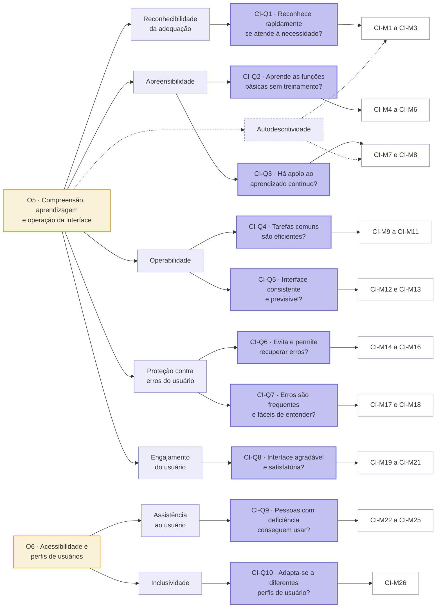

# Roteiro da análise

## 1. Propósito e partes interessadas

O propósito é identificar o nível de atendimento e as oportunidades de
melhoria do Excalidraw em **segurança, flexibilidade e capacidade de
interação**. Os
resultados apoiarão recomendações para usuários, instituições de ensino e
mantenedores do Excalidraw, além de fornecerem evidências para o artigo científico da
equipe.

A Tabela 4 resume as principais partes interessadas e o que cada uma precisa
da avaliação.

*Tabela 4. Partes interessadas e necessidades na avaliação. Fonte: elaboração
própria.*

| Parte interessada | Necessidade na avaliação |
| --- | --- |
| Usuário que cria e compartilha diagramas potencialmente sensíveis | Colaborar por link e gerar diagramas por IA sem expor o conteúdo a terceiros |
| Usuário iniciante e usuário experiente | Desenhar sem treinamento (iniciante) e trabalhar rápido com atalhos (experiente) |
| Usuário com necessidades de acessibilidade | Operar o canvas só pelo teclado, com leitor de tela e contraste adequado |
| Usuário que acessa apenas pelo celular | Usar o Excalidraw, inclusive a geração por IA, em navegador móvel e com conexão instável |
| Usuário que migra de outra ferramenta | Levar diagramas do draw.io ou do Miro e continuar trabalhando sem perda |
| Docente ou instituição que adota a ferramenta | Escolher um quadro branco gratuito, acessível e seguro para uso em aula |
| Mantenedores do Excalidraw | Saber quais vulnerabilidades, incompatibilidades e barreiras de uso existem |
| Operador da instância pública (excalidraw.com) | Que o serviço não seja afetado por testes de terceiros |

O requisitante, as decisões que a avaliação apoia e o critério de sucesso e a
influência de cada parte interessada estão em
[Propósito e partes interessadas](../fase1/proposito-partes-interessadas.md),
assim como o motivo de o integrador que usa o Excalidraw como biblioteca não
fazer parte da avaliação.

## 2. Produto, contexto e escopo

O produto é uma aplicação web de quadro branco colaborativo. O escopo inclui:

* criação e edição de formas, textos, setas e wireframes;
* interação com o canvas por mouse, teclado e toque;
* compartilhamento e colaboração por links;
* exportação e importação de diagramas;
* criação de diagramas com apoio de inteligência artificial;
* armazenamento local, autenticação observável e proteção das comunicações;
* execução em navegadores, sistemas operacionais, resoluções e dispositivos
  selecionados.

Ficam fora do escopo a auditoria completa da infraestrutura de produção, a
certificação criptográfica formal, o teste de penetração invasivo e a
avaliação exaustiva de todas as funcionalidades do produto. Essa delimitação
evita generalizar resultados obtidos em uma aplicação pública e em condições
de teste controladas.

## 3. Modelo de qualidade

O modelo adotado é a ISO/IEC 25010:2023, adaptado ao contexto colaborativo do
Excalidraw. Foram priorizadas, conforme a terminologia da edição de 2023:

* **Segurança:** confidencialidade, integridade, responsabilização,
  autenticidade e resistência;
* **Flexibilidade:** adaptabilidade e substituibilidade;
* **Capacidade de interação:** reconhecibilidade da adequação,
  apreensibilidade, operabilidade, proteção contra erros, engajamento do
  usuário, autodescritividade, inclusividade e assistência ao usuário.

Segurança foi priorizada pelo compartilhamento de informações e pela
colaboração em tempo real; flexibilidade, pelo uso predominante em dispositivos
móveis e pela variedade de navegadores; e capacidade de interação, pela
necessidade de desenhar com rapidez, aprender a interface e colaborar sem
perder dados.

## 4. Estratégia GQM

A medição segue o método **Goal-Question-Metric (GQM)**:

1. **Objetivo:** define o que será analisado, para qual finalidade, sob qual
   característica, para quem e em qual contexto.
2. **Questão:** decompõe o objetivo em perguntas observáveis.
3. **Métrica:** define o dado, a fórmula, a fonte e o critério usados para
   responder à questão.

Os seis objetivos estão descritos, com os cinco elementos do GQM, na página de
[objetivos de medição](../fase1/objetivos-qualidade.md). Esta seção apresenta
o desdobramento de cada objetivo em questões e métricas: **6 objetivos, 20
questões e 51 métricas**.

!!! note "Identificadores"
    Questões e métricas são identificadas pela característica da
    ISO/IEC 25010:2023 a que pertencem: **S** para Segurança, **F** para
    Flexibilidade e **CI** para Capacidade de interação. Assim, CI-Q9 é a nona
    questão de Capacidade de interação, e CI-M22 é a primeira métrica dessa
    questão.

### Como as questões e as métricas foram definidas

Cada objetivo foi desdobrado em questões que cobrem as subcaracterísticas do
respectivo foco de qualidade, de modo que cada questão pertence a um único
objetivo. A única subcaracterística sem questão própria é a
autodescritividade, observada por métricas de outras questões, como explicado
no objetivo [O5](#o5-compreensao-aprendizagem-e-operacao-da-interface).

As métricas foram selecionadas para responder diretamente às questões, e
nenhuma métrica fica sem questão associada. Cada métrica produz um único valor
(uma contagem, uma proporção, uma resposta Sim/Não ou uma escala curta), o que
as mantém simples. Elas dependem de instrumentos e procedimentos descritos na
própria definição, como DevTools, `npm audit`, securityheaders.com,
axe DevTools, Lighthouse e o questionário SUS, listados nas
[referências](../referencias.md), e não da opinião de quem mede, o
que as torna objetivas; as métricas de percepção, como o SUS e a escala Likert,
usam instrumentos padronizados. Cada métrica se liga ao atributo perguntado,
como a proporção de mensagens cifradas para a confidencialidade ou a taxa de
recuperabilidade para a proteção contra erros do usuário, o que sustenta sua
validade.

As métricas que dependem de participantes, como tempos, taxas de conclusão, SUS
e escala Likert, exigem um roteiro de tarefas único para todos, para que os
valores sejam comparáveis.

Em cada objetivo, a primeira tabela liga as questões às subcaracterísticas e
às métricas. A segunda descreve como cada métrica é medida e os limites dos
níveis de pontuação definidos na [seção 6](#6-criterios-de-julgamento).

### Segurança

O Diagrama 5 apresenta a hierarquia GQM de Segurança, dos objetivos O1 e O2
às subcaracterísticas, questões e métricas.

*Diagrama 5. Hierarquia GQM de Segurança, dos objetivos às métricas. Fonte:
elaboração própria.*

#### O1 — Proteção das informações e controle de acesso

Analisar armazenamento, compartilhamento e colaboração em tempo real para
identificar fragilidades na confidencialidade e integridade dos diagramas, do
ponto de vista de usuários que criam e compartilham conteúdo. As Tabelas 5 e 6
apresentam, respectivamente, as questões e as métricas do O1.

*Tabela 5. Questões do objetivo O1. Fonte: elaboração própria.*

| Questão | Subcaracterística | Métricas |
| --- | --- | --- |
| **S-Q1.** Os dados do desenho trafegam e ficam armazenados de forma protegida contra acesso não autorizado? | Confidencialidade | S-M1 e S-M2 |
| **S-Q2.** É possível controlar quem acessa um desenho compartilhado? | Confidencialidade | S-M3 e S-M4 |
| **S-Q3.** O sistema impede alteração ou corrupção não autorizada dos dados? | Integridade | S-M5 e S-M6 |

*Tabela 6. Métricas e níveis de pontuação do objetivo O1. Fonte: elaboração
própria.*

| Métrica | Como medir | Satisfatório (2) | Parcial (1) | Insatisfatório (0) |
| --- | --- | --- | --- | --- |
| **S-M1.** Proporção de mensagens de colaboração criptografadas | Mensagens cifradas ÷ total de mensagens capturadas, via DevTools ou proxy (Burp ou ZAP). Meta: 100% | 100% | ≥ 90% e < 100% | < 90% |
| **S-M2.** A chave de criptografia é enviada ao servidor? | Sim/Não, verificando se o fragmento `#` do link aparece nas requisições | Não | Não se aplica | Sim |
| **S-M3.** Mecanismos de controle de acesso | Escala de 0 a 3, um ponto por mecanismo: senha, expiração ou revogação do link | 2 ou 3 mecanismos | 1 mecanismo | Nenhum mecanismo |
| **S-M4.** Dados persistidos localmente sem criptografia | Sim/Não, inspecionando o localStorage e o IndexedDB | Não | Não se aplica | Sim |
| **S-M5.** Taxa de detecção de adulteração | Adulterações rejeitadas ÷ adulterações injetadas no texto cifrado, em testes que manipulam os payloads, executados em uma instância local do Excalidraw (ver [seção 5](#5-execucao-e-fontes-de-evidencia)) | 100% | ≥ 90% e < 100% | < 90% |
| **S-M6.** Inconsistências entre participantes após N edições simultâneas | Contagem, em teste de concorrência | 0 | 1 a 2 | ≥ 3 |

#### O2 — Identificação, responsabilização e riscos de segurança

Analisar identificação de participantes, registros de ações, dependências e
configurações técnicas para identificar limitações de autenticidade,
responsabilização e resistência a ataques. As Tabelas 7 e 8 apresentam,
respectivamente, as questões e as métricas do O2.

*Tabela 7. Questões do objetivo O2. Fonte: elaboração própria.*

| Questão | Subcaracterística | Métricas |
| --- | --- | --- |
| **S-Q4.** As ações dos usuários são rastreáveis? | Responsabilização | S-M7 e S-M8 |
| **S-Q5.** O sistema confirma a identidade de quem participa da sessão? | Autenticidade | S-M9 e S-M10 |
| **S-Q6.** A aplicação resiste a ataques e vulnerabilidades conhecidas? | Resistência | S-M11 a S-M13 |

*Tabela 8. Métricas e níveis de pontuação do objetivo O2. Fonte: elaboração
própria.*

| Métrica | Como medir | Satisfatório (2) | Parcial (1) | Insatisfatório (0) |
| --- | --- | --- | --- | --- |
| **S-M7.** Completude da trilha de auditoria | Ações registradas com autor identificado ÷ total de ações executadas | ≥ 90% | 50% a 89% | < 50% |
| **S-M8.** Histórico de versões com autoria | Existência do histórico, comparando a versão gratuita com o Excalidraw+ | Sim, na versão gratuita | Sim, apenas no Excalidraw+ | Não existe |
| **S-M9.** Suficiência do mecanismo de autenticação | Escala de 0 a 3: nenhum, nome autodeclarado, login, login + MFA | Login ou login + MFA | Nome autodeclarado | Nenhum mecanismo |
| **S-M10.** Um participante pode se passar por outro alterando o nome exibido? | Sim/Não | Não | Não se aplica | Sim |
| **S-M11.** Vulnerabilidades altas ou críticas nas dependências | Contagem via `npm audit` no repositório do GitHub | 0 | 1 a 3, nenhuma crítica | Qualquer crítica ou ≥ 4 |
| **S-M12.** Security advisories e CVEs publicados e tempo médio de correção | Número de advisories e CVEs publicados e tempo médio de correção, em dias | ≤ 30 dias (ou sem advisories) | 31 a 90 dias | > 90 dias ou sem correção |
| **S-M13.** Nota dos cabeçalhos de segurança HTTP | Nota dos cabeçalhos CSP, HSTS e X-Frame-Options, por exemplo via securityheaders.com | A ou A+ | B ou C | D, E ou F |

### Flexibilidade

O Diagrama 6 apresenta a hierarquia GQM de Flexibilidade, dos objetivos O3 e
O4 às subcaracterísticas, questões e métricas.

*Diagrama 6. Hierarquia GQM de Flexibilidade, dos objetivos às métricas.
Fonte: elaboração própria.*

#### O3 — Adaptabilidade a diferentes ambientes e dispositivos

Analisar a execução em diferentes ambientes, do ponto de vista de usuários que
acessam a aplicação em diferentes dispositivos e plataformas, em especial
quem acessa apenas pelo celular. As Tabelas 9 e 10 apresentam, respectivamente,
as questões e as métricas do O3.

*Tabela 9. Questões do objetivo O3. Fonte: elaboração própria.*

| Questão | Subcaracterística | Métricas |
| --- | --- | --- |
| **F-Q1.** O Excalidraw funciona de forma consistente em diferentes navegadores e sistemas operacionais? | Adaptabilidade | F-M1 a F-M3 |
| **F-Q2.** A aplicação se adapta a diferentes dispositivos e condições de uso? | Adaptabilidade | F-M4 a F-M6 |

*Tabela 10. Métricas e níveis de pontuação do objetivo O3. Fonte: elaboração
própria.*

| Métrica | Como medir | Satisfatório (2) | Parcial (1) | Insatisfatório (0) |
| --- | --- | --- | --- | --- |
| **F-M1.** Taxa de compatibilidade de navegadores | Navegadores sem falhas nas tarefas de teste ÷ navegadores testados (Chrome, Firefox, Edge e Safari). Meta: 75% | ≥ 75% | 50% a 74% | < 50% |
| **F-M2.** Taxa de compatibilidade de sistemas operacionais | Sistemas sem falhas ÷ sistemas testados (Windows, Linux, macOS, Android e iOS) | ≥ 80% | 60% a 79% | < 60% |
| **F-M3.** Defeitos específicos de ambiente | Contagem de defeitos de renderização do canvas, fontes e atalhos de teclado | 0 | 1 a 3 | ≥ 4 |
| **F-M4.** Cobertura funcional em dispositivos móveis | Funções operáveis por toque ou caneta ÷ funções operáveis com mouse no desktop | ≥ 90% | 70% a 89% | < 70% |
| **F-M5.** Cobertura funcional offline | Funções que funcionam sem conexão ÷ funções testadas, simulando o modo offline via DevTools | ≥ 80% | 50% a 79% | < 50% |
| **F-M6.** Resoluções suportadas sem perda de elementos da interface | Sim/Não para 360 px, 768 px, 1366 px e 2560 px | 4 de 4 | 3 de 4 | ≤ 2 de 4 |

#### O4 — Substituibilidade e migração de diagramas

Analisar a substituição de ferramentas equivalentes e a migração de dados, do
ponto de vista de usuários que migram de outra ferramenta de diagramação. As
Tabelas 11 e 12 apresentam, respectivamente, as questões e as métricas do O4.

*Tabela 11. Questões do objetivo O4. Fonte: elaboração própria.*

| Questão | Subcaracterística | Métricas |
| --- | --- | --- |
| **F-Q3.** O Excalidraw pode substituir uma ferramenta equivalente (por exemplo, draw.io ou Miro) sem perda de funcionalidade e produtividade? | Substituibilidade | F-M7 a F-M9 |
| **F-Q4.** Os dados podem ser migrados para dentro e para fora do Excalidraw sem perdas? | Substituibilidade | F-M10 a F-M12 |

*Tabela 12. Métricas e níveis de pontuação do objetivo O4. Fonte: elaboração
própria.*

| Métrica | Como medir | Satisfatório (2) | Parcial (1) | Insatisfatório (0) |
| --- | --- | --- | --- | --- |
| **F-M7.** Inclusão funcional | Funções da ferramenta anterior presentes no Excalidraw ÷ total de funções da ferramenta anterior | ≥ 90% | 70% a 89% | < 70% |
| **F-M8.** Razão de tempo de tarefa | Tempo no Excalidraw ÷ tempo na ferramenta anterior, para a mesma tarefa. Meta: ≤ 1 | ≤ 1,0 | > 1,0 e ≤ 1,5 | > 1,5 |
| **F-M9.** Taxa de conclusão de tarefas por usuários vindos da ferramenta anterior | Tarefas concluídas ÷ tarefas propostas | ≥ 90% | 70% a 89% | < 70% |
| **F-M10.** Cobertura de formatos de exportação | Formatos abertos suportados (JSON, SVG e PNG) ÷ formatos relevantes considerados | ≥ 80% | 50% a 79% | < 50% |
| **F-M11.** Fidelidade de migração | Elementos preservados (formas, textos, setas e cores) após exportar e reimportar ÷ total de elementos. Meta: 100% no round-trip `.excalidraw` | 100% | 90% a 99% | < 90% |
| **F-M12.** Formatos de importação aceitos | Contagem dos formatos aceitos (`.excalidraw`, `.excalidrawlib`, Mermaid e imagens) | ≥ 3 formatos | 2 formatos | ≤ 1 formato |

### Capacidade de interação

O Diagrama 7 apresenta a hierarquia GQM de Capacidade de interação, dos
objetivos O5 e O6 às subcaracterísticas e questões. Para manter a leitura, as
métricas aparecem agrupadas por questão.

*Diagrama 7. Hierarquia GQM de Capacidade de interação, dos objetivos às
métricas, agrupadas por questão. A linha tracejada indica a autodescritividade,
observada pelas métricas CI-M3 e CI-M7. Fonte: elaboração própria.*

#### O5 — Compreensão, aprendizagem e operação da interface

Analisar a interface de criação e edição para identificar dificuldades de
compreensão, aprendizagem, operação, recuperação de erros e engajamento. As
Tabelas 13 e 14 apresentam, respectivamente, as questões e as métricas do O5.

*Tabela 13. Questões do objetivo O5. Fonte: elaboração própria.*

| Questão | Subcaracterística | Métricas |
| --- | --- | --- |
| **CI-Q1.** O usuário consegue reconhecer rapidamente se o Excalidraw atende à sua necessidade? | Reconhecibilidade da adequação | CI-M1 a CI-M3 |
| **CI-Q2.** Um usuário novo consegue aprender a usar as funções básicas sem treinamento? | Apreensibilidade | CI-M4 a CI-M6 |
| **CI-Q3.** A ferramenta oferece recursos que apoiam o aprendizado contínuo? | Apreensibilidade | CI-M7 e CI-M8 |
| **CI-Q4.** As tarefas comuns podem ser realizadas de forma eficiente? | Operabilidade | CI-M9 a CI-M11 |
| **CI-Q5.** A interface se comporta de forma consistente e previsível? | Operabilidade | CI-M12 e CI-M13 |
| **CI-Q6.** O sistema evita e permite recuperar erros do usuário? | Proteção contra erros do usuário | CI-M14 a CI-M16 |
| **CI-Q7.** Os erros cometidos são frequentes e fáceis de entender? | Proteção contra erros do usuário | CI-M17 e CI-M18 |
| **CI-Q8.** A interface é agradável e satisfatória para o usuário? | Engajamento do usuário | CI-M19 a CI-M21 |

!!! note "Engajamento e autodescritividade"
    A edição de 2023 da ISO/IEC 25010 substituiu a estética da interface pelo
    **engajamento do usuário**; por isso a CI-Q8 e suas métricas respondem ao
    engajamento. A **autodescritividade**, também incluída nessa edição, não
    tem questão própria: ela é observada pelas métricas CI-M3 (ícones
    identificados sem tooltip) e CI-M7 (cobertura da ajuda interna), que
    verificam se as funções são compreensíveis sem consulta externa, conforme
    o [modelo de qualidade](../fase1/modelo-qualidade.md#capacidade-de-interacao).

*Tabela 14. Métricas e níveis de pontuação do objetivo O5. Fonte: elaboração
própria.*

| Métrica | Como medir | Satisfatório (2) | Parcial (1) | Insatisfatório (0) |
| --- | --- | --- | --- | --- |
| **CI-M1.** Tempo até identificar o propósito da ferramenta | Segundos até o participante identificar o propósito da ferramenta na tela inicial | ≤ 10 s | 11 a 30 s | > 30 s |
| **CI-M2.** Taxa de reconhecimento correto | Participantes que descrevem corretamente o que a ferramenta faz após 1 min de uso ÷ total. Meta: ≥ 90% | ≥ 90% | 70% a 89% | < 70% |
| **CI-M3.** Ícones autoexplicativos | Ícones da barra de ferramentas identificados corretamente sem tooltip ÷ total de ícones | ≥ 80% | 50% a 79% | < 50% |
| **CI-M4.** Tempo da primeira tarefa | Minutos para concluir, sem ajuda, a tarefa de desenhar um retângulo, ligá-lo com uma seta a uma elipse e rotulá-los | ≤ 3 min | > 3 e ≤ 5 min | > 5 min ou não concluiu |
| **CI-M5.** Taxa de conclusão sem ajuda | Tarefas básicas concluídas sem consultar ajuda externa ÷ tarefas propostas. Meta: ≥ 90% | ≥ 90% | 70% a 89% | < 70% |
| **CI-M6.** Consultas à ajuda | Número de consultas por participante durante as tarefas (diálogo "?", tooltips ou busca externa) | ≤ 1 | 2 a 3 | ≥ 4 |
| **CI-M7.** Cobertura da ajuda interna | Funções documentadas no diálogo de ajuda e de atalhos ÷ total de funções disponíveis | ≥ 80% | 50% a 79% | < 50% |
| **CI-M8.** Melhoria de desempenho entre sessões | Tempo da tarefa na 1ª sessão ÷ tempo da mesma tarefa na 3ª sessão; valor acima de 1 indica aprendizado | ≥ 1,3 | > 1,0 e < 1,3 | ≤ 1,0 |
| **CI-M9.** Ações por tarefa frequente | Média de cliques ou ações para criar forma, mudar cor, agrupar e exportar em PNG | ≤ 3 | 4 a 5 | ≥ 6 |
| **CI-M10.** Cobertura de atalhos de teclado | Funções frequentes com atalho ÷ total de funções frequentes | ≥ 80% | 50% a 79% | < 50% |
| **CI-M11.** Tempo de experientes em relação ao de iniciantes | Tempo médio por tarefa de usuários experientes ÷ tempo médio de iniciantes | ≤ 0,5 | > 0,5 e ≤ 0,8 | > 0,8 |
| **CI-M12.** Inconsistências da interface | Número de casos em que a mesma ação tem comportamentos diferentes (por exemplo, seleção, snapping e edição de texto) | 0 | 1 a 2 | ≥ 3 |
| **CI-M13.** Ações com feedback visual imediato | Ações com feedback ÷ ações testadas. Meta: 100% | 100% | 90% a 99% | < 90% |
| **CI-M14.** Taxa de recuperabilidade | Ações revertíveis por desfazer e refazer ÷ total de ações testadas. Meta: 100% | 100% | 90% a 99% | < 90% |
| **CI-M15.** Ações destrutivas sem confirmação | Contagem (por exemplo, limpar o canvas ou sobrescrever o arquivo ao abrir outro) | 0 | 1 a 2 | ≥ 3 |
| **CI-M16.** Perda de dados ao fechar a aba ou recarregar sem salvar | Sim/Não, verificando o salvamento automático local | Não | Não se aplica | Sim |
| **CI-M17.** Taxa de erro do usuário | Ações erradas (forma errada, elemento movido sem querer) ÷ total de ações nas sessões observadas | ≤ 5% | > 5% e ≤ 10% | > 10% |
| **CI-M18.** Mensagens de erro compreensíveis | Mensagens que o usuário entende e sabe como agir ÷ total de mensagens exibidas | ≥ 80% | 50% a 79% | < 50% |
| **CI-M19.** Escore SUS | *System Usability Scale*, de 0 a 100. Meta: ≥ 68 (média de mercado) | ≥ 68 | 51 a 67 | < 51 |
| **CI-M20.** Satisfação visual | Nota média em escala Likert de 1 a 5 (estilo desenhado à mão, organização e modo escuro) | ≥ 4,0 | 3,0 a 3,9 | < 3,0 |
| **CI-M21.** Intenção de uso futuro | Participantes que usariam a ferramenta novamente ÷ total | ≥ 80% | 60% a 79% | < 60% |

#### O6 — Acessibilidade e adequação a diferentes perfis de usuários

Analisar os mecanismos de navegação, interação e apresentação das informações
para identificar barreiras de inclusividade e de assistência ao usuário. As
Tabelas 15 e 16 apresentam, respectivamente, as questões e as métricas do O6.

*Tabela 15. Questões do objetivo O6. Fonte: elaboração própria.*

| Questão | Subcaracterística | Métricas |
| --- | --- | --- |
| **CI-Q9.** Pessoas com deficiência conseguem usar o Excalidraw? | Assistência ao usuário | CI-M22 a CI-M25 |
| **CI-Q10.** A ferramenta se adapta a diferentes perfis de usuário? | Inclusividade | CI-M26 |

!!! note "Contraste"
    A métrica de contraste (CI-M25) responde à assistência ao usuário, e não à
    inclusividade, para manter a coerência com o
    [modelo de qualidade](../fase1/modelo-qualidade.md#capacidade-de-interacao),
    que associa o contraste adequado à assistência ao usuário.

*Tabela 16. Métricas e níveis de pontuação do objetivo O6. Fonte: elaboração
própria.*

| Métrica | Como medir | Satisfatório (2) | Parcial (1) | Insatisfatório (0) |
| --- | --- | --- | --- | --- |
| **CI-M22.** Violações da WCAG 2.2, níveis A e AA | Contagem das violações detectadas via axe DevTools, Lighthouse ou WAVE | 0 | 1 a 5 | ≥ 6 |
| **CI-M23.** Funções operáveis apenas pelo teclado | Funções operáveis sem mouse ÷ total de funções testadas | ≥ 90% | 60% a 89% | < 60% |
| **CI-M24.** Elementos do desenho anunciados por leitor de tela | Elementos anunciados pelo NVDA ou pelo VoiceOver ÷ total de elementos; ponto crítico, pois o desenho é feito em canvas | ≥ 80% | 40% a 79% | < 40% |
| **CI-M25.** Contraste mínimo de 4,5:1 | Sim/Não por tela, nos modos claro e escuro; resultado = combinações que atendem ÷ combinações testadas | 100% das combinações | ≥ 80% e < 100% | < 80% |
| **CI-M26.** Idiomas e tradução para o português | Número de idiomas disponíveis e proporção da interface traduzida para o português (strings traduzidas ÷ total de strings) | ≥ 95% das strings | 70% a 94% | < 70% ou sem português |

## 5. Execução e fontes de evidência

1. Fixar a versão avaliada, os navegadores, sistemas operacionais, resoluções
   e dispositivos.
2. Preparar casos de teste e tarefas representativas de criação,
   compartilhamento, exportação, importação e colaboração.
3. Inspecionar o código-fonte e as dependências; registrar comandos, versões e
   saída, sem executar testes invasivos contra terceiros. Testes que adulteram
   dados ou sobrecarregam o serviço são feitos em uma instância local do
   Excalidraw, e não no excalidraw.com.
4. Executar testes funcionais, de compatibilidade, de acessibilidade e de
   capacidade de interação com participantes, quando autorizados.
5. Armazenar evidências no repositório, vinculando cada resultado à métrica,
   data, ambiente e responsável.

Entrevistas ou testes com participantes exigem autorização prévia. Os registros
não devem conter nomes reais ou dados pessoais desnecessários.

## 6. Critérios de julgamento

Cada métrica recebe uma pontuação de 0 a 2, com o significado de cada nível
descrito na Tabela 17.

*Tabela 17. Níveis de pontuação das métricas. Fonte: elaboração própria.*

| Nível | Significado |
| --- | --- |
| **2 — Satisfatório** | O valor atinge a meta ou o comportamento esperado |
| **1 — Parcial** | O valor fica abaixo da meta, mas ainda indica atendimento limitado |
| **0 — Insatisfatório** | O atributo não é atendido |

Os limites de cada nível, para as 51 métricas, estão nas Tabelas 6, 8, 10,
12, 14 e 16, na [seção 4](#4-estrategia-gqm). Quando a definição da métrica já traz uma
meta, como 100% de mensagens cifradas, taxa de recuperabilidade de 100%, razão
de tempo de tarefa menor ou igual a 1 ou escore SUS maior ou igual a 68, essa
meta é o limite do nível 2. As métricas de resposta Sim/Não têm apenas os
níveis 2 e 0. As demais faixas são valores de referência definidos para esta
avaliação.

A pontuação de uma questão é a média simples das pontuações de suas métricas,
e a de um objetivo é a média simples das pontuações de suas questões. Assim,
todas as métricas de uma questão e todas as questões de um objetivo têm o mesmo
peso. A média é convertida em percentual do máximo de 2 pontos
(`média / 2 × 100`) e interpretada conforme a Tabela 18.

*Tabela 18. Interpretação do percentual de atendimento. Fonte: elaboração
própria.*

| Percentual | Interpretação |
| --- | --- |
| 75% ou mais | Atendido |
| 50% a 74% | Parcialmente atendido |
| Abaixo de 50% | Não atendido |

Independentemente da média, toda métrica com pontuação 0 é registrada como
oportunidade de melhoria, para que um resultado ruim não fique escondido pelas
demais métricas da mesma questão. O julgamento vale apenas para as
funcionalidades, os ambientes e as condições efetivamente examinados, conforme
o [registro e análise dos resultados](../metodologia.md#registro-e-analise-dos-resultados).

## 7. Gestão e rastreabilidade

As contribuições devem ser realizadas no Git, com commits identificáveis,
revisões e vínculo entre mudanças e evidências. A gestão do projeto usará
práticas do **PSM (Practical Software and Systems Measurement)**, acompanhando
recursos, custos, desempenho do processo e calendário. O registro de decisões,
alterações de escopo e resultados deve permanecer no repositório.

As métricas operacionais de participação, entrega, revisão, rastreabilidade e
calendário são definidas na página de
[Métricas de gestão do grupo](gestao-grupo.md). Elas complementam, mas não
substituem, as métricas de qualidade do Excalidraw. A sessão automatizada de
membros e atividades deve alimentar o contrato de dados dessa página e
preservar o denominador, a janela e a fonte de cada valor.
