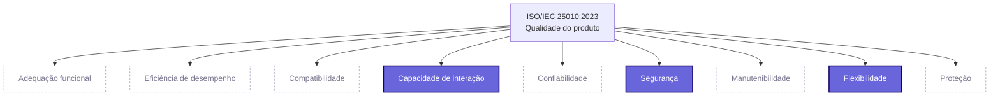
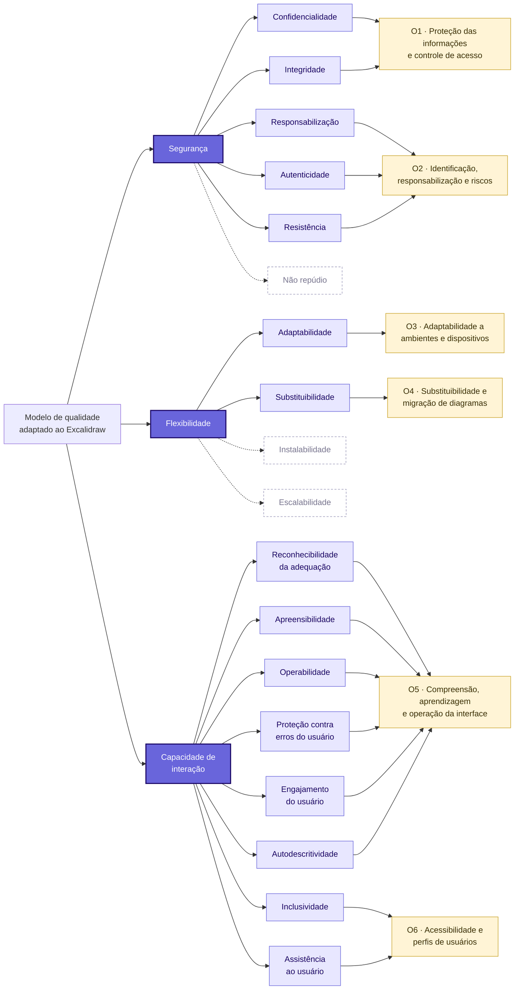

# Modelo de qualidade

O modelo de qualidade da avaliação parte da **ISO/IEC 25010:2023**, que
organiza a qualidade do produto em nove características e suas
subcaracterísticas. A equipe não aplicou o modelo de forma integral: ele foi
adaptado ao contexto do Excalidraw e às partes interessadas da avaliação,
mantendo apenas as subcaracterísticas que podem ser medidas no escopo definido
e que respondem às necessidades desses grupos.

!!! note "Sobre os termos em português"
    A ISO/IEC 25010:2023 não possui tradução oficial em português. Os nomes
    usados nesta página são traduções livres da equipe, acompanhadas do termo
    original em inglês na primeira ocorrência.

## Modelo de referência

Em relação à versão de 2011, a edição de 2023 renomeou **Usabilidade** para
**Capacidade de interação** (*interaction capability*) e **Portabilidade**
para **Flexibilidade** (*flexibility*), incluiu a característica **Proteção**
(*safety*) e reorganizou algumas subcaracterísticas. Entre as mudanças que
afetam esta avaliação estão:

* a **acessibilidade** foi dividida em **inclusividade** (*inclusivity*) e
  **assistência ao usuário** (*user assistance*);
* a **estética da interface** foi substituída por **engajamento do usuário**
  (*user engagement*);
* foram incluídas a **autodescritividade** (*self-descriptiveness*), em
  Capacidade de interação, a **resistência** (*resistance*), em Segurança, e
  a **escalabilidade** (*scalability*), em Flexibilidade.

O Diagrama 1 apresenta as nove características do modelo de referência e
destaca as três que foram selecionadas para esta avaliação.

*Diagrama 1. Características da ISO/IEC 25010:2023. Em destaque, as
características selecionadas; tracejadas, as não selecionadas. Fonte:
elaboração própria a partir da ISO/IEC 25010:2023.*

## Adaptação ao contexto do Excalidraw

A adaptação considera três elementos definidos na Fase 1:

* **o contexto do produto:** aplicação web pública, gratuita e de código
  aberto, sem necessidade de conta, com colaboração em tempo real por link e
  criptografia de ponta a ponta;
* **o escopo:** criação de diagramas com inteligência artificial, seção de
  compartilhamento e uso do canvas pelo teclado;
* **as partes interessadas:** usuário final (iniciante ou experiente), usuário
  com necessidades de acessibilidade, desenvolvedor ou mantenedor e
  integrador que leva o Excalidraw para outro sistema ou migra de outra
  ferramenta.

### Segurança

O compartilhamento por link e a colaboração em tempo real fazem com que o
conteúdo dos diagramas circule entre navegadores e servidores. Os recursos de
inteligência artificial também enviam o texto digitado pelo usuário a um
serviço externo. Por isso, a segurança é observada do ponto de vista de quem
cria e compartilha diagramas potencialmente sensíveis.

| Subcaracterística | Decisão | Justificativa | Parte interessada | Objetivo |
| --- | --- | --- | --- | --- |
| Confidencialidade (*confidentiality*) | Incluída | Diagramas trafegam pela sessão colaborativa e ficam armazenados no navegador; o link de compartilhamento carrega a chave de acesso | Usuário final | O1 |
| Integridade (*integrity*) | Incluída | Vários participantes editam o mesmo diagrama ao mesmo tempo; alterações indevidas ou conflitos corrompem o conteúdo | Usuário final | O1 |
| Responsabilização (*accountability*) | Incluída | Em uma sessão aberta por link é preciso saber quem alterou o quê | Usuário final; mantenedor | O2 |
| Autenticidade (*authenticity*) | Incluída | Na versão gratuita o participante só informa um nome, sem login, o que permite que alguém se passe por outra pessoa | Usuário final | O2 |
| Resistência (*resistance*) | Incluída | Como o código é aberto, dependências vulneráveis e cabeçalhos HTTP mal configurados podem ser verificados publicamente | Mantenedor | O2 |
| Não repúdio (*non-repudiation*) | **Excluída** | A versão gratuita não tem contas nem assinatura das ações, então não há evidência a medir; a rastreabilidade observável já é coberta por responsabilização | — | — |

### Flexibilidade

A justificativa principal é o perfil de acesso no Brasil: 60% dos usuários de
Internet acessam a rede **apenas pelo celular**, proporção que chega a 82% na
área rural e a 86% nas classes DE (NIC.BR, 2025). Uma ferramenta de
diagramação só atende essa população se funcionar fora do computador de mesa
e em diferentes navegadores. Além disso, quem adota o Excalidraw costuma vir
de outra ferramenta e precisa levar os diagramas com ele.

| Subcaracterística | Decisão | Justificativa | Parte interessada | Objetivo |
| --- | --- | --- | --- | --- |
| Adaptabilidade (*adaptability*) | Incluída | Uso em navegadores, sistemas operacionais, resoluções e dispositivos diferentes, inclusive com toque e sem conexão | Usuário final; integrador | O3 |
| Substituibilidade (*replaceability*) | Incluída | O usuário vindo do draw.io ou do Miro precisa realizar as mesmas tarefas e migrar os arquivos sem perdas | Usuário final; integrador | O4 |
| Instalabilidade (*installability*) | **Excluída** | O produto é usado direto no navegador; a instalação como aplicativo (PWA) é opcional e não faz parte do escopo | — | — |
| Escalabilidade (*scalability*) | **Excluída** | Exigiria testes de carga na infraestrutura pública de terceiros, o que é invasivo e está fora do escopo | — | — |

A importação e a exportação de arquivos também poderiam ser enquadradas em
**interoperabilidade**, subcaracterística de Compatibilidade. A equipe optou
por tratá-las em **substituibilidade** porque o interesse da parte
interessada é migrar o trabalho de uma ferramenta para outra, e não trocar
dados continuamente entre sistemas em funcionamento.

### Capacidade de interação

O Excalidraw é usado por pessoas com perfis diferentes: iniciantes que
precisam desenhar sem treinamento, usuários experientes que dependem de
atalhos e pessoas que operam a aplicação apenas pelo teclado ou com leitor de
tela. Como o desenho é feito em um elemento *canvas*, o conteúdo não é
naturalmente acessível a tecnologias assistivas, o que torna a inclusão um
ponto crítico.

| Subcaracterística | Decisão | Justificativa | Parte interessada | Objetivo |
| --- | --- | --- | --- | --- |
| Reconhecibilidade da adequação (*appropriateness recognizability*) | Incluída | O usuário precisa perceber rapidamente se a ferramenta atende à sua necessidade | Usuário iniciante | O5 |
| Apreensibilidade (*learnability*) | Incluída | As funções básicas devem ser aprendidas sem treinamento | Usuário iniciante | O5 |
| Operabilidade (*operability*) | Incluída | Tarefas frequentes, atalhos de teclado e comportamento previsível do canvas | Usuários iniciante e experiente | O5 |
| Proteção contra erros do usuário (*user error protection*) | Incluída | Desfazer, confirmação de ações destrutivas e salvamento automático evitam perda de trabalho | Usuário final | O5 |
| Engajamento do usuário (*user engagement*) | Incluída | Substitui a estética da interface; inclui satisfação e intenção de uso futuro | Usuário final | O5 |
| Autodescritividade (*self-descriptiveness*) | Incluída | Ícones e ajuda interna devem tornar as funções compreensíveis sem consulta externa | Usuário iniciante | O5 |
| Inclusividade (*inclusivity*) | Incluída | Uso por pessoas de idades, idiomas e capacidades diferentes, incluindo a interface em português | Usuário com necessidades de acessibilidade | O6 |
| Assistência ao usuário (*user assistance*) | Incluída | Operação apenas pelo teclado, suporte a leitor de tela e contraste adequado | Usuário com necessidades de acessibilidade | O6 |

### Características não selecionadas

As demais características da ISO/IEC 25010:2023 não foram incluídas porque
não estão ligadas às necessidades das partes interessadas mapeadas ou porque
não podem ser medidas de forma confiável no escopo da avaliação:

* **Adequação funcional:** as funções de desenho são maduras e amplamente
  utilizadas; a preocupação das partes interessadas está em como elas são
  usadas, compartilhadas e protegidas.
* **Eficiência de desempenho:** os resultados dependeriam do equipamento e da
  rede de cada avaliador, sem controle sobre a infraestrutura de produção.
* **Compatibilidade:** os aspectos relevantes de troca de arquivos foram
  tratados em substituibilidade.
* **Confiabilidade:** disponibilidade e tolerância a falhas exigiriam
  monitoramento prolongado do serviço público, fora do prazo da disciplina.
* **Manutenibilidade:** interessa à equipe que desenvolve o Excalidraw, que
  não é parte interessada direta desta avaliação.
* **Proteção (*safety*):** a aplicação não controla equipamentos nem
  processos que possam causar dano físico, à saúde ou ao meio ambiente.

## Modelo adaptado

O Diagrama 2 apresenta o modelo adaptado: as três características
selecionadas, suas subcaracterísticas e o objetivo de medição da Fase 2 a que
cada uma está ligada. As subcaracterísticas excluídas aparecem tracejadas.

*Diagrama 2. Modelo de qualidade adaptado ao Excalidraw, com as
subcaracterísticas ligadas aos objetivos de medição. Fonte: elaboração
própria.*

## Implicações para a avaliação

* Cada subcaracterística incluída tem pelo menos um objetivo de medição
  associado na Fase 2, o que garante a rastreabilidade entre o modelo e o
  GQM.
* As exclusões delimitam a validade dos resultados: a avaliação não permite
  conclusões sobre desempenho, confiabilidade, manutenibilidade ou
  escalabilidade do Excalidraw.
* As subcaracterísticas de Capacidade de interação que foram renomeadas ou
  divididas pela edição de 2023 (engajamento do usuário, inclusividade e
  assistência ao usuário) correspondem, respectivamente, à estética da
  interface e à acessibilidade, termos ainda usados em parte da literatura.
