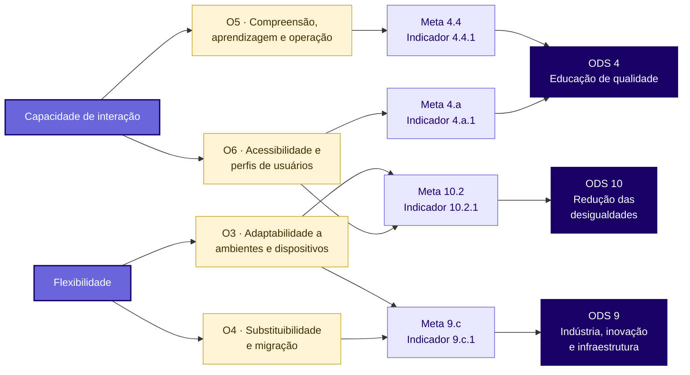

# ODS, metas e indicadores

Os Objetivos de Desenvolvimento Sustentável (ODS) da Agenda 2030 da
Organização das Nações Unidas (ONU) são 17 objetivos, desdobrados em metas e
acompanhados por indicadores. Esta página relaciona a avaliação do Excalidraw
aos ODS em que a qualidade do software tem efeito observável.

O critério de seleção foi o seguinte: um ODS só foi considerado pertinente
quando uma característica avaliada (segurança, flexibilidade ou capacidade de
interação) interfere diretamente no que a meta pretende alcançar. A
avaliação não altera os valores dos indicadores, que são medidos em escala
nacional ou global; ela verifica se o software **favorece ou dificulta** o
avanço da meta para as pessoas que o utilizam.

## ODS selecionados

| ODS | Meta | Indicador | Ligação com a avaliação |
| --- | --- | --- | --- |
| 4 — Educação de qualidade | 4.4 | 4.4.1 | Capacidade de interação (O5) |
| 4 — Educação de qualidade | 4.a | 4.a.1 | Capacidade de interação (O6) |
| 9 — Indústria, inovação e infraestrutura | 9.c | 9.c.1 | Flexibilidade (O3, O4) |
| 10 — Redução das desigualdades | 10.2 | 10.2.1 | Capacidade de interação (O6) e Flexibilidade (O3) |

### ODS 4 — Educação de qualidade

**Meta 4.4:** "Até 2030, aumentar substancialmente o número de jovens e
adultos que tenham habilidades relevantes, inclusive competências técnicas e
profissionais, para emprego, trabalho decente e empreendedorismo."

**Indicador 4.4.1:** proporção de jovens e adultos com habilidades em
tecnologias de informação e comunicação (TIC), por tipo de habilidade.

**Pertinência ao software.** Diagramar é uma habilidade técnica usada no
ensino e no trabalho, por exemplo para modelar sistemas, planejar processos e
organizar ideias. No Brasil, habilidades digitais que exigem mais
conhecimento técnico ainda são pouco frequentes: apenas 17% dos usuários de
Internet criaram uma apresentação de slides e 19% usaram fórmulas em
planilhas (NIC.BR, 2025). O Excalidraw é gratuito e dispensa cadastro, o
que reduz barreiras de acesso. Esse benefício, porém, depende de o usuário
conseguir aprender a ferramenta sozinho. Por isso a meta se relaciona ao
objetivo **O5**, que mede reconhecibilidade, apreensibilidade e
autodescritividade.

**Meta 4.a:** "Construir e melhorar instalações físicas para educação,
apropriadas para crianças e sensíveis às deficiências e ao gênero, e que
proporcionem ambientes de aprendizagem seguros e não violentos, inclusivos e
eficazes para todos."

**Indicador 4.a.1:** proporção de escolas com acesso a: (a) eletricidade;
(b) internet para fins pedagógicos; (c) computadores para fins pedagógicos;
(d) infraestrutura e materiais adaptados para alunos com deficiência;
(e) água potável; (f) instalações sanitárias separadas por sexo; e
(g) instalações básicas para lavagem das mãos.

**Pertinência ao software.** Quadros brancos digitais são usados como
material pedagógico em aulas presenciais e remotas. Para que esse material
seja "adaptado para alunos com deficiência", como prevê o indicador, ele
precisa ser operável pelo teclado e compreensível com leitores de tela. O
objetivo **O6** verifica exatamente essas condições.

### ODS 9 — Indústria, inovação e infraestrutura

**Meta 9.c:** aumentar significativamente o acesso às tecnologias de
informação e comunicação e se empenhar para oferecer acesso universal e a
preços acessíveis à Internet nos países menos desenvolvidos.

**Indicador 9.c.1:** proporção da população coberta por rede móvel, por
tecnologia.

**Pertinência ao software.** O indicador mostra que o acesso às TIC é
medido, cada vez mais, pela rede móvel. No Brasil, 60% dos usuários de
Internet acessam a rede apenas pelo celular, e 57% de quem tem celular usa
planos pré-pagos, com pacotes de dados mais limitados (NIC.BR, 2025). A
cobertura de rede só se converte em acesso efetivo à ferramenta se o
software funcionar no celular, em diferentes navegadores e em conexões
instáveis. O objetivo **O3** mede a compatibilidade com navegadores,
sistemas operacionais, dispositivos móveis e uso sem conexão. O objetivo
**O4** complementa a análise ao verificar se os diagramas podem ser levados
para outras ferramentas sem perdas, evitando a dependência de um único
fornecedor.

### ODS 10 — Redução das desigualdades

**Meta 10.2:** "Até 2030, empoderar e promover a inclusão social, econômica e
política de todos, independentemente da idade, gênero, deficiência, raça,
etnia, origem, religião, condição econômica ou outra."

**Indicador 10.2.1:** proporção de pessoas vivendo abaixo de 50% da mediana
da renda, por sexo, idade e pessoas com deficiência.

**Pertinência ao software.** O indicador mede renda, e não uso de
tecnologia; por isso o vínculo com o Excalidraw está na meta, e não no
indicador. O acesso exclusivo pelo celular é muito mais comum entre quem tem
menos renda e escolaridade: chega a 86% nas classes DE e a 82% na área rural,
contra 18% na classe A (NIC.BR, 2025). Uma ferramenta que só funciona bem
no computador reproduz essa desigualdade. Do mesmo modo, uma interface que
não pode ser usada com teclado ou leitor de tela exclui pessoas com
deficiência. Os objetivos **O3** e **O6** verificam essas duas formas de
exclusão.

## ODS considerados e não adotados

| ODS e meta | Motivo da não adoção |
| --- | --- |
| 16.10 — Acesso público à informação e proteção das liberdades fundamentais | A segurança dos diagramas está relacionada à privacidade, mas os indicadores da meta (16.10.1 e 16.10.2) tratam de violência contra jornalistas e de leis de acesso à informação, sem relação com o software |
| 8.2 — Produtividade por meio da tecnologia e da inovação | O indicador 8.2.1 mede o crescimento do PIB por pessoa ocupada, que não pode ser atribuído ao uso de uma ferramenta de diagramação |

A segurança, embora não esteja ligada a um ODS específico, é tratada na
avaliação pela proteção de dados pessoais, em linha com a Lei Geral de
Proteção de Dados Pessoais (Lei nº 13.709/2018).

## Relação com o modelo de qualidade

*Diagrama 3. Relação entre as características avaliadas, os objetivos de
medição e as metas dos ODS. Fonte: elaboração própria.*

Os textos das metas seguem a tradução publicada pelas Nações Unidas no
Brasil. Os indicadores seguem a lista oficial de indicadores globais da ONU,
acompanhada no Brasil pelo IBGE.
