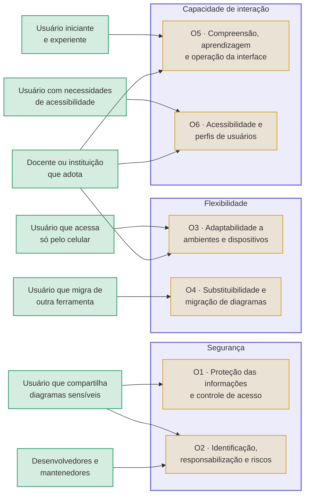

# Propósito da avaliação e partes interessadas

Esta página define **por que** o Excalidraw está sendo avaliado, **quem**
pediu a avaliação, **quem** usará os resultados e **quais decisões** eles vão
apoiar. As escolhas das páginas seguintes da Fase 1, o
[modelo de qualidade](modelo-qualidade.md) e os [ODS](ods.md), e os objetivos
de medição da Fase 2 partem do que está definido aqui.

Os papéis seguem o processo de avaliação da série SQuaRE (ISO/IEC 25040), que
distingue quem solicita a avaliação (**requisitante**), quem a executa
(**avaliador**) e as demais partes interessadas no produto, como
desenvolvedor, fornecedor, adquirente (comprador), operador e usuário.

## Propósito da avaliação

O Excalidraw é um quadro branco gratuito, de código aberto e sem cadastro.
Qualquer pessoa cria um diagrama e o compartilha por link em poucos segundos.
Essa facilidade gera três dúvidas para quem pensa em usar a ferramenta no
estudo ou no trabalho:

1. **É seguro compartilhar por ele um diagrama com informação sensível?** A
   colaboração em tempo real e a geração de diagramas por inteligência
   artificial (IA) fazem o conteúdo sair do navegador, e a versão gratuita
   não tem login nem controle de permissões.
2. **Ele funciona para quem só tem o celular?** No Brasil, 60% dos usuários
   de Internet acessam a rede apenas pelo celular, proporção que chega a 86%
   nas classes DE (NIC.BR, 2025). Também importa se é possível trazer
   diagramas de outra ferramenta e levá-los embora sem perdas.
3. **Qualquer pessoa consegue usá-lo sem treinamento?** Isso inclui
   iniciantes e pessoas que dependem do teclado ou de leitor de tela, já que o
   desenho é feito em um elemento *canvas*, pouco acessível a tecnologias
   assistivas.

O propósito da avaliação é **verificar até que ponto o Excalidraw atende a
essas três necessidades e apontar onde ele falha**, medindo as
características de **Segurança**, **Flexibilidade** e **Capacidade de
interação** da ISO/IEC 25010:2023. O resultado esperado não é uma nota única
para o produto, mas evidências que permitam a cada parte interessada tomar uma
decisão concreta, descrita a seguir.

## Uso pretendido dos resultados

A Tabela 1 relaciona cada decisão que a avaliação vai apoiar a quem a toma,
aos objetivos de medição que fornecem as evidências e ao critério usado para
decidir. Os objetivos O1 a O6 estão detalhados na Fase 2 e são pontuados
pelos critérios de julgamento do [roteiro da análise](../analise/roteiro.md)
(atendido a partir de 75%, parcialmente atendido de 50% a 74%, não atendido
abaixo de 50%).

*Tabela 1. Decisões apoiadas pela avaliação. Fonte: elaboração própria.*

| Decisão | Quem decide | Evidência | Critério de decisão |
| --- | --- | --- | --- |
| Usar o link de colaboração gratuito para diagramas sensíveis (arquitetura de sistemas, dados de clientes, planejamento interno) ou recorrer a uma alternativa (Excalidraw+, instância própria ou outra ferramenta) | Usuário que compartilha diagramas; equipe ou instituição que adota a ferramenta | O1 e O2 | Uso recomendado somente se O1 e O2 forem atendidos **e** nenhuma métrica de confidencialidade tiver pontuação 0, em especial o envio da chave de criptografia ao servidor |
| Adotar o Excalidraw como recurso pedagógico em turmas com alunos que acessam pelo celular ou que têm deficiência | Docente ou instituição de ensino | O3, O5 e O6 | Adoção recomendada se O3, O5 e O6 forem ao menos parcialmente atendidos; barreiras com pontuação 0 viram restrições de uso explícitas (por exemplo, "não usar com leitor de tela") |
| Migrar de outra ferramenta de diagramação (draw.io, Miro) para o Excalidraw | Usuário ou equipe que já usa outra ferramenta | O4 | Migração recomendada se O4 for atendido e a fidelidade ao exportar e reimportar um diagrama for de 100% |
| Quais problemas corrigir primeiro | Mantenedores do Excalidraw | Métricas com pontuação 0 em qualquer objetivo | Cada métrica com pontuação 0 vira um relato reprodutível; falhas de segurança seguem o canal de divulgação responsável do projeto, e não uma *issue* pública |
| Se a avaliação aplica corretamente o processo SQuaRE e o GQM | Requisitante (docente da disciplina) | Relatório, artigo e esta GitPage | Critérios de correção da disciplina |

Os resultados serão publicados em três formatos: o **artigo científico** da
equipe, esta **GitPage**, com as evidências de cada medição, e um **resumo de
recomendações** organizado por parte interessada, com uma linha por decisão
da Tabela 1. A equipe não toma nenhuma dessas decisões em nome das partes
interessadas; ela fornece as evidências e o critério.

## Requisitante e avaliador

A Tabela 2 separa quem pede a avaliação de quem a executa e indica o que
cada um considera uma avaliação bem-sucedida.

*Tabela 2. Requisitante e avaliador. Fonte: elaboração própria.*

| Papel | Quem | Responsabilidade | Critério de sucesso |
| --- | --- | --- | --- |
| **Requisitante** | Docente da disciplina de Qualidade de Software (FCTE/UnB) | Solicita a avaliação, define o processo (fases, GQM, ISO/IEC 25010:2023), os prazos e o formato de entrega, e julga a qualidade da avaliação | A avaliação segue as fases do processo SQuaRE e usa a terminologia da ISO/IEC 25010:2023; no GQM, todo objetivo tem questões, toda questão tem hipótese e métricas, e toda métrica tem critério de julgamento |
| **Avaliador** | Equipe Ada Lovelace | Define propósito, modelo, escopo e métricas; executa as medições; registra as evidências no repositório; redige o relatório | Cada resultado está ligado a uma métrica, com data, ambiente e evidência registrados no repositório; a contribuição de cada integrante é rastreável pelo Git; o andamento do projeto é acompanhado pelo PSM (recursos, custos, desempenho do processo e calendário) |

O requisitante não é dono do produto avaliado. Por isso, as necessidades que
orientam **o que** medir vêm das demais partes interessadas, e as exigências
do requisitante definem **como** a avaliação é conduzida: usar a edição de
2023 da norma, escolher de duas a quatro características, ligar o trabalho a
ODS, registrar tudo pelo Git, gravar entrevistas com autorização e não
publicar nomes reais de participantes.

## Partes interessadas

A Tabela 3 apresenta cada parte interessada, o que ela precisa do Excalidraw,
o resultado que ela consideraria um sucesso e como influencia a avaliação.

*Tabela 3. Partes interessadas, critérios de sucesso e influência na
avaliação. Fonte: elaboração própria.*

| Parte interessada | Papel (ISO/IEC 25040) | Necessidade | Critério de sucesso | Influência na avaliação |
| --- | --- | --- | --- | --- |
| Usuário que cria e compartilha diagramas potencialmente sensíveis | Usuário | Colaborar por link e gerar diagramas por IA sem expor o conteúdo a terceiros | Conteúdo cifrado no tráfego e no armazenamento; chave fora do servidor; meios de controlar quem acessa | Motivou a seleção de **Segurança**; é o ponto de vista do **O1** e, nas sessões colaborativas, também do **O2** (autenticidade e responsabilização); colocou a seção de compartilhamento e a criação por IA no escopo |
| Usuário iniciante e usuário experiente | Usuário | Desenhar sem treinamento (iniciante) e trabalhar rápido com atalhos (experiente) | Conclui as tarefas básicas sem ajuda; usa atalhos nas tarefas frequentes | Ponto de vista do **O5**; levou a recrutar participantes dos dois perfis, com o mesmo roteiro de tarefas, e a medir o tempo de experientes em relação ao de iniciantes |
| Usuário com necessidades de acessibilidade | Usuário | Operar o canvas só pelo teclado, com leitor de tela e contraste adequado | Executa as tarefas sem mouse; os elementos do desenho são anunciados pelo leitor de tela | Ponto de vista do **O6**; colocou o uso do canvas pelo teclado no escopo; levou à inclusão de inclusividade e assistência ao usuário no modelo |
| Usuário que acessa apenas pelo celular | Usuário | Usar o Excalidraw, inclusive a geração por IA, em navegador móvel e com conexão instável | As funções testadas no desktop também funcionam por toque e em telas pequenas | Principal motivo para selecionar **Flexibilidade**; ponto de vista do **O3**; base da ligação com os ODS 9 e 10 |
| Usuário que migra de outra ferramenta | Usuário | Levar diagramas do draw.io ou do Miro e continuar trabalhando sem perda | Realiza as mesmas tarefas em tempo igual ou menor e exporta e reimporta sem perder elementos | Ponto de vista do **O4**; levou a tratar importação e exportação em substituibilidade, e não em interoperabilidade |
| Docente ou instituição que adota a ferramenta | Adquirente (comprador) | Escolher um quadro branco gratuito, acessível e seguro para uso em aula | Funciona nos dispositivos dos alunos, é acessível e não expõe dados dos alunos | Une as decisões dos objetivos O3, O5 e O6; base da ligação com as metas 4.4 e 4.a (ODS 4); motiva a comparação entre a versão gratuita e o Excalidraw+ |
| Equipe principal do Excalidraw e comunidade de código aberto | Desenvolvedor, fornecedor e mantenedor | Saber quais vulnerabilidades, incompatibilidades e barreiras de uso existem | Recebe relatos reprodutíveis, ligados a uma versão identificada do código | Ponto de vista do **O2** (resistência); exige fixar a versão do repositório analisada para que a auditoria de dependências seja reprodutível |
| Operador da instância pública (excalidraw.com) | Operador | Que o serviço não seja afetado por testes de terceiros | Nenhum teste de carga ou de ataque contra a infraestrutura pública | Excluiu a **escalabilidade** do modelo; os testes que adulteram dados cifrados serão feitos em uma **instância local** do Excalidraw, e não no excalidraw.com |

### Parte interessada não considerada: o integrador

O Excalidraw também é distribuído como biblioteca para outras aplicações (o
pacote npm `@excalidraw/excalidraw`). O desenvolvedor que embute o editor em
outro sistema seria uma parte interessada legítima, mas a equipe **não o
incluiu** nesta avaliação. Avaliar a integração exigiria construir uma
aplicação hospedeira e medir a API da biblioteca, o que foge do escopo
definido (criação de diagramas com IA, compartilhamento e uso do canvas pelo
teclado na versão web pública). Como nenhum objetivo mediria as necessidades
desse grupo, mantê-lo na lista criaria uma parte interessada sem métrica. Os
resultados desta avaliação, portanto, **não valem** para o uso do Excalidraw
como biblioteca.

## Das partes interessadas aos objetivos

O Diagrama 1 liga cada parte interessada aos objetivos de medição que
respondem à sua necessidade. Os objetivos estão agrupados pela característica
de qualidade a que pertencem. O requisitante não aparece no diagrama porque define o processo,
e não o foco da medição.

*Diagrama 1. Partes interessadas, características selecionadas e objetivos de
medição. Fonte: elaboração própria.*

## Limites do propósito

* A avaliação responde às decisões da Tabela 1 apenas para a versão web
  pública e para os ambientes efetivamente testados. Ela não certifica a
  segurança do Excalidraw nem substitui uma auditoria profissional.
* O Excalidraw+ entra apenas como comparação, quando uma métrica depende de um
  recurso que só existe na versão paga. A avaliação é da versão gratuita.
* Os mantenedores não participam da avaliação e não se comprometeram a usar
  os resultados. O uso por eles é uma possibilidade, não um compromisso.
