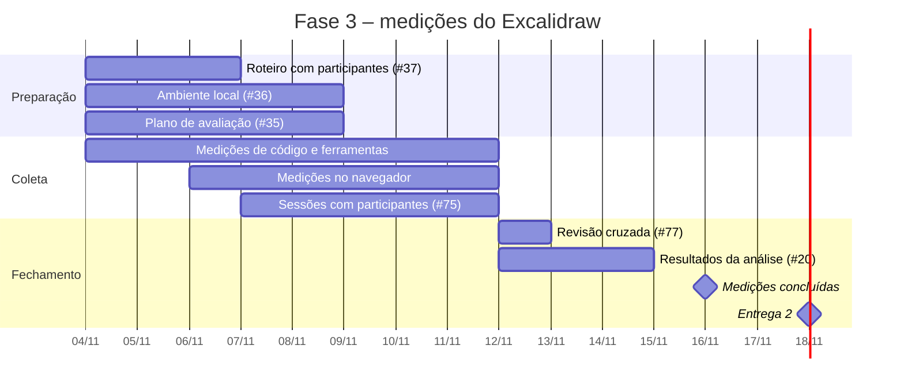

# Plano de avaliação

Este plano descreve como cada uma das 51 métricas do
[roteiro da análise](../analise/roteiro.md) é obtida, com quais recursos, por
quem e até quando. Ele não redefine métricas nem critérios: fórmulas, metas e
faixas de pontuação continuam sendo as do roteiro, e o passo a passo detalhado
de cada coleta fica registrado na evidência da métrica.

## 1. Versão avaliada e período de coleta

* **Versão:** commit
  [`e7b5346`](https://github.com/excalidraw/excalidraw/commit/e7b534668a60add7f725531f3c9abf32508c7b4e)
  do Excalidraw, conforme a [visão geral da Fase de Aplicação](index.md). Toda
  inspeção de código, de dependências e de configuração usa essa versão. Testes
  feitos no excalidraw.com podem refletir uma versão posterior, e isso é
  registrado na evidência.
* **Período:** as coletas começaram em 04/11/2026 e terminam em 16/11/2026,
  data em que o [cronograma](../gestao/cronograma.md) prevê as medições
  concluídas. A data de cada coleta fica na evidência da métrica.

## 2. Ambiente e recursos

### 2.1 Onde os testes são executados

| Ambiente | Uso | Referência |
| --- | --- | --- |
| Instância local do Excalidraw (`http://localhost:3001`) com servidor de colaboração `excalidraw-room` (commit `03ff435`) e projeto Firebase de teste do grupo | Obrigatória para os testes que adulteram dados ou exigem controle do servidor (S-M5 e S-M6, conforme a seção 5 do roteiro); usada também na S-M1, na S-M2 e em testes funcionais | [Ambiente de teste e instância local](https://github.com/FCTE-Qualidade-de-Software-1/2026-2_T02_ADA_LOVELACE/blob/main/evidencias/ambiente/ambiente-local.md) (#36) |
| Build de produção local | F-M5, porque o *service worker* que permite o uso offline só existe nesse build | #64 |
| excalidraw.com | Cabeçalhos HTTP da versão pública (S-M13) e testes que não alteram dados de terceiros | Seção 5 do roteiro |
| Ferramenta anterior (draw.io ou Miro) | Comparação funcional (F-M7) e tarefas do perfil que vem de outra ferramenta (F-M8 e F-M9) | #65 e #66 |

Nas sessões com participantes, todos usam a mesma instância, o mesmo
navegador, o tema claro, o canvas vazio e o `localStorage` limpo, conforme o
protocolo de testes com participantes (#37, PR #86).

### 2.2 Navegadores, sistemas, dispositivos e resoluções

| Recurso | O que é coberto | Métricas |
| --- | --- | --- |
| Navegadores | Chrome, Firefox, Edge e Safari | F-M1, F-M3 |
| Sistemas operacionais | Windows, Linux, macOS, Android e iOS, os que estiverem disponíveis | F-M2, F-M3 |
| Dispositivos | Celular ou tablet, com toque ou caneta | F-M4 |
| Resoluções | 360 px, 768 px, 1366 px e 2560 px | F-M6 |

A [estimativa de custos](../gestao/estimativa-custos.md) prevê cinco
configurações que cobrem esses sistemas e navegadores, sem testar todas as
combinações. Cada evidência registra o navegador, a versão, o sistema e o
dispositivo usados. Exemplos de ambientes já registrados: Windows 11 com
Helium 157 (baseado no Chromium), na instância local da #36, e Linux com
Google Chrome 157, na F-M11.

### 2.3 Ferramentas

| Ferramenta | Uso | Métricas |
| --- | --- | --- |
| DevTools do navegador (Network, WS, Application) | Mensagens de rede, armazenamento local e modo offline | S-M1, S-M2, S-M4, F-M5 |
| Proxy (Burp ou ZAP) | Alternativa ao DevTools para capturar mensagens | S-M1 |
| `npm audit` ou `yarn audit` | Vulnerabilidades nas dependências | S-M11 |
| GitHub Security Advisories | Advisories e tempo de correção | S-M12 |
| securityheaders.com | Nota dos cabeçalhos HTTP | S-M13 |
| `git grep` e leitura do código em `aplicacao/` | Inspeção de código | F-M10, F-M12, CI-M7, CI-M10, CI-M18, CI-M26 |
| axe DevTools, Lighthouse ou WAVE | Violações da WCAG 2.2 | CI-M22 |
| Medidor de contraste | Razão de contraste nos modos claro e escuro | CI-M25 |
| NVDA ou VoiceOver | Leitor de tela sobre a interface e o canvas | CI-M24 |
| Cronômetro, ficha de observação, TCLE e questionários (SUS e Likert) | Sessões com participantes | CI-M1 a CI-M6, CI-M8, CI-M11, CI-M17, CI-M19 a CI-M21, F-M8, F-M9 |

## 3. Método de coleta por métrica

As métricas são coletadas de quatro formas:

* **Código:** inspeção do código-fonte, das dependências, da documentação ou
  de registros públicos, sem executar a aplicação.
* **Navegador:** teste funcional executado por um integrante.
* **Ferramenta:** resultado gerado por uma ferramenta automática ou de
  acessibilidade.
* **Participantes:** sessões com pessoas de fora da equipe, com autorização
  prévia e registros identificados apenas por código.

A Tabela 1 resume a instrução de cada métrica, a partir das *issues* de
medição. Fórmula, meta e faixas de pontuação estão nas tabelas da
[seção 4 do roteiro](../analise/roteiro.md#4-estrategia-gqm).

*Tabela 1. Método, responsável e issue de cada métrica. Fonte: roteiro da
análise, issues de medição e Kanban da equipe.*

| Métrica | Tipo | Como é coletada | Responsável | Issue |
| --- | --- | --- | --- | --- |
| S-M1 | Navegador | Verificar no DevTools (Network/WS) ou por proxy se as mensagens da sala colaborativa trafegam cifradas | João Pedro Lopes | #55 |
| S-M2 | Navegador | Verificar se a chave da sala (fragmento `#` do link) aparece em alguma requisição | João Pedro Lopes | #55 |
| S-M3 | Navegador | Listar os mecanismos de controle de acesso a cenas e salas (link, permissões, leitura e edição) e pontuar na escala do roteiro | Renato Araújo | #56 |
| S-M4 | Navegador | Inspecionar o localStorage e o IndexedDB e registrar os dados da cena salvos sem criptografia | Renato Araújo | #57 |
| S-M5 | Navegador | Na instância local, alterar mensagens ou dados cifrados da cena e verificar se a adulteração é detectada | João Pedro Lopes | #58 |
| S-M6 | Navegador | Na instância local, editar o mesmo elemento ao mesmo tempo em dois navegadores e contar as inconsistências | João Pedro Lopes | #58 |
| S-M7 | Navegador | Verificar se existe registro de quem fez cada ação e medir a completude da trilha | Luís Cunha | #59 |
| S-M8 | Navegador | Verificar se há histórico de versões com autor, na versão gratuita e no Excalidraw+ | Luís Cunha | #59 |
| S-M9 | Código | Identificar o mecanismo de autenticação da colaboração e pontuar na escala do roteiro | João Pedro Lopes e Renato Araújo | #52 |
| S-M10 | Navegador | Em uma sala colaborativa, testar se um participante consegue usar o nome de outro e se algo impede ou sinaliza isso | Luís Cunha | #60 |
| S-M11 | Ferramenta | Rodar `npm audit` ou `yarn audit` na versão fixada e contar as vulnerabilidades por severidade | Renato Araújo | #61 |
| S-M12 | Código | Levantar os advisories de segurança do Excalidraw e o tempo até a correção | Renato Araújo | #61 |
| S-M13 | Ferramenta | Obter a nota dos cabeçalhos CSP, HSTS e X-Frame-Options | João Pedro Lopes e Renato Araújo | #53 |
| F-M1 | Navegador | Repetir a mesma lista de tarefas no Chrome, Firefox, Edge e Safari | Luís Cunha | #62 |
| F-M2 | Navegador | Repetir a mesma lista em Windows, Linux, macOS, Android e iOS | Luís Cunha | #62 |
| F-M3 | Navegador | Anotar defeitos específicos de cada ambiente (renderização, fontes e atalhos) | Luís Cunha | #62 |
| F-M4 | Navegador | Num celular ou tablet, fazer por toque as funções da lista de desktop e contar as que funcionam | Giovanna Felipe | #63 |
| F-M5 | Navegador | No build de produção, carregar com rede, ativar o modo offline no DevTools e testar uma lista fixa de funções | André Henrique | #64 |
| F-M6 | Navegador | Abrir em 360, 768, 1366 e 2560 px e registrar com print se algum controle some ou fica cortado | André Henrique | #64 |
| F-M7 | Código | Definir a lista de funções da ferramenta de referência (draw.io ou Miro) e marcar quais existem no Excalidraw | Giovanna Felipe | #65 |
| F-M8 | Participantes | Cronometrar a mesma tarefa no Excalidraw e na ferramenta anterior e calcular a razão | André Henrique | #66 |
| F-M9 | Participantes | Registrar tarefas concluídas ÷ tarefas propostas por participante vindo de outra ferramenta | André Henrique | #66 |
| F-M10 | Código | Levantar os formatos de exportação pela interface e comparar com os formatos relevantes considerados | André Henrique | PR #54 |
| F-M11 | Navegador | Salvar uma cena em `.excalidraw` e exportar em PNG e SVG com a cena incorporada, reabrir cada arquivo e contar os elementos preservados | André Henrique | #67 |
| F-M12 | Código | Levantar os formatos aceitos ao abrir, importar biblioteca, inserir imagem e colar Mermaid | André Henrique | PR #54 |
| CI-M1 | Participantes | Segundos até o participante identificar o propósito da ferramenta na tela inicial | Zayra Moraes | #75 |
| CI-M2 | Participantes | Participantes que descrevem corretamente a ferramenta após 1 minuto de uso | Zayra Moraes | #75 |
| CI-M3 | Participantes | Ícones da barra identificados sem tooltip | Zayra Moraes | #75 |
| CI-M4 | Participantes | Minutos para desenhar um retângulo, ligá-lo com uma seta a uma elipse e rotulá-los, sem ajuda | Zayra Moraes | #75 |
| CI-M5 | Participantes | Tarefas básicas concluídas sem ajuda externa ÷ tarefas propostas | Zayra Moraes | #75 |
| CI-M6 | Participantes | Consultas à ajuda por participante durante as tarefas | Zayra Moraes | #75 |
| CI-M7 | Código | Funções documentadas em `HelpDialog.tsx` ÷ funções disponíveis | Zayra Moraes | #68 |
| CI-M8 | Participantes | Tempo da mesma tarefa na 1ª sessão ÷ tempo na 3ª sessão | Zayra Moraes | #75 |
| CI-M9 | Navegador | Contar cliques para criar forma, mudar cor, agrupar e exportar em PNG | Luís Cunha | #69 |
| CI-M10 | Código | Definir a lista de funções frequentes e marcar quais têm atalho | Zayra Moraes | #68 |
| CI-M11 | Participantes | Tempo médio de experientes ÷ tempo médio de iniciantes | Zayra Moraes | #75 |
| CI-M12 | Navegador | Registrar inconsistências de seleção, snapping e edição de texto em formas | Luís Cunha | #69 |
| CI-M13 | Navegador | Listar ações (selecionar, desenhar, mover, redimensionar, cor, texto) e se cada uma dá retorno visual imediato | Renato Araújo | #70 |
| CI-M14 | Navegador | Repetir as mesmas ações, conferir desfazer e refazer e registrar as não revertíveis | Renato Araújo | #70 |
| CI-M15 | Navegador | Listar ações destrutivas e se pedem confirmação (limpar canvas, abrir arquivo sobre a cena atual, excluir biblioteca) | Renato Araújo | #71 |
| CI-M16 | Navegador | Desenhar, recarregar a página e fechar a aba sem salvar, e conferir se a cena volta | Renato Araújo | #71 |
| CI-M17 | Participantes | Ações erradas ÷ total de ações nas sessões observadas | Zayra Moraes | #75 |
| CI-M18 | Código | Classificar as mensagens de erro exibidas quanto a compreensão e orientação ao usuário | Zayra Moraes | #49 |
| CI-M19 | Participantes | Questionário SUS | Zayra Moraes | #75 |
| CI-M20 | Participantes | Questionário Likert de satisfação visual | Zayra Moraes | #75 |
| CI-M21 | Participantes | Participantes que usariam a ferramenta novamente | Zayra Moraes | #75 |
| CI-M22 | Ferramenta | Rodar axe DevTools e Lighthouse na tela principal, nos modos claro e escuro, e contar as violações WCAG 2.2 A e AA | Giovanna Felipe | #72 |
| CI-M23 | Navegador | Percorrer a lista de funções só com o teclado e contar as operáveis | Luís Cunha | #73 |
| CI-M24 | Ferramenta | Usar NVDA ou VoiceOver sobre a interface e o canvas e contar os elementos anunciados | João Pedro Lopes | #74 |
| CI-M25 | Ferramenta | Medir o contraste das combinações principais nos dois modos (mínimo de 4,5:1) | Giovanna Felipe | #72 |
| CI-M26 | Código | Contar os idiomas disponíveis e a proporção de strings traduzidas para o português | Zayra Moraes | #49 |

O passo a passo de flexibilidade e de capacidade de interação também está nos
planos de tarefas
([flexibilidade](https://github.com/FCTE-Qualidade-de-Software-1/2026-2_T02_ADA_LOVELACE/blob/main/evidencias/flexibilidade/tarefas-flexibilidade.md)
e [capacidade de interação](https://github.com/FCTE-Qualidade-de-Software-1/2026-2_T02_ADA_LOVELACE/blob/main/evidencias/capacidade-interacao/tarefas-capacidade-interacao.md)).
As métricas com participantes seguem o roteiro único de tarefas, os perfis,
as regras de condução e a tabela que leva do dado à métrica, definidos no
protocolo de testes com participantes (#37, PR #86). F-M8 e F-M9 são
registradas nas mesmas sessões da #75.

## 4. Cronograma das medições

*Tabela 2. Prazos das atividades da Fase 3. Fonte: Kanban da equipe e
[cronograma](../gestao/cronograma.md).*

| Prazo | Atividade | Issues |
| --- | --- | --- |
| 07/11 | Roteiro de tarefas, participantes e consentimento | #37 |
| 09/11 | Ambiente de teste e instância local | #36 |
| 09/11 | Plano de avaliação | #35 |
| 09/11 | S-M11 e S-M12, F-M7, CI-M7 e CI-M10 | #61, #65, #68 |
| 12/11 | Demais medições de segurança | #55 a #60 |
| 12/11 | Demais medições de flexibilidade | #62 a #64, #66, #67 |
| 12/11 | Medições de capacidade de interação e sessões com participantes | #69 a #75 |
| 13/11 | Revisão cruzada das métricas e decisões de denominador | #77 |
| 15/11 | Resultados da análise | #20 |
| 16/11 | Medições concluídas | Cronograma |
| 18/11 | Entrega 2 | Cronograma |

*Diagrama 1. Cronograma das medições até a Entrega 2. As barras de coleta
vão do início das coletas ao prazo do Kanban. Fonte: elaboração própria a
partir do Kanban da equipe.*

O andamento de cada issue é acompanhado no
[Kanban da equipe](https://github.com/users/giovannafg/projects/1) e nas
[métricas de desenvolvimento](../gestao/metricas.md).

## 5. Consistência com a Fase 2

* **Cobertura:** as 51 métricas do roteiro têm método, responsável e issue na
  Tabela 1, e cada método produz o valor na unidade da métrica (proporção,
  contagem, Sim/Não, escala, tempo ou nota), o que permite aplicar
  diretamente as faixas de pontuação do roteiro.
* **Ambiente exigido pelo roteiro:** os testes que adulteram dados ou
  sobrecarregam o serviço (S-M5 e S-M6) são feitos na instância local, e não
  no excalidraw.com, como determina a seção 5 do roteiro.
* **Participantes:** as métricas que dependem de pessoas usam o protocolo da
  #37, com autorização prévia e registros sem nomes reais, como exige a seção
  5 do roteiro. A [estimativa de custos](../gestao/estimativa-custos.md)
  considerou seis participantes com três sessões cada; o protocolo define a
  quantidade de participantes por perfil. A quantidade efetivamente atendida
  é registrada nos resultados, porque a CI-M8 depende de três sessões com a
  mesma pessoa.
* **Denominadores:** os denominadores da F-M10, da CI-M7 e da CI-M10 são
  decididos em grupo na #77 e registrados na evidência de cada métrica.
* **Pontuação:** a nota de cada métrica e as médias por questão e por
  objetivo seguem a seção 6 do roteiro, e os valores coletados são publicados
  em [Resultados](../resultados/index.md).

## 6. Registro das evidências

1. Copiar o template da característica (`evidencias/<característica>/template.md`)
   e preencher valor, pontuação de 0 a 2, data, ambiente, versão `e7b5346`,
   responsável e evidências.
2. Guardar os arquivos de apoio (prints, saídas de comando, arquivos de teste)
   junto da evidência, com o nome da métrica e a data.
3. Registrar também as buscas sem resultado, com o comando usado.
4. Abrir um PR com `Closes #<issue>`. O PR passa pela revisão de outro
   integrante antes do *merge*.
5. Dados de participantes ficam fora do repositório público; no repositório
   entram só os dados tabulados, identificados por código.
