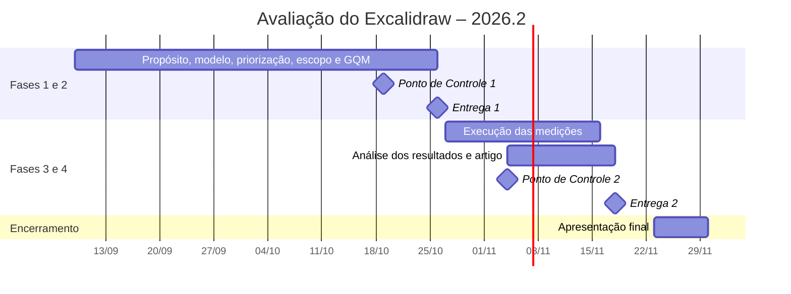

# Cronograma

Esta página reúne o calendário da avaliação. Ela cobre a categoria
**calendário** do PSM citada na seção 7 do
[roteiro da análise](../analise/roteiro.md#7-gestao-e-rastreabilidade): as
datas fixadas pela disciplina e, para cada marco, o que a equipe precisa
entregar. O andamento das tarefas dentro de cada período é acompanhado nas
[métricas de desenvolvimento](metricas.md).

As datas da disciplina vêm do **Calendário 2026.2 de Qualidade de Software 1**,
versão de 10/08/2026, assinado pela docente. O cronograma começa em 09/09,
com a aprovação da proposta e o início da Fase 1. Pontos de controle e
apresentações finais são feitos por sorteio: cada equipe apresenta em apenas
uma das datas indicadas.

## Marcos da disciplina e entregas da equipe

*Tabela 1. Marcos da disciplina e o que a equipe entrega em cada um. Fonte:
Calendário 2026.2 da disciplina e planejamento da equipe.*

| Data | Marco da disciplina | O que a equipe entrega |
| --- | --- | --- |
| 09/09 | Aprovação das propostas de projeto | Proposta aprovada; início da Fase 1 |
| 20/09 a 25/09 | Semana Universitária | — |
| 28/09 | TAI 1 (avaliação individual) | — |
| 19/10 | Ponto de Controle 1 (data sorteada para a equipe) | Andamento das Fases 1 e 2 |
| 21/10 a 28/10 | 1ª Avaliação Cruzada | Revisão do relatório de outra equipe |
| 26/10 | TAI 2 (avaliação individual) e Entrega 1 | Fases 1 e 2 no GitPages e no artigo (introdução, referencial teórico, metodologia e fases) |
| 04/11 ou 09/11 | Ponto de Controle 2 (sorteio) | Andamento das Fases 3 e 4 (execução das medições e análise) |
| 16/11 | Aula liberada para o projeto | Medições concluídas |
| 18/11 | **Entrega 2** | Fases 3 e 4 no GitPages e artigo completo (até 15 páginas) |
| 23/11 a 30/11 | 2ª Avaliação Cruzada | Revisão do relatório de outra equipe |
| 23/11, 25/11 ou 30/11 | Apresentação final (sorteio) | Apresentação dos resultados |
| 02/12 | TAF (avaliação final) | — |
| 07/12 | Prova substitutiva | — |
| 09/12 a 19/12 | Fechamento, revisão e consolidação das notas | — |

Feriados e dias sem aula: 12/10, 28/10 (ponto facultativo) e 02/11.
## Linha do tempo

O Diagrama 1 mostra as fases da avaliação ao longo do semestre, com os marcos
da disciplina que encerram cada uma.

*Diagrama 1. Linha do tempo das fases da avaliação e dos marcos da
disciplina. O Ponto de Controle 2 aparece na primeira data possível do
sorteio. Fonte: elaboração própria a partir do Calendário 2026.2 da
disciplina.*

## Como o cronograma é acompanhado

* As *issues* de cada fase são identificadas pelas *labels* `fase-1` e
  `fase-2` no quadro kanban, o que permite ver o que falta para cada entrega.
* Antes de cada marco da Tabela 1, a equipe compara o que estava planejado
  com o que já foi concluído, conforme as
  [métricas de desenvolvimento](metricas.md).
* Mudanças de data feitas pela docente são registradas nesta página, com a
  data da alteração.
