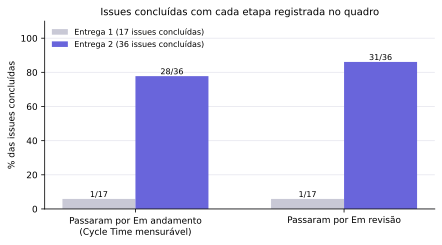
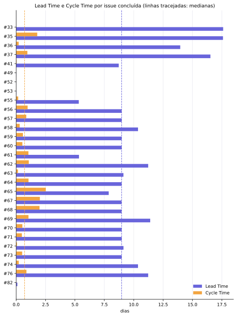
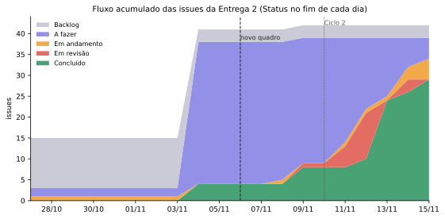
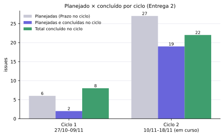
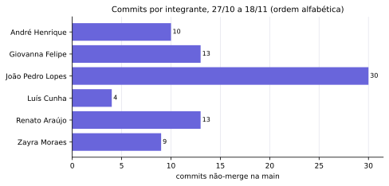
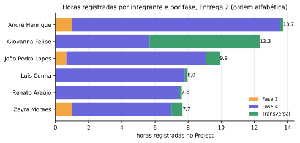
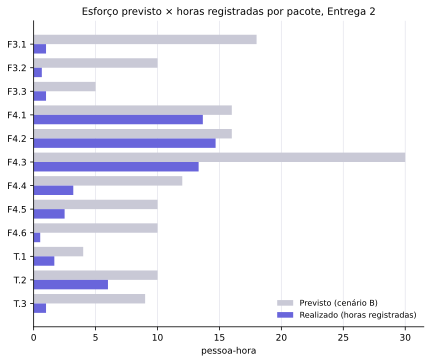
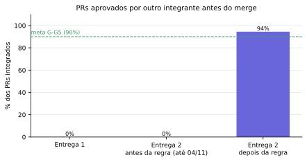

# Gráficos de gestão da Entrega 2

Esta página aplica à Entrega 2 as medidas definidas nas
[métricas de desenvolvimento](metricas.md) e nos
[indicadores de fluxo da gestão do grupo](../analise/gestao-grupo.md#indicadores-de-fluxo).
Os gráficos e as tabelas são gerados pelo
[workflow de métricas de gestão](https://github.com/FCTE-Qualidade-de-Software-1/2026-2_T02_ADA_LOVELACE/blob/main/.github/workflows/metricas-gestao.yml)
a partir do histórico de **Status** do Kanban e do histórico de commits da
`main`; os trechos entre os marcadores automáticos não devem ser editados à
mão.

<!-- BEGIN AUTO: coleta -->
*Dados do Project coletados em 16/11/2026 15:39 (horário de Brasília); 42 issues no milestone Entrega 2.*
<!-- END AUTO: coleta -->

## Escopo e regras de contagem

* **Issues consideradas:** as do milestone **Entrega 2**, exceto as fechadas
  como *not planned*. As issues-mãe de cada característica (#17, #18 e #19)
  entram no fluxo acumulado, mas não têm Prazo.
* **Período:** de 27/10/2026, dia seguinte à Entrega 1, a 18/11/2026, data da
  Entrega 2. Os dias seguem o horário de Brasília.
* **Ciclos:** dois ciclos, no ritmo de duas semanas do processo. O
  **Ciclo 1** vai de 27/10 a 09/11 e o **Ciclo 2** de 10/11 a 18/11; o
  segundo é mais curto porque termina na data da entrega.
* **Fonte do Status:** os eventos de mudança de Status do Project #19 até a
  migração do quadro (06/11/2026 05:47 UTC) e do Project de usuário depois
  dela, como descrito em
  [coleta automática de Lead Time e Cycle Time](metricas.md#coleta-automatica-de-lead-time-e-cycle-time).
  O histórico completo fica em
  [`historico-status.json`](dados/historico-status.json).

## Efeito da troca do quadro

Até a Entrega 1, o quadro era o Project #19 da organização, onde só uma
pessoa conseguia mover os cartões. Na prática, as issues iam direto para
**Concluído** e as etapas intermediárias não ficavam registradas, o que
impedia medir o Cycle Time. Em 06/11/2026 o quadro passou para um Project de
usuário, com todos os integrantes como colaboradores
([decisão de gestão](../analise/gestao-grupo.md#processo-de-trabalho-e-fonte-dos-dados)).
O gráfico compara, nas duas entregas, quantas issues concluídas tiveram as
etapas **Em andamento** e **Em revisão** registradas no quadro.



*Gráfico 1. Registro das etapas do Kanban nas issues concluídas da Entrega 1 e
da Entrega 2. Fonte: histórico de Status dos dois quadros.*

<!-- BEGIN AUTO: comparacao -->
| Entrega | Issues concluídas | Passaram por Em andamento | Passaram por Em revisão |
| --- | ---: | ---: | ---: |
| Entrega 1 | 17 | 1 (6%) | 1 (6%) |
| Entrega 2 | 30 | 25 (83%) | 26 (87%) |
<!-- END AUTO: comparacao -->

## Lead Time e Cycle Time

Lead Time vai da criação da issue até a entrada em **Concluído**; Cycle Time,
da entrada em **Em andamento** até **Concluído**. Para issues concluídas mais
de uma vez, valem a última conclusão e o primeiro início depois da conclusão
anterior, a mesma regra do [`lead-cycle-time.csv`](dados/lead-cycle-time.csv).
Issues que foram direto para **Concluído**, sem passar por **Em andamento**,
ficam com Cycle Time N/A.

!!! note "Limitação do Cycle Time"
    O Cycle Time só é tão preciso quanto o momento em que o cartão é movido.
    Quando o cartão vai para **Em andamento** só perto de abrir o pull
    request, o trabalho feito antes não entra na conta, e o Cycle Time fica
    menor que o tempo real de execução.



*Gráfico 2. Lead Time e Cycle Time por issue concluída. Fonte: histórico de
Status do Kanban.*

<!-- BEGIN AUTO: lead-cycle -->
| Issue | Título | Concluída em | Lead Time (dias) | Cycle Time (dias) |
| --- | --- | :---: | ---: | ---: |
| [#33](https://github.com/FCTE-Qualidade-de-Software-1/2026-2_T02_ADA_LOVELACE/issues/33) | Declarações de uso de IA | 13/11 | 17,6 | N/A |
| [#35](https://github.com/FCTE-Qualidade-de-Software-1/2026-2_T02_ADA_LOVELACE/issues/35) | Plano de avaliação (Fase 3) | 13/11 | 17,6 | 1,8 |
| [#36](https://github.com/FCTE-Qualidade-de-Software-1/2026-2_T02_ADA_LOVELACE/issues/36) | Ambiente de teste e instância local do Excalidraw | 09/11 | 14,0 | 0,2 |
| [#37](https://github.com/FCTE-Qualidade-de-Software-1/2026-2_T02_ADA_LOVELACE/issues/37) | Roteiro de tarefas, participantes e consentimento | 12/11 | 16,5 | 1,0 |
| [#40](https://github.com/FCTE-Qualidade-de-Software-1/2026-2_T02_ADA_LOVELACE/issues/40) | Gestão PSM/CID na Entrega 2 | 15/11 | 20,1 | 1,1 |
| [#41](https://github.com/FCTE-Qualidade-de-Software-1/2026-2_T02_ADA_LOVELACE/issues/41) | Revisão obrigatória na main | 04/11 | 8,7 | 0,0 |
| [#49](https://github.com/FCTE-Qualidade-de-Software-1/2026-2_T02_ADA_LOVELACE/issues/49) | CI-M18 e M26 | 04/11 | 0,0 | N/A |
| [#52](https://github.com/FCTE-Qualidade-de-Software-1/2026-2_T02_ADA_LOVELACE/issues/52) | S-M9 suficiência da autenticação | 04/11 | 0,0 | N/A |
| [#53](https://github.com/FCTE-Qualidade-de-Software-1/2026-2_T02_ADA_LOVELACE/issues/53) | S-M13 cabeçalhos de segurança HTTP | 04/11 | 0,0 | N/A |
| [#55](https://github.com/FCTE-Qualidade-de-Software-1/2026-2_T02_ADA_LOVELACE/issues/55) | S-M1 e S-M2 criptografia da colaboração e chave enviada ao servidor | 09/11 | 5,3 | 0,2 |
| [#56](https://github.com/FCTE-Qualidade-de-Software-1/2026-2_T02_ADA_LOVELACE/issues/56) | S-M3 mecanismos de controle de acesso | 13/11 | 9,0 | 1,0 |
| [#57](https://github.com/FCTE-Qualidade-de-Software-1/2026-2_T02_ADA_LOVELACE/issues/57) | S-M4 dados locais sem criptografia | 13/11 | 9,0 | 0,9 |
| [#58](https://github.com/FCTE-Qualidade-de-Software-1/2026-2_T02_ADA_LOVELACE/issues/58) | S-M5 e S-M6 detecção de adulteração e edição simultânea | 14/11 | 10,4 | 0,3 |
| [#59](https://github.com/FCTE-Qualidade-de-Software-1/2026-2_T02_ADA_LOVELACE/issues/59) | S-M7 e S-M8 trilha de auditoria e histórico de versões com autoria | 13/11 | 9,0 | 0,6 |
| [#60](https://github.com/FCTE-Qualidade-de-Software-1/2026-2_T02_ADA_LOVELACE/issues/60) | S-M10 personificação pelo nome exibido | 13/11 | 9,0 | 0,5 |
| [#61](https://github.com/FCTE-Qualidade-de-Software-1/2026-2_T02_ADA_LOVELACE/issues/61) | S-M11 e S-M12 vulnerabilidades nas dependências e advisories | 09/11 | 5,3 | 1,0 |
| [#62](https://github.com/FCTE-Qualidade-de-Software-1/2026-2_T02_ADA_LOVELACE/issues/62) | F-M1, F-M2 e F-M3 compatibilidade de navegadores e sistemas | 15/11 | 11,2 | 1,1 |
| [#63](https://github.com/FCTE-Qualidade-de-Software-1/2026-2_T02_ADA_LOVELACE/issues/63) | F-M4 cobertura funcional em dispositivos móveis | 13/11 | 9,1 | 0,2 |
| [#64](https://github.com/FCTE-Qualidade-de-Software-1/2026-2_T02_ADA_LOVELACE/issues/64) | F-M5 e F-M6 funcionamento offline e resoluções | 13/11 | 9,0 | 1,1 |
| [#65](https://github.com/FCTE-Qualidade-de-Software-1/2026-2_T02_ADA_LOVELACE/issues/65) | F-M7 inclusão funcional em relação ao draw.io ou Miro | 12/11 | 7,9 | 2,5 |
| [#67](https://github.com/FCTE-Qualidade-de-Software-1/2026-2_T02_ADA_LOVELACE/issues/67) | F-M11 fidelidade de migração (exportar e reimportar) | 13/11 | 9,0 | 2,0 |
| [#68](https://github.com/FCTE-Qualidade-de-Software-1/2026-2_T02_ADA_LOVELACE/issues/68) | CI-M7 e CI-M10 cobertura da ajuda interna e dos atalhos | 13/11 | 9,0 | 2,0 |
| [#69](https://github.com/FCTE-Qualidade-de-Software-1/2026-2_T02_ADA_LOVELACE/issues/69) | CI-M9 e CI-M12 cliques por tarefa e consistência | 15/11 | 11,4 | 1,0 |
| [#70](https://github.com/FCTE-Qualidade-de-Software-1/2026-2_T02_ADA_LOVELACE/issues/70) | CI-M13 e CI-M14 retorno visual e desfazer/refazer | 13/11 | 9,0 | 0,5 |
| [#71](https://github.com/FCTE-Qualidade-de-Software-1/2026-2_T02_ADA_LOVELACE/issues/71) | CI-M15 e CI-M16 confirmação de ações destrutivas e recuperação | 13/11 | 9,0 | 0,5 |
| [#72](https://github.com/FCTE-Qualidade-de-Software-1/2026-2_T02_ADA_LOVELACE/issues/72) | CI-M22 e CI-M25 violações da WCAG 2.2 e contraste | 13/11 | 9,1 | 0,1 |
| [#73](https://github.com/FCTE-Qualidade-de-Software-1/2026-2_T02_ADA_LOVELACE/issues/73) | CI-M23 funções operáveis sem mouse | 13/11 | 9,0 | 0,5 |
| [#74](https://github.com/FCTE-Qualidade-de-Software-1/2026-2_T02_ADA_LOVELACE/issues/74) | CI-M24 elementos anunciados por leitor de tela | 14/11 | 10,4 | 0,2 |
| [#76](https://github.com/FCTE-Qualidade-de-Software-1/2026-2_T02_ADA_LOVELACE/issues/76) | Gráficos de gestão da Entrega 2 | 15/11 | 11,2 | 0,9 |
| [#82](https://github.com/FCTE-Qualidade-de-Software-1/2026-2_T02_ADA_LOVELACE/issues/82) | Páginas de resultado de S-M9, S-M13, F-M10, F-M12, CI-M18 e CI-M26 | 09/11 | 0,1 | N/A |

**Mediana:** Lead Time de **9,0 dias** (30 issues) e Cycle Time de **0,9 dias** (25 issues; 5 sem passagem por *Em andamento* ficam como N/A).
<!-- END AUTO: lead-cycle -->

## Fluxo acumulado

Para cada dia, conta quantas issues da Entrega 2 estavam em cada Status no fim
do dia. Uma issue só aparece a partir do primeiro Status registrado no quadro.
A linha tracejada marca a troca do quadro (06/11). Faixas de **Em andamento** e **Em revisão** largas indicam muito trabalho
aberto ao mesmo tempo (WIP).



*Gráfico 3. Diagrama de fluxo acumulado da Entrega 2. Fonte: histórico de
Status do Kanban.*

A tabela mostra o início do período, o início de cada ciclo, as
segundas-feiras e o último dia coletado.

<!-- BEGIN AUTO: fluxo -->
| Dia | Backlog | A fazer | Em andamento | Em revisão | Concluído | WIP (andamento + revisão) |
| --- | ---: | ---: | ---: | ---: | ---: | ---: |
| 27/10 | 12 | 2 | 1 | 0 | 0 | 1 |
| 02/11 | 12 | 2 | 1 | 0 | 0 | 1 |
| 09/11 | 3 | 30 | 0 | 1 | 8 | 1 |
| 10/11 | 3 | 30 | 0 | 1 | 8 | 1 |
| 16/11 | 3 | 4 | 5 | 0 | 30 | 5 |
<!-- END AUTO: fluxo -->

## Planejado × concluído por ciclo

* **Planejadas:** issues com **Prazo** dentro do ciclo.
* **Planejadas e concluídas:** dessas, as que estavam em **Concluído** no fim
  do ciclo (ou na data da coleta, se o ciclo ainda está em curso).
* **Total concluído no ciclo:** todas as issues cuja conclusão caiu no ciclo,
  inclusive as sem Prazo e as atrasadas de um ciclo anterior; equivale à
  velocidade do ciclo.



*Gráfico 4. Issues planejadas e concluídas em cada ciclo. Fonte: campo Prazo e
histórico de Status do Kanban.*

<!-- BEGIN AUTO: planejado -->
| Ciclo | Período | Planejadas | Planejadas e concluídas | Planejado × concluído | Total concluído no ciclo |
| --- | --- | ---: | ---: | ---: | ---: |
| Ciclo 1 | 27/10 a 09/11 | 6 | 2 | 33% | 8 |
| Ciclo 2 (em curso) | 10/11 a 18/11 | 27 | 19 | 70% | 22 |

Issues da Entrega 2 sem Prazo no Project (fora do planejado): 8 ([#17](https://github.com/FCTE-Qualidade-de-Software-1/2026-2_T02_ADA_LOVELACE/issues/17), [#18](https://github.com/FCTE-Qualidade-de-Software-1/2026-2_T02_ADA_LOVELACE/issues/18), [#19](https://github.com/FCTE-Qualidade-de-Software-1/2026-2_T02_ADA_LOVELACE/issues/19), [#41](https://github.com/FCTE-Qualidade-de-Software-1/2026-2_T02_ADA_LOVELACE/issues/41), [#49](https://github.com/FCTE-Qualidade-de-Software-1/2026-2_T02_ADA_LOVELACE/issues/49), [#52](https://github.com/FCTE-Qualidade-de-Software-1/2026-2_T02_ADA_LOVELACE/issues/52), [#53](https://github.com/FCTE-Qualidade-de-Software-1/2026-2_T02_ADA_LOVELACE/issues/53), [#82](https://github.com/FCTE-Qualidade-de-Software-1/2026-2_T02_ADA_LOVELACE/issues/82)).
<!-- END AUTO: planejado -->

## Commits por integrante

Commits não-merge na `main` feitos no período da Entrega 2, com as
identidades de Git agrupadas por integrante e sem commits de bots. É um dado
descritivo de atividade no repositório e aparece em ordem alfabética: commits
variam em tamanho e há trabalho que não passa pelo Git (sessões com
participantes, revisões, artigo), então o número não mede esforço nem
contribuição e não serve para comparar integrantes.



*Gráfico 5. Commits não-merge por integrante na Entrega 2. Fonte: histórico de
commits da `main`.*

<!-- BEGIN AUTO: commits -->
| Integrante | Commits não-merge |
| --- | ---: |
| André Henrique | 10 |
| Giovanna Felipe | 15 |
| João Pedro Lopes | 30 |
| Luís Cunha | 7 |
| Renato Araújo | 13 |
| Zayra Moraes | 9 |
| **Total** | **84** |
<!-- END AUTO: commits -->

## Horas por integrante e por fase

Horas de trabalho registradas no campo **Horas** do Project. Em issue de um
só responsável, vale o campo; em atividade compartilhada, vale o comentário
"Horas: x" de cada integrante na issue (sem comentários, o campo é dividido
igualmente entre os responsáveis). As fases seguem os pacotes da
[estimativa de custos](estimativa-custos.md): Fase 3 é o plano de avaliação,
Fase 4 são as medições e a análise, e Transversal reúne GitPage, gestão e
revisão. Como em commits, a ordem é alfabética e o número não serve para
comparar integrantes: as horas dependem do registro de cada um.



*Gráfico 6. Horas registradas no Project por integrante e por fase. Fonte:
campo Horas e comentários das issues.*

<!-- BEGIN AUTO: horas -->
| Integrante | Fase 3 | Fase 4 | Transversal | Total |
| --- | ---: | ---: | ---: | ---: |
| André Henrique | 1,0 | 7,6 | 0,2 | 8,7 |
| Giovanna Felipe | 0,0 | 5,7 | 6,7 | 12,3 |
| João Pedro Lopes | 0,7 | 7,6 | 0,8 | 9,1 |
| Luís Cunha | 0,0 | 7,8 | 0,2 | 8,0 |
| Renato Araújo | 0,0 | 7,4 | 0,2 | 7,6 |
| Zayra Moraes | 1,0 | 6,0 | 0,7 | 7,7 |
| **Total** | **2,7** | **42,1** | **8,7** | **53,5** |

Issues concluídas com horas registradas: **30 de 30**.
<!-- END AUTO: horas -->

## Esforço previsto × realizado

Compara, por pacote da [estimativa de custos](estimativa-custos.md), o
esforço que restava na data-base da estimativa (25/10, cenário B) com as
horas registradas nas issues do pacote
(`desvio = realizado − previsto`). A ligação entre issue e pacote está em
[`pacotes-issues.json`](dados/pacotes-issues.json). Enquanto houver issues
abertas ou sem horas, o realizado é um piso, e não o esforço final.



*Gráfico 7. Esforço previsto (cenário B) e horas registradas por pacote.
Fonte: estimativa de custos e campo Horas do Project.*

<!-- BEGIN AUTO: esforco -->
| Pacote | Issues | Previsto B (p-h) | Realizado (p-h) | Desvio |
| --- | --- | ---: | ---: | ---: |
| F3.1 | [#35](https://github.com/FCTE-Qualidade-de-Software-1/2026-2_T02_ADA_LOVELACE/issues/35) | 18,0 | 1,0 | -17,0 (-94%) |
| F3.2 | [#36](https://github.com/FCTE-Qualidade-de-Software-1/2026-2_T02_ADA_LOVELACE/issues/36) | 10,0 | 0,7 | -9,3 (-93%) |
| F3.3 | [#37](https://github.com/FCTE-Qualidade-de-Software-1/2026-2_T02_ADA_LOVELACE/issues/37) | 5,0 | 1,0 | -4,0 (-80%) |
| F4.1 | [#52](https://github.com/FCTE-Qualidade-de-Software-1/2026-2_T02_ADA_LOVELACE/issues/52), [#53](https://github.com/FCTE-Qualidade-de-Software-1/2026-2_T02_ADA_LOVELACE/issues/53), [#55](https://github.com/FCTE-Qualidade-de-Software-1/2026-2_T02_ADA_LOVELACE/issues/55), [#56](https://github.com/FCTE-Qualidade-de-Software-1/2026-2_T02_ADA_LOVELACE/issues/56), [#57](https://github.com/FCTE-Qualidade-de-Software-1/2026-2_T02_ADA_LOVELACE/issues/57), [#58](https://github.com/FCTE-Qualidade-de-Software-1/2026-2_T02_ADA_LOVELACE/issues/58), [#59](https://github.com/FCTE-Qualidade-de-Software-1/2026-2_T02_ADA_LOVELACE/issues/59), [#60](https://github.com/FCTE-Qualidade-de-Software-1/2026-2_T02_ADA_LOVELACE/issues/60), [#61](https://github.com/FCTE-Qualidade-de-Software-1/2026-2_T02_ADA_LOVELACE/issues/61) | 16,0 | 13,7 | -2,3 (-15%) |
| F4.2 | [#62](https://github.com/FCTE-Qualidade-de-Software-1/2026-2_T02_ADA_LOVELACE/issues/62), [#63](https://github.com/FCTE-Qualidade-de-Software-1/2026-2_T02_ADA_LOVELACE/issues/63), [#64](https://github.com/FCTE-Qualidade-de-Software-1/2026-2_T02_ADA_LOVELACE/issues/64), [#65](https://github.com/FCTE-Qualidade-de-Software-1/2026-2_T02_ADA_LOVELACE/issues/65), [#66](https://github.com/FCTE-Qualidade-de-Software-1/2026-2_T02_ADA_LOVELACE/issues/66), [#67](https://github.com/FCTE-Qualidade-de-Software-1/2026-2_T02_ADA_LOVELACE/issues/67) | 16,0 | 12,2 | -3,8 (-24%) |
| F4.3 | [#49](https://github.com/FCTE-Qualidade-de-Software-1/2026-2_T02_ADA_LOVELACE/issues/49), [#68](https://github.com/FCTE-Qualidade-de-Software-1/2026-2_T02_ADA_LOVELACE/issues/68), [#69](https://github.com/FCTE-Qualidade-de-Software-1/2026-2_T02_ADA_LOVELACE/issues/69), [#70](https://github.com/FCTE-Qualidade-de-Software-1/2026-2_T02_ADA_LOVELACE/issues/70), [#71](https://github.com/FCTE-Qualidade-de-Software-1/2026-2_T02_ADA_LOVELACE/issues/71), [#72](https://github.com/FCTE-Qualidade-de-Software-1/2026-2_T02_ADA_LOVELACE/issues/72), [#73](https://github.com/FCTE-Qualidade-de-Software-1/2026-2_T02_ADA_LOVELACE/issues/73), [#74](https://github.com/FCTE-Qualidade-de-Software-1/2026-2_T02_ADA_LOVELACE/issues/74), [#75](https://github.com/FCTE-Qualidade-de-Software-1/2026-2_T02_ADA_LOVELACE/issues/75) | 30,0 | 13,3 | -16,7 (-56%) |
| F4.4 | [#20](https://github.com/FCTE-Qualidade-de-Software-1/2026-2_T02_ADA_LOVELACE/issues/20), [#77](https://github.com/FCTE-Qualidade-de-Software-1/2026-2_T02_ADA_LOVELACE/issues/77) | 12,0 | 3,0 | -9,1 (-75%) |
| F4.5 | [#38](https://github.com/FCTE-Qualidade-de-Software-1/2026-2_T02_ADA_LOVELACE/issues/38) | 10,0 | 0,0 | -10,0 (-100%) |
| F4.6 | [#39](https://github.com/FCTE-Qualidade-de-Software-1/2026-2_T02_ADA_LOVELACE/issues/39), [#42](https://github.com/FCTE-Qualidade-de-Software-1/2026-2_T02_ADA_LOVELACE/issues/42) | 10,0 | 0,0 | -10,0 (-100%) |
| T.1 | [#43](https://github.com/FCTE-Qualidade-de-Software-1/2026-2_T02_ADA_LOVELACE/issues/43), [#82](https://github.com/FCTE-Qualidade-de-Software-1/2026-2_T02_ADA_LOVELACE/issues/82) | 4,0 | 1,7 | -2,3 (-58%) |
| T.2 | [#40](https://github.com/FCTE-Qualidade-de-Software-1/2026-2_T02_ADA_LOVELACE/issues/40), [#41](https://github.com/FCTE-Qualidade-de-Software-1/2026-2_T02_ADA_LOVELACE/issues/41), [#76](https://github.com/FCTE-Qualidade-de-Software-1/2026-2_T02_ADA_LOVELACE/issues/76) | 10,0 | 6,0 | -4,0 (-40%) |
| T.3 | [#33](https://github.com/FCTE-Qualidade-de-Software-1/2026-2_T02_ADA_LOVELACE/issues/33) | 9,0 | 1,0 | -8,0 (-89%) |
| **Total** | | **150,0** | **53,5** | **-96,5 (-64%)** |

Custo de referência do realizado: **R$ 431,88** (53,5 p-h × R$ 8,08/p-h), contra R$ 1.212,00 previstos.
<!-- END AUTO: esforco -->

## Revisão efetiva dos pull requests

Métrica **G-G5** da [gestão do grupo](../analise/gestao-grupo.md#metricas-do-grupo):
pull requests integrados com aprovação (*Approve*) de outro integrante antes
do merge ÷ pull requests integrados. Comentários e revisões de bots não
contam. O período da Entrega 2 é dividido pela regra de revisão obrigatória
na `main` ([#41](https://github.com/FCTE-Qualidade-de-Software-1/2026-2_T02_ADA_LOVELACE/issues/41),
04/11), decisão tomada a partir da medição da Entrega 1. Pela mesma regra de
contagem, nenhum PR da Entrega 1 teve aprovação formal; o valor de 2 de 12
registrado no artigo da Entrega 1 contava também revisões sem aprovação.



*Gráfico 8. Percentual de PRs aprovados por outro integrante antes do merge.
Fonte: pull requests e revisões do repositório.*

<!-- BEGIN AUTO: revisao -->
| Período | PRs integrados | Aprovados por outro integrante | Revisão efetiva | Pontos G-G5 | Integrados pelo próprio autor | Commits direto na `main` |
| --- | ---: | ---: | ---: | :---: | ---: | ---: |
| Entrega 1 | 12 | 0 | 0% | 0 | 5 | 13 |
| Entrega 2, antes da regra (até 04/11) | 7 | 0 | 0% | 0 | 0 | 2 |
| Entrega 2, depois da regra | 29 | 27 | 93% | 2 | 0 | 0 |
| Entrega 2 (total) | 36 | 27 | 75% | 1 | 0 | 2 |

Integrados sem aprovação depois da regra: [#87](https://github.com/FCTE-Qualidade-de-Software-1/2026-2_T02_ADA_LOVELACE/pull/87), [#103](https://github.com/FCTE-Qualidade-de-Software-1/2026-2_T02_ADA_LOVELACE/pull/103).
<!-- END AUTO: revisao -->

## Como reproduzir

```bash
# coleta do Project (token com os escopos public_repo e project)
PROJECTS_TOKEN=<token> GITHUB_REPOSITORY=FCTE-Qualidade-de-Software-1/2026-2_T02_ADA_LOVELACE \
  python scripts/collect_project_metrics.py

# gráficos e tabelas desta página
python scripts/gerar_graficos_gestao.py
```

O segundo comando não acessa a API: usa o último `historico-status.json`
versionado e o histórico local do Git (com a `main` atualizada).
