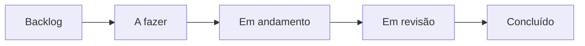

# Métricas de desenvolvimento

Esta página define como a equipe acompanha o trabalho no contexto de
*Continuous Iterative Development* (CID). As métricas foram selecionadas e
adaptadas a partir do **Measurement Framework do Practical Software
Measurement (PSM)**, que organiza a medição em torno de necessidades de
informação e indicadores úteis para a tomada de decisão. No projeto, os dados
serão coletados a partir das *issues*, do quadro Kanban e dos ciclos de
desenvolvimento de duas semanas.

O PSM não determina um conjunto único de métricas obrigatório para todo
projeto. Por isso, as medidas abaixo são uma aplicação do framework à realidade
da equipe e ao processo iterativo utilizado. Os resultados devem ser
interpretados em conjunto e no contexto de cada ciclo; nenhuma métrica isolada
representa produtividade ou qualidade por completo.

* **Kanban:** [Kanban – Ada Lovelace](https://github.com/orgs/FCTE-Qualidade-de-Software-1/projects/19)
* **Issues:** [lista de issues do repositório](https://github.com/FCTE-Qualidade-de-Software-1/2026-2_T02_ADA_LOVELACE/issues?q=is%3Aissue)

## Fluxo de trabalho e fonte dos dados

Cada atividade é registrada como uma *issue*, classificada por fase e tipo de
trabalho, e acompanhada no GitHub Projects. O fluxo adotado é:



*Diagrama 1. Colunas do Kanban. Fonte: elaboração própria.*

| Coluna | Significado |
| --- | --- |
| Backlog | Tarefa identificada, ainda não priorizada para um ciclo |
| A fazer | Tarefa comprometida/priorizada para o ciclo atual |
| Em andamento | Tarefa em execução por um integrante |
| Em revisão | Entrega aguardando revisão da equipe |
| Concluído | Entrega revisada e incorporada ao repositório |

As *labels* indicam fase e tipo de trabalho:

| Label | Uso |
| --- | --- |
| `fase-1` | Atividades da Fase 1 |
| `fase-2` | Atividades da Fase 2 |
| `documentation` | Redação e revisão da documentação |
| `gitpages` | Estrutura e publicação do GitPages |
| `medição` | Execução e análise das medições |

## Métricas selecionadas

### Planejado versus realizado (Committed vs. Completed)

Compara o conjunto de *issues* comprometidas para uma iteração com as que
foram efetivamente concluídas nela. Para cada ciclo, registra-se a quantidade
de itens em **A fazer** no início (Committed) e quantos desses itens chegaram
a **Concluído** até o encerramento (Completed). Pode-se apresentar também a
proporção `Completed / Committed`.

Essa medida ajuda a avaliar a previsibilidade do planejamento e a ajustar o
volume de trabalho assumido no ciclo seguinte. Itens adicionados depois do
início do ciclo devem ser identificados separadamente, para não distorcer a
comparação. A medida não deve ser usada isoladamente para avaliar indivíduos.

### Fluxo cumulativo (Cumulative Flow)

Registra, em datas regulares, a quantidade de *issues* em cada estado do
Kanban: **Backlog**, **A fazer**, **Em andamento**, **Em revisão** e
**Concluído**. A série pode ser representada em um diagrama de fluxo cumulativo,
com o tempo no eixo horizontal e as quantidades acumuladas por estado no eixo
vertical.

As faixas mostram como o trabalho se distribui e evolui. Uma faixa que cresce
continuamente, por exemplo em **Em revisão**, pode indicar acúmulo ou gargalo
naquela etapa. A leitura deve considerar mudanças no escopo e no tamanho das
issues, pois a contagem de itens não representa necessariamente o esforço.

### Lead Time e Cycle Time

As duas medidas acompanham o tempo de entrega, usando os registros de data e
hora das *issues* e das mudanças de estado no GitHub Projects:

| Métrica | Início | Fim | O que informa |
| --- | --- | --- | --- |
| **Lead Time** | Criação da issue | Entrada em **Concluído** | Tempo total de espera e execução desde que a demanda foi registrada até a entrega |
| **Cycle Time** | Entrada em **Em andamento** | Entrada em **Concluído** | Tempo decorrido desde o início efetivo do trabalho até a entrega |

As medidas ajudam a entender a rapidez de resposta e a duração da execução.
Devem ser calculadas por issue e resumidas por ciclo (por exemplo, mediana e
intervalo), explicitando o período analisado. Issues canceladas ou reabertas
precisam ser identificadas para que não sejam tratadas como entregas simples.

### Velocidade da equipe (Team Velocity)

Por ciclo de duas semanas, contabiliza o volume de trabalho concluído. A
equipe pode acompanhar a quantidade de *issues* concluídas; se adotar pontos de
história de forma consistente, também pode somar os pontos concluídos. O
critério escolhido deve permanecer estável entre ciclos, e apenas trabalho
concluído entra na contagem.

A velocidade oferece uma referência histórica para planejar a capacidade de
ciclos futuros. Como issues podem ter tamanhos diferentes, a contagem bruta
deve ser interpretada com cautela. A equipe já observou que o número de
commits não representa diretamente esforço ou complexidade; por isso, commits
não serão usados como medida de velocidade.


## Coleta e interpretação

Ao final de cada ciclo de duas semanas, a equipe consolidará as métricas a
partir do histórico das issues e dos estados do Kanban. Para permitir
comparações, serão mantidas as datas de início e fim do ciclo, as regras de
contagem e eventuais exceções (como cancelamentos, reaberturas ou itens
adicionados durante a iteração). Os resultados serão usados para discutir
ajustes no fluxo e no planejamento, e não para ranquear integrantes.

## Registro atual do quadro

Os números abaixo são uma fotografia do quadro em **19/10/2026**. Eles mostram
o estado atual das tarefas e servem como registro inicial; ainda não formam
uma série histórica suficiente para calcular tendências de fluxo, tempos ou
velocidade por ciclo.

| Fase | Concluído | Em andamento | A fazer | Backlog | Total |
| --- | :---: | :---: | :---: | :---: | :---: |
| Fase 1 | 6 | 0 | 0 | 0 | 6 |
| Fase 2 | 0 | 0 | 1 | 4 | 5 |
| GitPages | 1 | 1 | 0 | 0 | 2 |
| **Total** | **7** | **1** | **1** | **4** | **13** |

## Contribuições no repositório

Commits na branch `main` até **19/10/2026**, sem contar commits de *merge*.
Esse dado é mantido como informação descritiva de atividade no repositório;
não é uma métrica de esforço, qualidade, velocidade ou contribuição
individual, pois commits variam em tamanho e complexidade.

| Integrante | Commits |
| --- | :---: |
| Luís Cunha | 12 |
| João Pedro Lopes | 4 |
| André Henrique | 3 |
| Zayra Moraes | 3 |
| Giovanna Felipe | 2 |
| Renato Araújo | 1 |
| **Total** | **25** |

Além desses, foram integrados 9 *pull requests* por meio de commits de
*merge*.

Para atualizar a tabela, execute na raiz do repositório:

```bash
git shortlog -sn --no-merges main
```
