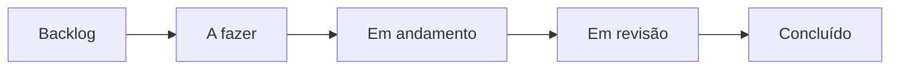

# Métricas de desenvolvimento

Esta página define como a equipe acompanha o trabalho no contexto de
*Continuous Iterative Development* (CID). As métricas foram selecionadas e
adaptadas a partir do **Measurement Framework do Practical Software
Measurement (PSM)**, que organiza a medição em torno de necessidades de
informação e indicadores úteis para a tomada de decisão. No projeto, os dados
serão coletados a partir das *issues*, do quadro Kanban e dos ciclos de
desenvolvimento de duas semanas.

O PSM não determina um conjunto único de métricas obrigatório para todo
projeto. Por isso, as medidas abaixo são uma aplicação do framework à realidade
da equipe e ao processo iterativo utilizado. Os resultados devem ser
interpretados em conjunto e no contexto de cada ciclo; nenhuma métrica isolada
representa produtividade ou qualidade por completo.

* **Kanban:** [Kanban – Ada Lovelace](https://github.com/orgs/FCTE-Qualidade-de-Software-1/projects/19)
  (Project #19 da organização; de 06/11 a 23/11/2026 o quadro em uso foi um
  [Project de usuário](https://github.com/users/giovannafg/projects/1), hoje fechado; veja as
  [decisões de mudança do quadro](#mudancas-do-quadro))
* **Issues:** [lista de issues do repositório](https://github.com/FCTE-Qualidade-de-Software-1/2026-2_T02_ADA_LOVELACE/issues?q=is%3Aissue)

## Fluxo de trabalho e fonte dos dados

Cada atividade é registrada como uma *issue*, classificada por fase e tipo de
trabalho, e acompanhada no GitHub Projects. O fluxo adotado é:



*Diagrama 1. Colunas do Kanban. Fonte: elaboração própria.*

| Coluna | Significado |
| --- | --- |
| Backlog | Tarefa identificada, ainda não priorizada para um ciclo |
| A fazer | Tarefa comprometida/priorizada para o ciclo atual |
| Em andamento | Tarefa em execução por um integrante |
| Em revisão | Entrega aguardando revisão da equipe |
| Concluído | Entrega revisada e incorporada ao repositório |

As *labels* indicam fase e tipo de trabalho:

| Label | Uso |
| --- | --- |
| `fase-1` | Atividades da Fase 1 |
| `fase-2` | Atividades da Fase 2 |
| `documentation` | Redação e revisão da documentação |
| `gitpages` | Estrutura e publicação do GitPages |
| `medição` | Execução e análise das medições |

### Mudanças do quadro

!!! note "Decisão de gestão: mudança do quadro (06/11/2026)"
    Até a Entrega 1, o quadro era o [Project #19 da organização](https://github.com/orgs/FCTE-Qualidade-de-Software-1/projects/19).
    Como os integrantes não fazem parte da organização e o grupo não tem
    permissão para adicioná-los, eles não conseguiam mover os cartões, e o
    registro de Status dependia de uma única pessoa. Para a Entrega 2, o
    quadro foi copiado para um [Project de usuário](https://github.com/users/giovannafg/projects/1), com os
    mesmos campos (Status, Prazo e Horas), visualizações e automações, e os
    integrantes foram convidados como colaboradores. As issues abertas e as
    concluídas na Entrega 2 foram levadas com o Status e o Prazo que tinham.
    O #19 deixou de ser atualizado e permanece como registro da Entrega 1. A
    coleta de Lead Time e Cycle Time lê os dois quadros e ignora os eventos
    gerados pela própria migração.

!!! note "Decisão de gestão: volta do quadro para a organização (23/11/2026)"
    A professora orientou que o quadro deve ficar na organização, e todos os
    integrantes passaram a ter acesso ao Project #19. Por isso, o quadro voltou
    a ser o [Project #19 da organização](https://github.com/orgs/FCTE-Qualidade-de-Software-1/projects/19).
    As issues da Entrega 2 já estavam no #19, adicionadas pelo auto-add da
    organização; o script
    [`copiar_kanban_para_organizacao.py`](https://github.com/FCTE-Qualidade-de-Software-1/2026-2_T02_ADA_LOVELACE/blob/main/scripts/copiar_kanban_para_organizacao.py)
    copiou do [Project de usuário](https://github.com/users/giovannafg/projects/1)
    os campos Status, Prazo e Horas (32 issues receberam as Horas e uma, a #43,
    o Status). Um campo vazio no quadro de usuário não apagou o valor do #19.
    A data das mudanças de Status não pode ser copiada, porque o GitHub
    registra o evento com o horário da cópia. Por isso o Project de usuário
    foi fechado, mas não apagado: a coleta continua lendo dele o histórico de
    06/11 a 23/11 (13:01 UTC) e, do #19, o histórico até 06/11 e depois de
    23/11, o que deixa de fora os eventos gerados pelas duas cópias.

!!! warning "Interpretação responsável"
    Quantidade de commits, linhas alteradas e tempo online são sinais de
    atividade, não medidas de produtividade individual. A interpretação deve
    combinar entrega, revisão, rastreabilidade e contexto, sem criar ranking
    entre integrantes. Trabalho documentado fora do Git deve ser registrado
    manualmente para não penalizar uma atividade legítima.

## Métricas selecionadas

### Planejado versus realizado (Committed vs. Completed)

Compara o conjunto de *issues* comprometidas para uma iteração com as que
foram efetivamente concluídas nela. Para cada ciclo, registra-se a quantidade
de itens em **A fazer** no início (Committed) e quantos desses itens chegaram
a **Concluído** até o encerramento (Completed). Pode-se apresentar também a
proporção `Completed / Committed`.

Essa medida ajuda a avaliar a previsibilidade do planejamento e a ajustar o
volume de trabalho assumido no ciclo seguinte. Itens adicionados depois do
início do ciclo devem ser identificados separadamente, para não distorcer a
comparação. A medida não deve ser usada isoladamente para avaliar indivíduos.

### Fluxo cumulativo (Cumulative Flow)

Registra, em datas regulares, a quantidade de *issues* em cada estado do
Kanban: **Backlog**, **A fazer**, **Em andamento**, **Em revisão** e
**Concluído**. A série pode ser representada em um diagrama de fluxo cumulativo,
com o tempo no eixo horizontal e as quantidades acumuladas por estado no eixo
vertical.

As faixas mostram como o trabalho se distribui e evolui. Uma faixa que cresce
continuamente, por exemplo em **Em revisão**, pode indicar acúmulo ou gargalo
naquela etapa. A leitura deve considerar mudanças no escopo e no tamanho das
issues, pois a contagem de itens não representa necessariamente o esforço.

### Lead Time e Cycle Time

As duas medidas acompanham o tempo de entrega, usando os registros de data e
hora das *issues* e das mudanças de estado no GitHub Projects:

| Métrica | Início | Fim | O que informa |
| --- | --- | --- | --- |
| **Lead Time** | Criação da issue | Entrada em **Concluído** | Tempo total de espera e execução desde que a demanda foi registrada até a entrega |
| **Cycle Time** | Entrada em **Em andamento** | Entrada em **Concluído** | Tempo decorrido desde o início efetivo do trabalho até a entrega |

As medidas ajudam a entender a rapidez de resposta e a duração da execução.
Devem ser calculadas por issue e resumidas por ciclo (por exemplo, mediana e
intervalo), explicitando o período analisado. Issues canceladas ou reabertas
precisam ser identificadas para que não sejam tratadas como entregas simples.

### Velocidade da equipe (Team Velocity)

Por ciclo de duas semanas, contabiliza o volume de trabalho concluído. A
equipe pode acompanhar a quantidade de *issues* concluídas; se adotar pontos de
história de forma consistente, também pode somar os pontos concluídos. O
critério escolhido deve permanecer estável entre ciclos, e apenas trabalho
concluído entra na contagem.

A velocidade oferece uma referência histórica para planejar a capacidade de
ciclos futuros. Como issues podem ter tamanhos diferentes, a contagem bruta
deve ser interpretada com cautela. A equipe já observou que o número de
commits não representa diretamente esforço ou complexidade; por isso, commits
não serão usados como medida de velocidade.

## Indicadores de participação e entrega

Complementam as métricas acima para acompanhar se o grupo distribui o
trabalho, mantém o calendário, produz evidências rastreáveis e revisa as
entregas. Avaliam a execução do trabalho da equipe, e não a qualidade do
Excalidraw: não alteram a pontuação das 51 métricas do
[roteiro da análise](../analise/roteiro.md). Commits de merge e de bots ficam
fora dos indicadores individuais, e um denominador zero dá `N/A`, não 0% nem
100%.

### Métricas individuais

Servem para identificar lacunas de participação e necessidade de apoio, sempre
com o denominador, o período e a fonte.

| ID | Métrica e fórmula | Fonte mínima | Referência para acompanhamento |
| --- | --- | --- | --- |
| **G-I1** | Dias ativos: dias distintos com commit, PR, revisão ou comentário ÷ dias úteis do período | GitHub Events/Commits/PRs | Todos os integrantes têm atividade em pelo menos 50% dos ciclos |
| **G-I2** | Cobertura de entrega: entregas atribuídas concluídas ÷ entregas atribuídas | Issues e PRs vinculados ao integrante | ≥ 80% |
| **G-I3** | Participação em revisão: PRs de outros integrantes revisados ÷ PRs elegíveis de outros integrantes | Reviews de PR | ≥ 1 revisão por PR elegível, distribuída entre o grupo |
| **G-I4** | Rastreabilidade: entregas com vínculo para issue e evidência ÷ entregas concluídas | PR/issue, links em `docs/analise` | ≥ 90% |
| **G-I5** | Taxa de retrabalho: PRs reabertos ou devolvidos por mudança necessária ÷ PRs concluídos | Histórico de PR e revisões | ≤ 30%; investigar, não punir |
| **G-I6** | Responsabilidade por evidência: evidências aceitas com responsável identificado ÷ evidências publicadas | Resultados e histórico Git | 100% |

Para G-I2, “entrega” deve ser definida antes da coleta (por exemplo, uma
issue fechada ou um PR aceito), e tarefas compartilhadas devem aceitar mais de
um responsável. G-I5 não deve ser usado isoladamente: revisões rigorosas e
mudanças de escopo podem aumentar o valor sem indicar falha individual.

### Métricas do grupo

| ID | Métrica e fórmula | Fonte mínima | Atendido | Parcial | Não atendido |
| --- | --- | --- | ---: | ---: | ---: |
| **G-G1** | Cobertura de participação: integrantes com atividade válida no ciclo ÷ integrantes ativos | GitHub e cadastro do grupo | 100% | 67%–99% | < 67% |
| **G-G2** | Equilíbrio de entregas: 1 − (maior participação individual − menor participação individual) | Entregas concluídas por integrante | ≥ 0,60 | 0,40–0,59 | < 0,40 |
| **G-G3** | Cumprimento do plano: entregas concluídas no prazo ÷ entregas planejadas para o período | Issues com marcos/prazos | ≥ 80% | 60%–79% | < 60% |
| **G-G4** | Tempo mediano de ciclo: mediana de abertura até fechamento de issue/PR | Histórico de issues/PRs | ≤ 7 dias | 8–14 dias | > 14 dias |
| **G-G5** | Revisão efetiva: PRs com revisão de outro integrante antes do merge ÷ PRs mesclados | Reviews e merges | ≥ 90% | 70%–89% | < 70% |
| **G-G6** | Rastreabilidade do estudo: métricas de produto com resultado, data, ambiente e evidência ÷ métricas executadas | `resultados.md` e evidências | ≥ 90% | 70%–89% | < 70% |
| **G-G7** | Saúde do backlog: issues vencidas abertas ÷ issues abertas com prazo | Issues e marcos | ≤ 10% | 11%–25% | > 25% |
| **G-G8** | Continuidade: ciclos consecutivos sem atividade do grupo | Histórico por ciclo | 0 | 1 | ≥ 2 |

O equilíbrio G-G2 é um alerta de distribuição, não uma meta de igualdade
aritmética; diferenças justificadas por papéis, especialização ou período
devem aparecer no registro de decisões.

Cada métrica do grupo recebe 2 pontos em “Atendido”, 1 em “Parcial” e 0 em
“Não atendido”. A média vira percentual por `média / 2 × 100`, com os mesmos
limites da avaliação do produto: 75% ou mais, gestão atendida (manter o
processo); de 50% a 74%, parcialmente atendida (criar ação, responsável e
prazo no backlog); abaixo de 50%, não atendida (replanejar o ciclo e revisar
riscos). Toda métrica com 0 pontos gera uma ação ou uma justificativa
registrada.

Ao final de cada ciclo, o registro de gestão traz a janela analisada, os
valores e as pontuações, as divergências entre o GitHub e o trabalho relatado,
as ações corretivas com responsável e prazo e as decisões de escopo, ambiente
ou prioridade que afetaram os números, sem dados pessoais desnecessários.

## Coleta e interpretação

Ao final de cada ciclo de duas semanas, a equipe consolidará as métricas a
partir do histórico das issues e dos estados do Kanban. Para permitir
comparações, serão mantidas as datas de início e fim do ciclo, as regras de
contagem e eventuais exceções (como cancelamentos, reaberturas ou itens
adicionados durante a iteração). Os resultados serão usados para discutir
ajustes no fluxo e no planejamento, e não para ranquear integrantes.

### Coleta automática de Lead Time e Cycle Time

O workflow [Atualizar métricas de gestão](https://github.com/FCTE-Qualidade-de-Software-1/2026-2_T02_ADA_LOVELACE/blob/main/.github/workflows/metricas-gestao.yml)
executa a cada push na `main` e semanalmente. Cada execução recoleta os dados,
sem intervalo mínimo entre coletas, e só cria commit quando eles mudam. O
script consulta o histórico de alterações de **Status** dos dois quadros do
grupo, o Project #19 da organização (até 06/11 e depois de 23/11/2026) e o
Project de usuário (de 06/11 a 23/11/2026), incluindo as datas em que cada
issue entrou em **Em andamento**, **Em revisão** e **Concluído**. Assim, a equipe continua
movendo os cartões manualmente; não é necessário aplicar labels de estado.

O resultado é salvo em
[lead-cycle-time.csv](dados/lead-cycle-time.csv). Cada linha representa uma
issue concluída no Project e contém datas de criação, início e conclusão,
Lead Time em dias, Cycle Time em dias e número de retornos de **Em revisão**
para **Em andamento**. Se uma issue foi reaberta e concluída novamente, os
tempos usam a conclusão mais recente e o início mais recente que a precede.
O CSV é uma fotografia atualizada a cada execução, não um histórico de cópias
por iteração. Nas migrações entre os quadros, os cartões foram recriados ou
atualizados com o Status que já tinham, o que gerou eventos de Status com a
data da cópia. Para que essas mudanças não sejam contadas como início ou
conclusão, cada quadro só conta os eventos do período em que era o quadro em
uso: o Project #19 até 06/11/2026 05:47 UTC e a partir de 23/11/2026 13:01
UTC, e o Project de usuário entre esses dois horários. A timeline de cada
issue é lida diretamente da issue, porque, aninhada na consulta do quadro, a
API do GitHub devolvia eventos faltando.

A leitura dos quadros usa o secret `KANBAN_TOKEN` do repositório, um token
clássico da Giovanna com os escopos `public_repo` e `project`. O
mesmo secret é usado pelo workflow
[Adicionar issue ao Kanban](https://github.com/FCTE-Qualidade-de-Software-1/2026-2_T02_ADA_LOVELACE/blob/main/.github/workflows/adicionar-ao-kanban.yml),
que adiciona ao #19 as issues abertas no repositório. Ele foi criado quando o
quadro era um Project de usuário, cujo auto-add não aceita repositórios da
organização, e hoje reforça o auto-add do #19. Quando o token
expirar, basta gerar outro com os mesmos escopos e atualizar o secret. Sem ele,
os dois workflows emitem um aviso e as demais métricas continuam sendo
coletadas.

A métrica Cycle Time depende de eventos de mudança de Status já registrados
no histórico do Project; mudanças anteriores à disponibilidade desse histórico
não podem ser reconstruídas pelo script.

## Registro atual do quadro

Os números abaixo são uma fotografia do quadro em **19/10/2026**. Eles mostram
o estado atual das tarefas e servem como registro inicial; ainda não formam
uma série histórica suficiente para calcular tendências de fluxo, tempos ou
velocidade por ciclo.

| Fase | Concluído | Em andamento | A fazer | Backlog | Total |
| --- | :---: | :---: | :---: | :---: | :---: |
| Fase 1 | 6 | 0 | 0 | 0 | 6 |
| Fase 2 | 0 | 0 | 1 | 4 | 5 |
| GitPages | 1 | 1 | 0 | 0 | 2 |
| **Total** | **7** | **1** | **1** | **4** | **13** |

## Contribuições no repositório

Commits não-merge na `main`, coletados automaticamente por
[`collect_member_metrics.py`](https://github.com/FCTE-Qualidade-de-Software-1/2026-2_T02_ADA_LOVELACE/blob/main/scripts/collect_member_metrics.py)
a cada push na `main` e semanalmente, pelo
[workflow de métricas de gestão](https://github.com/FCTE-Qualidade-de-Software-1/2026-2_T02_ADA_LOVELACE/blob/main/.github/workflows/metricas-gestao.yml).
Commits de merge e do `github-actions[bot]` ficam de fora. O resultado também
fica em [`membros-commits.csv`](dados/membros-commits.csv). O trecho entre os
marcadores automáticos não deve ser editado à mão.

<!-- BEGIN AUTO: membros-commits -->
| Integrante identificado | Commits não-merge |
| --- | ---: |
| João Pedro Lopes da Cruz | 38 |
| giovannafg | 19 |
| Luis Felipe | 18 |
| Renato Araújo Gameiro | 17 |
| andrehsb | 14 |
| Zayra-Moraes | 14 |
| Giovanna Felipe | 5 |
| André Henrique Belarmino | 3 |
| Luís Felipe Parreira Cunha | 3 |
| renatoyx | 2 |
| Renato Gameiro | 1 |
| renatvg | 1 |
| Zayra Moraes | 1 |
| **Total** | **136** |

*Última coleta: 2026-11-24T16:36:45+00:00, referência `main`.*
<!-- END AUTO: membros-commits -->

O valor é uma evidência auxiliar de **G-I1**, não uma medida de esforço,
qualidade ou velocidade, e não vira nota individual. Autores com mais de uma
identidade no Git aparecem separados na tabela e devem ser associados ao mesmo
integrante na interpretação. Para reproduzir a coleta localmente:

```bash
python scripts/collect_member_metrics.py
```
