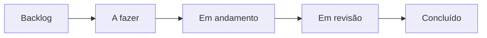

# Métricas de desenvolvimento

Esta página registra como a equipe organiza e acompanha o trabalho. As
tarefas são controladas por *issues* no repositório e acompanhadas em um
quadro kanban no GitHub Projects, o que permite ver quem fez cada entrega,
em que momento e em que etapa cada atividade se encontra.

* **Kanban:** [Kanban – Ada Lovelace](https://github.com/orgs/FCTE-Qualidade-de-Software-1/projects/19)
* **Issues:** [lista de issues do repositório](https://github.com/FCTE-Qualidade-de-Software-1/2026-2_T02_ADA_LOVELACE/issues?q=is%3Aissue)

## Fluxo de trabalho

Cada atividade da avaliação vira uma *issue*, classificada por fase e por
tipo de trabalho. Quem assume a tarefa se atribui à *issue* e a move pelas
colunas do quadro até a entrega.



*Diagrama 1. Colunas do kanban. Fonte: elaboração própria.*

| Coluna | Significado |
| --- | --- |
| Backlog | Tarefa identificada, ainda não priorizada |
| A fazer | Tarefa priorizada para o ciclo atual |
| Em andamento | Tarefa em execução por um integrante |
| Em revisão | Entrega aguardando revisão da equipe |
| Concluído | Entrega revisada e incorporada ao repositório |

As *labels* indicam a fase e o tipo de trabalho:

| Label | Uso |
| --- | --- |
| `fase-1` | Atividades da Fase 1 |
| `fase-2` | Atividades da Fase 2 |
| `documentation` | Redação e revisão da documentação |
| `gitpages` | Estrutura e publicação do GitPages |
| `medição` | Execução e análise das medições |

## Situação das tarefas

Dados de 19/10/2026.

| Fase | Concluído | Em andamento | A fazer | Backlog | Total |
| --- | :---: | :---: | :---: | :---: | :---: |
| Fase 1 | 6 | 0 | 0 | 0 | 6 |
| Fase 2 | 0 | 0 | 1 | 4 | 5 |
| GitPages | 1 | 1 | 0 | 0 | 2 |
| **Total** | **7** | **1** | **1** | **4** | **13** |

## Contribuições no repositório

Commits na branch `main` até 19/10/2026, sem contar os commits de *merge*.
O número de commits mostra a frequência de entregas, mas não mede o tamanho
nem a dificuldade de cada contribuição.

| Integrante | Commits |
| --- | :---: |
| Luís Cunha | 12 |
| João Pedro Lopes | 4 |
| André Henrique | 3 |
| Zayra Moraes | 3 |
| Giovanna Felipe | 2 |
| Renato Araújo | 1 |
| **Total** | **25** |

Além desses, foram integrados 9 *pull requests* por meio de commits de
*merge*.

Para atualizar a tabela, execute na raiz do repositório:

```bash
git shortlog -sn --no-merges main
```
