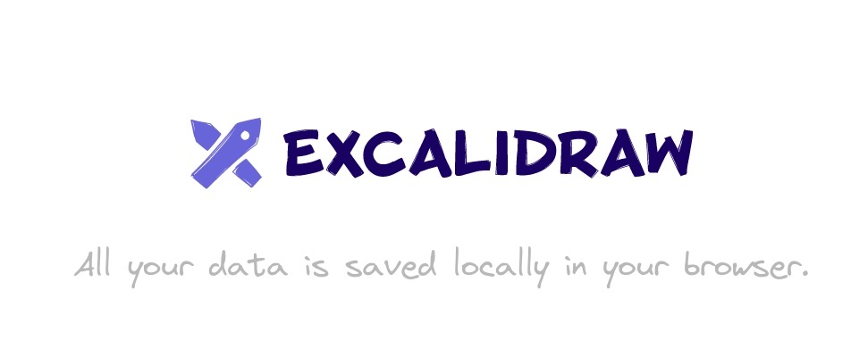
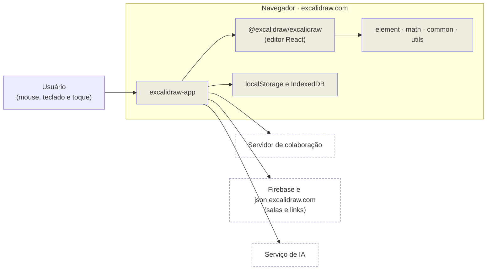

# Análise de qualidade do Excalidraw

  
  

    <strong>Estudo de caso · Equipe Ada Lovelace</strong>
    
Avaliação de segurança, flexibilidade e capacidade de interação de um quadro branco
    colaborativo.

  

## Introdução

Este site documenta a avaliação da qualidade do **Excalidraw**, um quadro
branco colaborativo para diagramas, esboços e wireframes, feita pela equipe
**Ada Lovelace** na disciplina de Qualidade de Software 1. A avaliação segue a
[ISO/IEC 25010:2023](https://www.iso.org/standard/78176.html), que chama de
**Flexibilidade** e **Capacidade de interação** o que as edições anteriores
chamavam de Portabilidade e Usabilidade.

O estudo combina medições objetivas, inspeção técnica e sessões com
participantes, no commit `e7b5346`. Os resultados valem para a versão, os
ambientes e as funções avaliados, e não são uma certificação do produto.

## Características avaliadas

-   :material-shield-lock-outline:{ .lg .middle } **Segurança**

    ---

    Os diagramas podem conter dados pessoais e circulam por links, salas
    colaborativas, armazenamento local e IA. A análise considera os
    princípios da **LGPD**, sem certificar conformidade legal.

    O1 41,7% e O2 13,9%: **não atendidos**.
    [Notas](resultados/index.md#seguranca)

-   :material-devices:{ .lg .middle } **Flexibilidade**

    ---

    Funcionar em navegadores, sistemas, resoluções e celulares com toque, e
    migrar diagramas sem perder conteúdo.

    O3 66,7%: **parcial**. O4 75,0%: **atendido**.
    [Notas](resultados/index.md#flexibilidade)

-   :material-gesture-tap:{ .lg .middle } **Capacidade de interação**

    ---

    Iniciantes aprenderem, experientes trabalharem rápido e pessoas com
    deficiência operarem por teclado ou leitor de tela.

    O5 71,4%: **parcial**. O6 31,3%: **não atendido**.
    [Notas](resultados/index.md#capacidade-de-interacao)

A justificativa da escolha está na [priorização](priorizacao.md), e o que os
resultados significam para cada decisão, na
[conclusão](analise/ameacas-conclusao.md#conclusao).

## Projeto avaliado

| Item | Descrição |
| --- | --- |
| Aplicação | [excalidraw.com](https://excalidraw.com) |
| Repositório | [github.com/excalidraw/excalidraw](https://github.com/excalidraw/excalidraw) |
| Tipo | Aplicação web de código aberto (MIT), instalável como PWA e distribuída como biblioteca React no npm |
| Uso | Criar, editar, exportar e compartilhar diagramas com mouse, teclado e toque |

O Diagrama 1 resume a estrutura do produto. O editor roda inteiro no
navegador e depende de serviços externos só para colaboração, links
compartilháveis e IA. Por isso a avaliação observa o que sai do navegador, mas
não o que acontece nos servidores.

*Diagrama 1. Módulos do Excalidraw e serviços externos. Fonte: elaboração
própria a partir do repositório do Excalidraw.*

### Escopo

* **Dentro:** formas, textos, setas e wireframes; mouse, teclado e toque;
  colaboração e compartilhamento por links; exportação e importação; IA;
  armazenamento local, autenticação observável e proteção das comunicações;
  ambientes selecionados.
* **Fora:** auditoria da infraestrutura de produção, certificação
  criptográfica, teste de penetração invasivo e avaliação exaustiva de todas
  as funções.

## Integrantes

| Nome | GitHub |
| --- | --- |
| André Henrique | [andrehsb](https://github.com/andrehsb) |
| Giovanna Felipe | [giovannafg](https://github.com/giovannafg) |
| João Pedro Lopes | [ojplc](https://github.com/ojplc) |
| Luís Cunha | [cunha-luiss](https://github.com/cunha-luiss) |
| Renato Araújo | [renatoyx](https://github.com/renatoyx) |
| Zayra Moraes | [Zayra-Moraes](https://github.com/Zayra-Moraes) |

## Organização da documentação

-   **[Metodologia](metodologia.md)**

    Caracterização da pesquisa, normas, GQM e
    [priorização das qualidades](priorizacao.md).

-   **Fase de Planejamento**

    [Propósito e partes interessadas](fase_planejamento/proposito-partes-interessadas.md),
    [modelo de qualidade](fase_planejamento/modelo-qualidade.md),
    [ODS](fase_planejamento/ods.md) e
    [objetivos GQM](fase_planejamento/objetivos-qualidade.md).

-   **Análise**

    [Roteiro](analise/roteiro.md) com questões, métricas e critérios;
    [análise dos resultados](analise/resultados.md);
    [melhoria executada](analise/melhoria.md); e
    [ameaças e conclusão](analise/ameacas-conclusao.md).

-   **Fase de Aplicação**

    [Versão analisada](fase_aplicacao/index.md) e
    [plano de avaliação](fase_aplicacao/plano-avaliacao.md): como, com quê e
    quando cada métrica foi coletada.

-   **[Resultados](resultados/index.md)**

    Valor, nota e evidência de cada uma das 51 métricas.

-   **Gestão**

    [Métricas de desenvolvimento](gestao/metricas.md),
    [gráficos da Entrega 2](gestao/graficos-entrega-2.md),
    [cronograma](gestao/cronograma.md) e
    [estimativa de custos](gestao/estimativa-custos.md).

-   **[Referências](referencias.md)**

    Normas, métodos, ferramentas e documentação consultados.

-   **[Uso de IA](uso-ia.md)**

    O que cada integrante usou, para quê e como conferiu o resultado.

