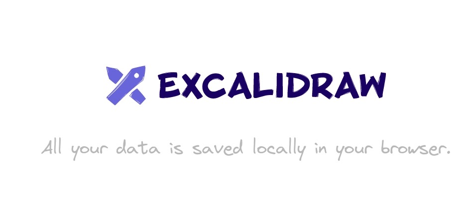

# Análise de qualidade do Excalidraw

  
  

    <strong>Estudo de caso · Equipe Ada Lovelace</strong>
    
Avaliação de segurança, flexibilidade e capacidade de interação de um quadro branco
    colaborativo.

  

## Introdução

Este site documenta a avaliação da qualidade do **Excalidraw**, uma aplicação
web de quadro branco colaborativo para criação de diagramas, esboços e
wireframes. O trabalho é realizado pela equipe **Ada Lovelace**, na disciplina
de Qualidade de Software.

O Excalidraw foi escolhido por combinar edição visual, colaboração em tempo
real, compartilhamento de diagramas e recursos de inteligência artificial. A
avaliação concentra-se nas características mais relevantes para esse contexto:
**flexibilidade (portabilidade), segurança e capacidade de interação
(usabilidade)**, conforme a
[ISO/IEC 25010:2023](https://www.iso.org/standard/78176.html). Na edição de
2023, a norma utiliza **Flexibilidade** e **Capacidade de interação** como os
nomes oficiais correspondentes a Portabilidade e Usabilidade.

O estudo adota uma abordagem mista, combinando medições objetivas, inspeção
técnica e observação da experiência de uso. Os resultados devem ser
interpretados somente para a versão, os ambientes e as funcionalidades
efetivamente avaliados; eles não constituem uma certificação integral do
produto.

### Projeto avaliado

* **Nome:** Excalidraw
* **Aplicação:** [excalidraw.com](https://excalidraw.com)
* **Repositório:** [github.com/excalidraw/excalidraw](https://github.com/excalidraw/excalidraw)
* **Tipo de produto:** aplicação web de quadro branco colaborativo.
* **Descrição:** quadro branco colaborativo para criação, edição, exportação e
  compartilhamento de diagramas, com interação por mouse, teclado e toque.

### Características e escopo do projeto

* **Características avaliadas:** flexibilidade (portabilidade), segurança e
  capacidade de interação (usabilidade), conforme a adaptação da
  [ISO/IEC 25010:2023](https://www.iso.org/standard/78176.html).
* **Justificativa das características:** segurança é essencial porque os
  diagramas podem conter informações pessoais, acadêmicas ou profissionais e
  circulam por meio de links, sessões colaborativas, armazenamento local e,
  em alguns recursos, serviços externos de inteligência artificial. A análise
  considera a importância de aplicar os princípios da **Lei Geral de Proteção
  de Dados (LGPD)**, especialmente finalidade, necessidade, transparência,
  segurança e prevenção, além de verificar controle de acesso, proteção das
  comunicações, integridade do conteúdo, autenticidade dos participantes e
  rastreabilidade das ações. Isso reduz o risco de exposição, alteração ou
  uso indevido de dados e ajuda a preservar os direitos dos titulares, sem
  presumir que a avaliação, por si só, certifique conformidade legal.
  Flexibilidade é relevante porque a aplicação precisa funcionar em
  diferentes navegadores, sistemas operacionais, resoluções e dispositivos,
  inclusive celulares e interfaces sensíveis ao toque, além de permitir a
  migração de diagramas sem perda significativa de conteúdo ou produtividade.
  Capacidade de interação é necessária para que iniciantes aprendam a
  ferramenta, usuários experientes trabalhem com eficiência e pessoas com
  diferentes capacidades consigam operar o sistema, inclusive por teclado ou
  com tecnologia assistiva, com feedback compreensível e proteção contra a
  perda acidental de trabalho.
* **Escopo:** criação e edição de formas, textos, setas e wireframes;
  interação por mouse, teclado e toque; compartilhamento e colaboração por
  links; exportação e importação de diagramas; recursos de inteligência
  artificial; armazenamento local, autenticação observável e proteção das
  comunicações; e execução em ambientes selecionados.
* **Fora do escopo:** auditoria completa da infraestrutura de produção,
  certificação criptográfica formal, teste de penetração invasivo e avaliação
  exaustiva de todas as funcionalidades do produto.

### Integrantes

| Nome | GitHub |
| --- | --- |
| André Henrique | [andrehsb](https://github.com/andrehsb) |
| Giovanna Felipe | [giovannafg](https://github.com/giovannafg) |
| João Pedro Lopes | [ojplc](https://github.com/ojplc) |
| Luís Cunha | [cunha-luiss](https://github.com/cunha-luiss) |
| Renato Araújo | [renatoyx](https://github.com/renatoyx) |
| Zayra Moraes | [Zayra-Moraes](https://github.com/Zayra-Moraes) |

## Organização da documentação

* **[Metodologia](metodologia.md):** apresenta a caracterização da avaliação,
  a fundamentação normativa, a abordagem GQM e as etapas adotadas para
  conduzir as medições e interpretar os resultados.
* Fase 1: [propósito e partes interessadas](fase1/proposito-partes-interessadas.md),
  com as decisões que a avaliação apoia e quem as toma;
  [modelo de qualidade](fase1/modelo-qualidade.md), com a adaptação
  da ISO/IEC 25010:2023 ao Excalidraw, e [ODS](fase1/ods.md), com as metas e
  os indicadores relacionados à avaliação.
* [Roteiro da análise](analise/roteiro.md): propósito, escopo, método, objetivos
  GQM, questões, métricas e critérios de julgamento.
* [Gestão do grupo](analise/gestao-grupo.md): métricas automatizáveis de
  participação, entrega, revisão, rastreabilidade e calendário.
* [Resultados](analise/resultados.md): evidências coletadas, pontuações,
  achados, pontos fortes e recomendações.
* [Referências](referencias.md): normas, métodos, ferramentas e documentação
  consultados.
* [Uso de IA](uso-ia.md): declaração de cada integrante sobre as ferramentas
  de inteligência artificial usadas, para quê e como o resultado foi
  conferido.
