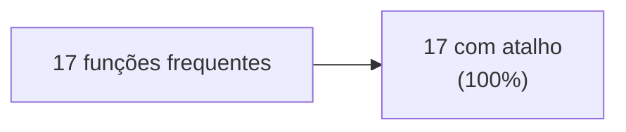

# CI-M10 · Cobertura de atalhos de teclado

**Nota 2**: as 17 funções frequentes têm atalho de teclado (100%). As
ferramentas têm atalho de uma tecla (R ou 2 para retângulo, A para seta, T para
texto).

| Grupo | Funções e atalhos |
| --- | --- |
| Ferramentas | retângulo (R ou 2), seta (A ou 5), texto (T ou 8) |
| Estilo | cor do traço (S), cor de fundo (G) |
| Edição | agrupar (Ctrl+G), desfazer (Ctrl+Z), refazer (Ctrl+Y), copiar (Ctrl+C), colar (Ctrl+V), excluir (Delete), duplicar (Ctrl+D), selecionar tudo (Ctrl+A) |
| Tela e arquivo | zoom (Ctrl + / -), salvar (Ctrl+S), abrir (Ctrl+O), exportar imagem (Ctrl+Shift+E, abre o diálogo) |

!!! note "Lista de funções frequentes"
    A lista foi definida pela equipe a partir das tarefas de usabilidade. Com
    todas as ações do programa, a cobertura seria menor. Os atalhos foram
    verificados no código, não em navegador. O universo mais amplo inclui
    101 ações de `ActionName`. Ctrl+Shift+E só abre o diálogo de exportação;
    S e G exigem elemento selecionado ou ferramenta ativa que aceite a
    propriedade. A revisão por outro integrante permanece pendente.

Registro completo:
[`CI-M10_cobertura-atalhos.md`](https://github.com/FCTE-Qualidade-de-Software-1/2026-2_T02_ADA_LOVELACE/blob/main/evidencias/capacidade-interacao/CI-M10_cobertura-atalhos.md).
