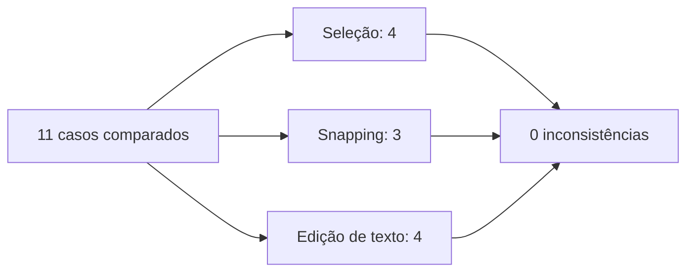
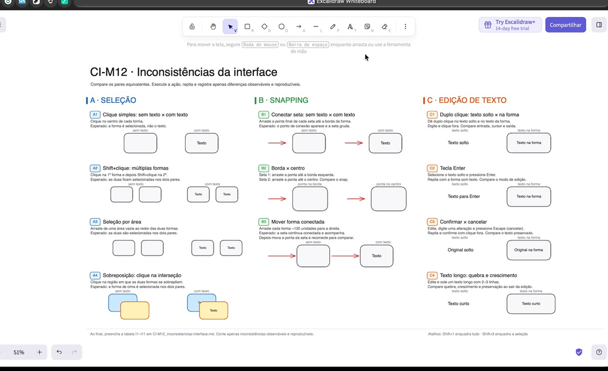

# CI-M12 · Inconsistências da interface

**Nota 2**: nenhuma inconsistência reproduzível em 11 casos que comparam o
mesmo gesto em dois contextos, nas três áreas apontadas pela hipótese:
seleção, snapping e edição de texto.

| Área | Casos | Contextos comparados | Inconsistências |
| --- | :---: | --- | :---: |
| Seleção | I1 a I4 | forma sem texto × com texto (clique, Shift, área, sobreposição) | 0 |
| Snapping | I5 a I7 | seta para forma sem texto × com texto; borda × centro; mover a forma | 0 |
| Edição de texto | I8 a I11 | texto solto × dentro da forma (duplo clique, Enter, Escape, texto longo) | 0 |

!!! note "Comportamentos registrados"
    Em I10, o Escape preserva a edição nos dois contextos, o que pode
    surpreender, mas é igual nos dois e por isso não conta. Em I11, o texto
    solto e o texto dentro da forma quebram linha de jeitos diferentes, o que
    foi tratado como diferença de layout.

## Evidências

Quadro com os 11 cenários, montado no próprio Excalidraw para a coleta:

Registro completo:
[`CI-M12_inconsistencias-interface.md`](https://github.com/FCTE-Qualidade-de-Software-1/2026-2_T02_ADA_LOVELACE/blob/main/evidencias/capacidade-interacao/CI-M12/CI-M12_inconsistencias-interface.md).
