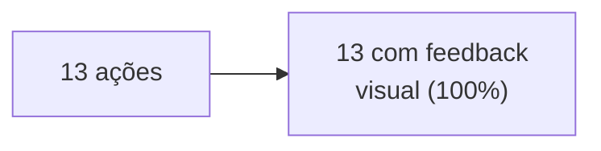
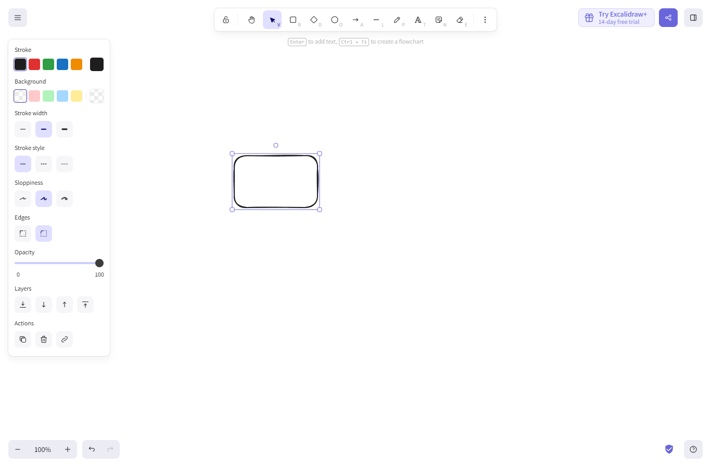
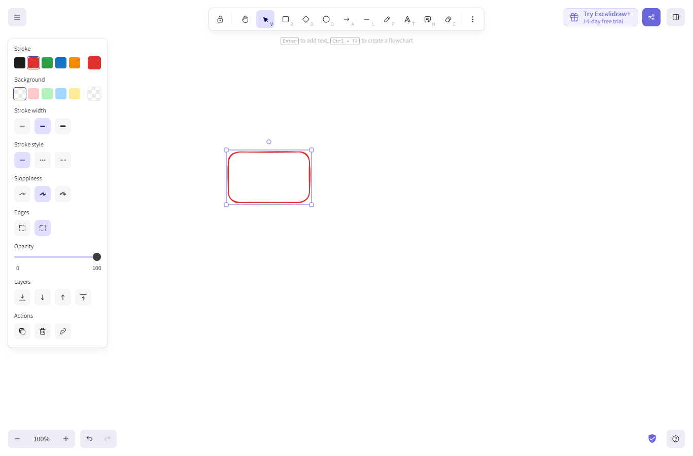

# CI-M13 · Ações com feedback visual imediato

**Nota 2 (provisória)**: as 13 ações testadas deram o retorno visual esperado (100%):
alças de seleção, mudança de posição, tamanho, cor ou texto, moldura de grupo,
tema e escala. Cada ação foi conferida por captura antes e depois e pelo
estado do aplicativo, numa coleta automatizada com Playwright.

| Ações testadas | Feedback |
| --- | :---: |
| Criar retângulo, selecionar, mover, redimensionar, alterar cor | Sim |
| Criar texto, editar texto, duplicar, excluir | Sim |
| Agrupar, desagrupar, trocar tema, zoom | Sim |

!!! note "Imediato"
    A coleta confirmou a mudança visual em cada ação, mas não mediu a latência.
    A evidência registra a nota 2 como provisória quanto ao requisito de o
    feedback ser imediato. O retorno estava presente no ponto de observação,
    mas não se mediu quando apareceu; o critério operacional temporal ainda
    depende da equipe. Validação manual e revisão cruzada pendentes.

## Evidências

=== "Antes"

    Retângulo selecionado, com contorno preto.

    

=== "Depois"

    Logo depois de escolher a cor, o contorno e o seletor mostram o vermelho.

    

Registro completo:
[`CI-M13_feedback-visual.md`](https://github.com/FCTE-Qualidade-de-Software-1/2026-2_T02_ADA_LOVELACE/blob/main/evidencias/capacidade-interacao/CI-M13/CI-M13_feedback-visual.md).

Arquivos de apoio: [`CI-M13_feedback-visual.md`](https://github.com/FCTE-Qualidade-de-Software-1/2026-2_T02_ADA_LOVELACE/tree/main/evidencias/capacidade-interacao/CI-M13).

Arquivos de apoio: [`CI-M13-M14`](https://github.com/FCTE-Qualidade-de-Software-1/2026-2_T02_ADA_LOVELACE/tree/main/evidencias/capacidade-interacao/CI-M13-M14).
