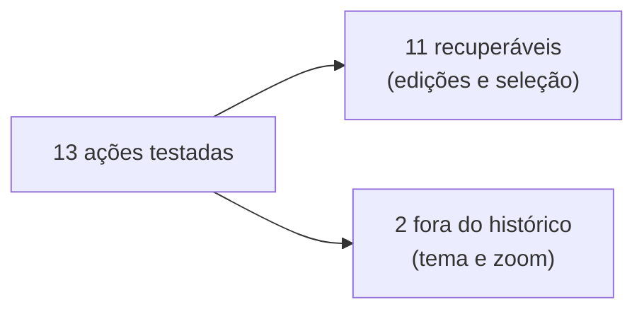

# CI-M14 · Taxa de recuperabilidade

**Nota 0 (provisória)**: 11 das 13 ações testadas foram desfeitas e refeitas
com Ctrl+Z e Ctrl+Shift+Z (84,62%). As dez edições e a seleção voltaram ao
estado anterior. Mudar o tema e o zoom não entram no histórico: o desfazer
manteve o tema e o zoom e removeu a criação anterior do retângulo.

!!! note "Nota provisória"
    A equipe ainda não decidiu se tema e zoom contam como ações não
    recuperáveis. Só com as 11 operações do histórico, o valor seria 11 de 11
    (100%, nota 2), mas esse cenário não substitui o resultado original. A
    validação manual e a revisão por outro integrante estão pendentes.

## Contexto da consolidação

| Item | Registro |
| --- | --- |
| Objetivo e questão GQM | O5 · CI-Q6 ([roteiro](../../analise/roteiro.md)) |
| Versão de referência | Excalidraw [`e7b534668a60add7f725531f3c9abf32508c7b4e`](https://github.com/excalidraw/excalidraw/commit/e7b534668a60add7f725531f3c9abf32508c7b4e); ressalvas de correspondência abaixo |
| Valor medido | 11 de 13 ações (84,62%) |
| Pontuação | **0/2 (provisória)** |
| Origem | [PR #96](https://github.com/FCTE-Qualidade-de-Software-1/2026-2_T02_ADA_LOVELACE/pull/96), integrado na main |

**Procedimento resumido:** Execução das 13 ações predefinidas, seguida de desfazer/refazer, com comparação de conteúdo e estado específico de cada ação.

**Resultado e justificativa:** A01–A11 passaram, incluindo seleção; tema e zoom não foram recuperados pelo histórico. 84,62% fica abaixo de 90%, com nota original 0/2 provisória.

**Limitações:** Tema e zoom permanecem no denominador original. O cenário 11/11 = 100%, nota 2, é apenas sensibilidade e depende de decisão explícita da equipe. Uma execução por ação no Edge headless; validação manual de Renato e revisão cruzada pendentes.

**Evidência original:** [CI-M14_recuperabilidade.md](https://github.com/FCTE-Qualidade-de-Software-1/2026-2_T02_ADA_LOVELACE/blob/c9ac9610b92474af82cc9ad3e67dc53bfa3490d4/evidencias/capacidade-interacao/CI-M14/CI-M14_recuperabilidade.md), com dados, procedimento completo e arquivos de apoio. Esta página consolida a coleta existente; não registra nova medição ou aprovação humana.

Registro completo:
[`CI-M14_recuperabilidade.md`](https://github.com/FCTE-Qualidade-de-Software-1/2026-2_T02_ADA_LOVELACE/tree/main/evidencias/capacidade-interacao/CI-M14).
Dados e capturas da coleta:
[`CI-M13-M14`](https://github.com/FCTE-Qualidade-de-Software-1/2026-2_T02_ADA_LOVELACE/tree/main/evidencias/capacidade-interacao/CI-M13-M14).
