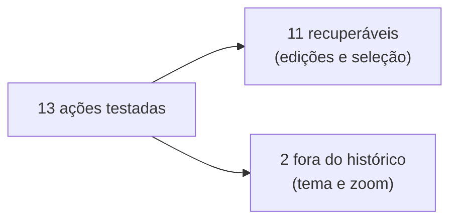

# CI-M14 · Taxa de recuperabilidade

**Nota 0 (provisória)**: 11 das 13 ações testadas foram desfeitas e refeitas
com Ctrl+Z e Ctrl+Shift+Z (84,62%). As dez edições e a seleção voltaram ao
estado anterior. Mudar o tema e o zoom não entram no histórico: o desfazer
manteve o tema e o zoom e removeu a criação anterior do retângulo.

!!! note "Nota provisória"
    A equipe ainda não decidiu se tema e zoom contam como ações não
    recuperáveis. Só com as 11 operações do histórico, o valor seria 11 de 11
    (100%, nota 2), mas esse cenário não substitui o resultado original. A
    validação manual e a revisão por outro integrante estão pendentes.

Registro completo:
[`CI-M14_recuperabilidade.md`](https://github.com/FCTE-Qualidade-de-Software-1/2026-2_T02_ADA_LOVELACE/tree/main/evidencias/capacidade-interacao/CI-M14).
Dados e capturas da coleta:
[`CI-M13-M14`](https://github.com/FCTE-Qualidade-de-Software-1/2026-2_T02_ADA_LOVELACE/tree/main/evidencias/capacidade-interacao/CI-M13-M14).
