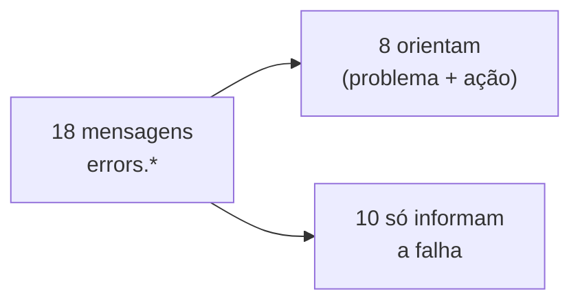
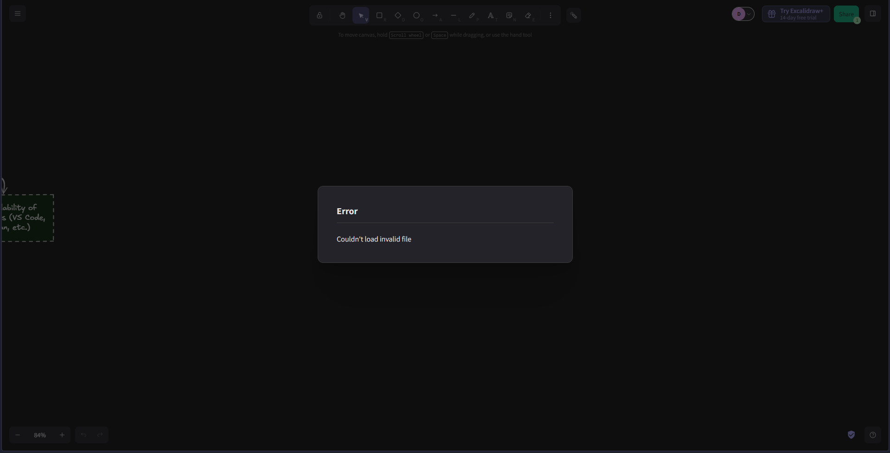

# CI-M18 · Mensagens de erro compreensíveis

**Nota 0**: só 8 das 18 mensagens do grupo `errors.*` (44%) dizem o que
aconteceu e o que o usuário pode fazer. A maioria só informa que a operação
falhou.

!!! warning "Rascunho provisório"
    A classificação é um julgamento feito por uma pessoa e ainda não foi revisada
    por outro integrante. Mudando a classe de poucas mensagens, o valor varia entre
    39% e 61%.



## Evidências

Exemplos do bloco `errors` de `locales/en.json`:

=== "Só informam (N)"

    ```json
    "unsupportedFileType": "Unsupported file type.",
    "imageToolNotSupported": "Images are disabled.",
    "asyncPasteFailedOnParse": "Couldn't paste.",
    "copyToSystemClipboardFailed": "Couldn't copy to clipboard."
    ```

=== "Orientam (S)"

    ```json
    "fileTooBig": "File is too big. Maximum allowed size is {{maxSize}}.",
    "collabSaveFailed": "Couldn't save to the backend database. If problems persist, you should save your file locally to ensure you don't lose your work."
    ```

=== "Na tela"

    Erro ao abrir um arquivo inválido. Essa mensagem (`alerts.couldNotLoadInvalidFile`)
    fica fora do grupo `errors.*` e não entra na contagem.

    

Classificação das 18 mensagens:
[`CI-M18_mensagens-de-erro.md`](https://github.com/FCTE-Qualidade-de-Software-1/2026-2_T02_ADA_LOVELACE/blob/main/evidencias/capacidade-interacao/CI-M18_mensagens-de-erro.md).
