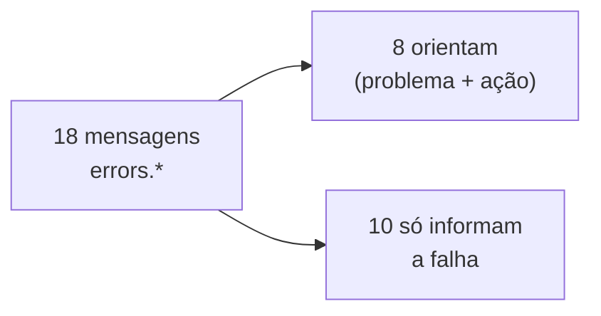
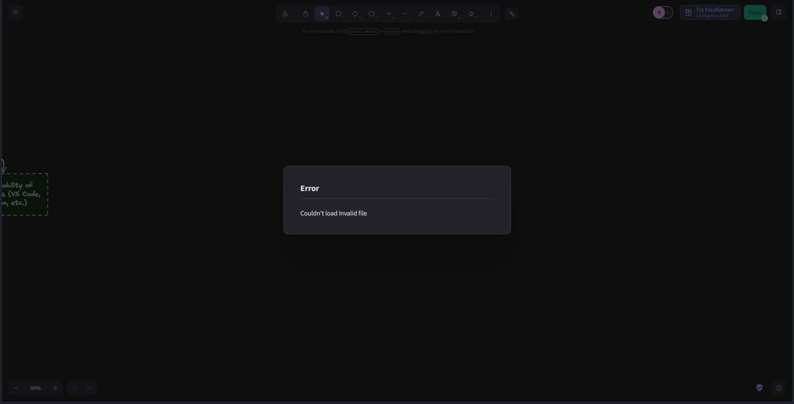

# CI-M18 · Mensagens de erro compreensíveis

**Nota 0**: só 8 das 18 mensagens do grupo `errors.*` (44%) dizem o que
aconteceu e o que o usuário pode fazer. A maioria só informa que a operação
falhou.

!!! warning "Classificação de uma avaliadora"
    A classificação é um julgamento de uma pessoa, e a reclassificação
    independente prevista na #77 não foi feita. Mudando a classe de poucas
    mensagens, o valor varia entre 39% e 61%; a partir de 50%, a nota seria 1.



## Evidências

Exemplos do bloco `errors` de `locales/en.json`:

=== "Só informam (N)"

    ```json
    "unsupportedFileType": "Unsupported file type.",
    "imageToolNotSupported": "Images are disabled.",
    "asyncPasteFailedOnParse": "Couldn't paste.",
    "copyToSystemClipboardFailed": "Couldn't copy to clipboard."
    ```

=== "Orientam (S)"

    ```json
    "fileTooBig": "File is too big. Maximum allowed size is {{maxSize}}.",
    "collabSaveFailed": "Couldn't save to the backend database. If problems persist, you should save your file locally to ensure you don't lose your work."
    ```

=== "Na tela"

    Erro ao abrir um arquivo inválido. Essa mensagem (`alerts.couldNotLoadInvalidFile`)
    fica fora do grupo `errors.*` e não entra na contagem.

    

Classificação das 18 mensagens:
[`CI-M18_mensagens-de-erro.md`](https://github.com/FCTE-Qualidade-de-Software-1/2026-2_T02_ADA_LOVELACE/blob/main/evidencias/capacidade-interacao/CI-M18_mensagens-de-erro.md).

## Contexto da consolidação

| Item | Registro |
| --- | --- |
| Objetivo e questão GQM | O5 · CI-Q7 ([roteiro](../../analise/roteiro.md)) |
| Valor medido | 8 de 18 mensagens (44%) |
| Pontuação | **0/2** |
| Origem | [PR #50](https://github.com/FCTE-Qualidade-de-Software-1/2026-2_T02_ADA_LOVELACE/pull/50), aprovado por outro integrante e integrado na main |

**Procedimento resumido:** Classificação documental das mensagens errors.* em inglês: explicar o problema e indicar uma ação.

**Resultado e justificativa:** O registro classifica oito de dezoito como compreensíveis e acionáveis. Abaixo de 50% recebe 0.

**Limitações:** Classificação de uma avaliadora, sem validação de compreensão com participantes; sensibilidade de 39% a 61%. Não incorpora entrevistas nem cobre toasts, pt-BR ou todas as mensagens exibidas. SHA do snapshot não confirmado na evidência.

**Evidência original:** [CI-M18_mensagens-de-erro.md](https://github.com/FCTE-Qualidade-de-Software-1/2026-2_T02_ADA_LOVELACE/blob/c9ac9610b92474af82cc9ad3e67dc53bfa3490d4/evidencias/capacidade-interacao/CI-M18_mensagens-de-erro.md), com dados, procedimento completo e arquivos de apoio. Esta página consolida a coleta existente, sem nova medição.
