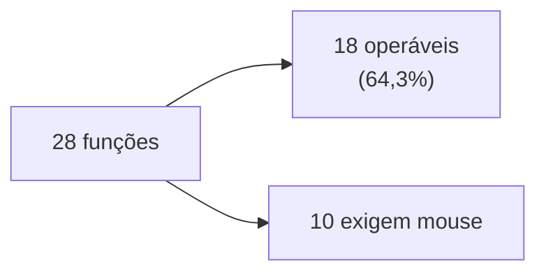

# CI-M23 · Funções operáveis só pelo teclado

**Nota 1**: 18 das 28 funções testadas puderam ser feitas só com o teclado
(64,3%). Edição, propriedades, histórico, zoom, tema, arquivo e colaboração
funcionam por atalhos e `Tab`. Selecionar um elemento, criar formas e texto no
canvas, redimensionar, abrir o menu principal e mudar o idioma exigem mouse.

!!! note "Limitações"
    O teste foi feito num navegador Chromium embutido, no macOS, diferente do
    ambiente documentado, e a versão `e7b5346` não pôde ser confirmada por
    hash. Copiar, colar, abrir e exportar foram ativados pelo teclado, mas a
    conclusão depende da área de transferência ou de diálogos do sistema, que
    a automação não observou por completo. A revisão está pendente.

## Contexto da consolidação

| Item | Registro |
| --- | --- |
| Objetivo e questão GQM | O6 · CI-Q9 ([roteiro](../../analise/roteiro.md)) |
| Versão de referência | Excalidraw [`e7b534668a60add7f725531f3c9abf32508c7b4e`](https://github.com/excalidraw/excalidraw/commit/e7b534668a60add7f725531f3c9abf32508c7b4e); ressalvas de correspondência abaixo |
| Valor medido | 18 de 28 funções (64,3%) |
| Pontuação | **1/2** |
| Origem | [PR #97](https://github.com/FCTE-Qualidade-de-Software-1/2026-2_T02_ADA_LOVELACE/pull/97), integrado na main |

**Procedimento resumido:** Percurso de 28 funções usando teclado, com registro de foco, seleção, efeitos e limitações da automação.

**Resultado e justificativa:** A evidência registra 18 funções como operáveis e dez como não operáveis; 64,3% corresponde a 1.

**Limitações:** Quatro Sim têm ressalvas: clipboard sintético e diálogos nativos sem conclusão completa. Pela exigência estrita de conclusão, 14/28 = 50% seria cenário a revisar, sem substituir a nota registrada. macOS/Chromium embutido; SHA não confirmado por hash; revisão pendente.

**Evidência original:** [CI-M23_funcoes-operaveis-teclado_2026-11-12.md](https://github.com/FCTE-Qualidade-de-Software-1/2026-2_T02_ADA_LOVELACE/blob/c9ac9610b92474af82cc9ad3e67dc53bfa3490d4/evidencias/capacidade-interacao/CI-M23/CI-M23_funcoes-operaveis-teclado_2026-11-12.md), com dados, procedimento completo e arquivos de apoio. Esta página consolida a coleta existente; não registra nova medição ou aprovação humana.

Registro completo:
[`CI-M23_funcoes-operaveis-teclado_2026-11-12.md`](https://github.com/FCTE-Qualidade-de-Software-1/2026-2_T02_ADA_LOVELACE/tree/main/evidencias/capacidade-interacao/CI-M23).
