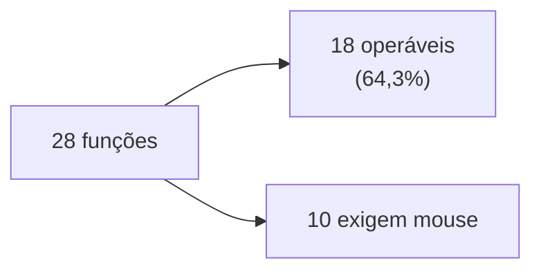

# CI-M23 · Funções operáveis só pelo teclado

**Nota 1**: 18 das 28 funções testadas puderam ser feitas só com o teclado
(64,3%). Edição, propriedades, histórico, zoom, tema, arquivo e colaboração
funcionam por atalhos e `Tab`. Selecionar um elemento, criar formas e texto no
canvas, redimensionar, abrir o menu principal e mudar o idioma exigem mouse.

!!! note "Limitações"
    O teste foi feito num navegador Chromium embutido, no macOS, diferente do
    ambiente documentado, e a versão `e7b5346` não pôde ser confirmada por
    hash. Copiar, colar, abrir e exportar foram ativados pelo teclado, mas a
    conclusão depende da área de transferência ou de diálogos do sistema, que
    a automação não observou por completo. A revisão está pendente.

Registro completo:
[`CI-M23_funcoes-operaveis-teclado_2026-11-12.md`](https://github.com/FCTE-Qualidade-de-Software-1/2026-2_T02_ADA_LOVELACE/tree/main/evidencias/capacidade-interacao/CI-M23).
