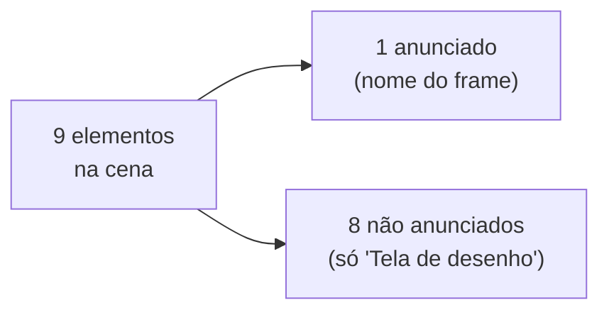

# CI-M24 · Elementos anunciados por leitor de tela

**Nota 0**: o NVDA anunciou só 1 dos 9 elementos da cena de teste (11%), o
frame, cujo nome é um texto HTML sobre o canvas. Formas, linhas, texto, desenho
livre e imagem são pixels num canvas que o leitor de tela lê apenas como "Tela
de desenho".

Registro completo, com o script que controla o NVDA e o registro de fala:
[`CI-M24_elementos-anunciados.md`](https://github.com/FCTE-Qualidade-de-Software-1/2026-2_T02_ADA_LOVELACE/blob/main/evidencias/capacidade-interacao/CI-M24/CI-M24_elementos-anunciados.md).
