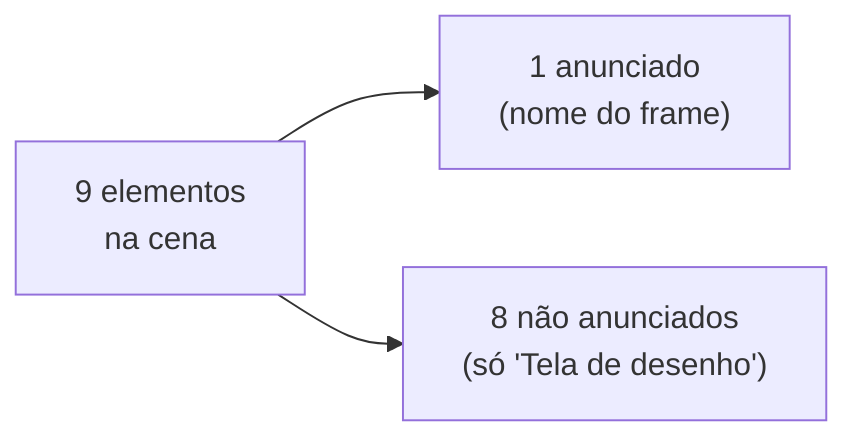

# CI-M24 · Elementos anunciados por leitor de tela

**Nota 0**: o NVDA anunciou só 1 dos 9 elementos da cena de teste (11%), o
frame, cujo nome é um texto HTML sobre o canvas. Formas, linhas, texto, desenho
livre e imagem são pixels num canvas que o leitor de tela lê apenas como "Tela
de desenho".

Registro completo, com o script que controla o NVDA e o registro de fala:
[`CI-M24_elementos-anunciados.md`](https://github.com/FCTE-Qualidade-de-Software-1/2026-2_T02_ADA_LOVELACE/blob/main/evidencias/capacidade-interacao/CI-M24/CI-M24_elementos-anunciados.md).

## Contexto da consolidação

| Item | Registro |
| --- | --- |
| Objetivo e questão GQM | O6 · CI-Q9 ([roteiro](../../analise/roteiro.md)) |
| Valor medido | 1 de 9 elementos (11,1%) |
| Pontuação | **0/2** |
| Origem | [PR #103](https://github.com/FCTE-Qualidade-de-Software-1/2026-2_T02_ADA_LOVELACE/pull/103), aprovado por outro integrante e integrado na main |

**Procedimento resumido:** NVDA real controlado por script em quatro caminhos, comparando cena com nove elementos e controle vazio.

**Resultado e justificativa:** Somente o nome HTML do frame foi anunciado; 11,1% fica abaixo de 40%, nota 0.

**Limitações:** NVDA/Edge em Windows, sem VoiceOver; frame só entra no DOM quando visível. Rodadas anteriores foram descartadas e sobrescritas; não generalizar para outros leitores.

**Evidência original:** [CI-M24_elementos-anunciados.md](https://github.com/FCTE-Qualidade-de-Software-1/2026-2_T02_ADA_LOVELACE/blob/c9ac9610b92474af82cc9ad3e67dc53bfa3490d4/evidencias/capacidade-interacao/CI-M24/CI-M24_elementos-anunciados.md), com dados, procedimento completo e arquivos de apoio. Esta página consolida a coleta existente, sem nova medição.
