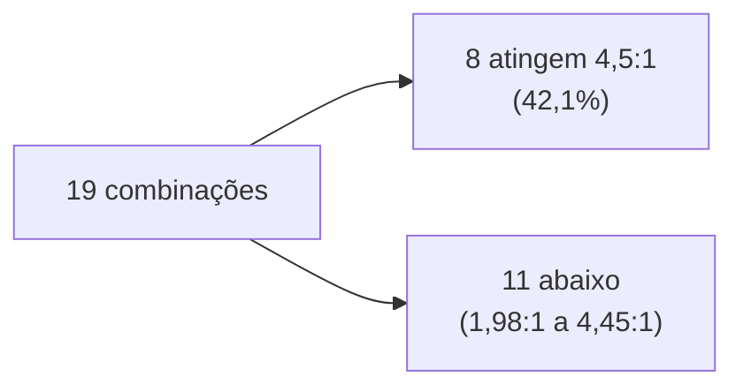

# CI-M25 · Contraste mínimo de 4,5:1

**Nota 0**: 8 das 19 combinações de cor de texto e fundo da tela principal
atingem 4,5:1 (42,1%): 4 de 10 no modo claro e 4 de 9 no escuro. O texto
principal tem contraste alto, mas os textos de apoio (tela de boas-vindas,
dicas, letras de atalho e atalhos do menu) ficam entre 1,98:1 e 4,45:1.

Contando por texto, e não por combinação, 73 dos 186 textos visíveis atingem
4,5:1 (39,2%), também nota 0. Nenhuma das 6 telas (3 estados nos 2 modos) tem
todas as combinações acima do limite.

Registro completo:
[`CI-M25_contraste.md`](https://github.com/FCTE-Qualidade-de-Software-1/2026-2_T02_ADA_LOVELACE/blob/main/evidencias/capacidade-interacao/CI-M25_contraste.md).
