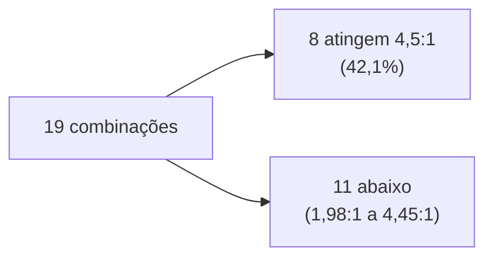

# CI-M25 · Contraste mínimo de 4,5:1

**Nota 0**: 8 das 19 combinações de cor de texto e fundo da tela principal
atingem 4,5:1 (42,1%): 4 de 10 no modo claro e 4 de 9 no escuro. O texto
principal tem contraste alto, mas os textos de apoio (tela de boas-vindas,
dicas, letras de atalho e atalhos do menu) ficam entre 1,98:1 e 4,45:1.

Contando por texto, e não por combinação, 73 dos 186 textos visíveis atingem
4,5:1 (39,2%), também nota 0. Nenhuma das 6 telas (3 estados nos 2 modos) tem
todas as combinações acima do limite.

## Contexto da consolidação

| Item | Registro |
| --- | --- |
| Objetivo e questão GQM | O6 · CI-Q9 ([roteiro](../../analise/roteiro.md)) |
| Versão de referência | Excalidraw [`e7b534668a60add7f725531f3c9abf32508c7b4e`](https://github.com/excalidraw/excalidraw/commit/e7b534668a60add7f725531f3c9abf32508c7b4e); ressalvas de correspondência abaixo |
| Valor medido | 8 de 19 combinações (42,1%) |
| Pontuação | **0/2** |
| Origem | [PR #101](https://github.com/FCTE-Qualidade-de-Software-1/2026-2_T02_ADA_LOVELACE/pull/101), integrado na main |

**Procedimento resumido:** Leitura de cores de texto e fundos efetivos nos três estados dos dois temas; cálculo de luminância e contraste.

**Resultado e justificativa:** Quatro de dez combinações claras e quatro de nove escuras atingiram 4,5:1. Total abaixo de 80% recebe 0.

**Limitações:** Peso igual por combinação; por texto seria 73/186 (39,2%), também 0. Fundo padrão e cálculo por ancestrais com ressalva documentada; não mede ícones ou todos os diálogos. Revisado por não preenchido.

**Evidência original:** [CI-M25_contraste.md](https://github.com/FCTE-Qualidade-de-Software-1/2026-2_T02_ADA_LOVELACE/blob/c9ac9610b92474af82cc9ad3e67dc53bfa3490d4/evidencias/capacidade-interacao/CI-M25_contraste.md), com dados, procedimento completo e arquivos de apoio. Esta página consolida a coleta existente; não registra nova medição ou aprovação humana.

Registro completo:
[`CI-M25_contraste.md`](https://github.com/FCTE-Qualidade-de-Software-1/2026-2_T02_ADA_LOVELACE/blob/main/evidencias/capacidade-interacao/CI-M25_contraste.md).
