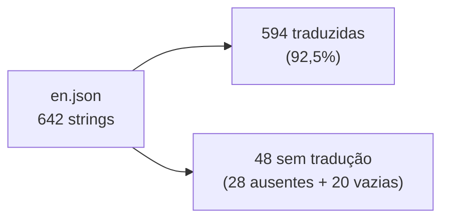

# CI-M26 · Idiomas e tradução para o português

**Nota 1**: a interface tem 57 idiomas, e o pt-BR cobre 594 das 642 strings
(92,5%). Fica abaixo de 95% quando se conta o que falta, quase tudo de recursos
recentes.

!!! note "Revisão pendente"
    A coleta ainda não foi revisada por outro integrante.



O `percentages.json` oficial diz 96% (o que daria nota 2), mas calcula sobre as
614 chaves que existem em pt-BR e ignora as 28 que faltam.

## Evidências

=== "Contagem"

    ```text
    en chaves: 642
    pt-BR chaves: 614 (não vazias: 594)
    chaves de en ausentes em pt-BR: 28
    chaves de pt-BR inexistentes em en: 0
    strings de pt-BR idênticas às de en: 21
    ```

=== "Cálculo oficial"

    O denominador é o próprio arquivo do idioma
    (`scripts/build-locales-coverage.js:27-29`):

    ```js
    const allKeys = Object.keys(data);
    const translatedKeys = allKeys.filter((item) => data[item] !== "");
    const percentage = Math.floor((100 * translatedKeys.length) / allKeys.length);
    ```

Registro completo:
[`CI-M26_idiomas-traducao-pt-BR.md`](https://github.com/FCTE-Qualidade-de-Software-1/2026-2_T02_ADA_LOVELACE/blob/main/evidencias/capacidade-interacao/CI-M26_idiomas-traducao-pt-BR.md).
