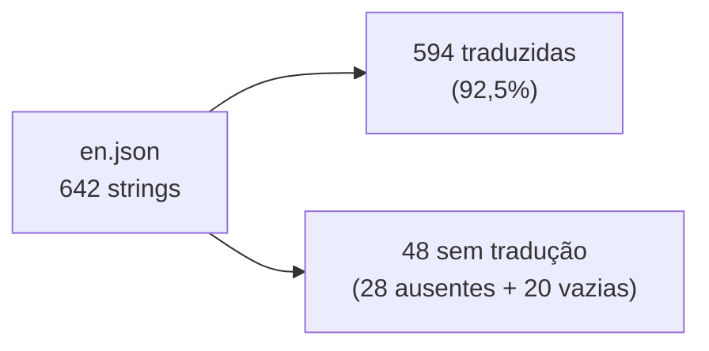

# CI-M26 · Idiomas e tradução para o português

**Nota 1**: a interface tem 57 idiomas, e o pt-BR cobre 594 das 642 strings
(92,5%). Fica abaixo de 95% quando se conta o que falta, quase tudo de recursos
recentes.

!!! note "Revisão registrada"
    A evidência original registra revisão por Luís Felipe Parreira Cunha em
    15/11/2026. A reavaliação independente e a comparação foram integradas pelo
    [PR #107](https://github.com/FCTE-Qualidade-de-Software-1/2026-2_T02_ADA_LOVELACE/pull/107),
    mantendo 57 idiomas, 594/642 strings (92,5%) e nota 1. Isso não representa
    nova medição ou revisão nesta etapa.



O `percentages.json` oficial diz 96% (o que daria nota 2), mas calcula sobre as
614 chaves que existem em pt-BR e ignora as 28 que faltam.

## Evidências

=== "Contagem"

    ```text
    en chaves: 642
    pt-BR chaves: 614 (não vazias: 594)
    chaves de en ausentes em pt-BR: 28
    chaves de pt-BR inexistentes em en: 0
    strings de pt-BR idênticas às de en: 21
    ```

=== "Cálculo oficial"

    O denominador é o próprio arquivo do idioma
    (`scripts/build-locales-coverage.js:27-29`):

    ```js
    const allKeys = Object.keys(data);
    const translatedKeys = allKeys.filter((item) => data[item] !== "");
    const percentage = Math.floor((100 * translatedKeys.length) / allKeys.length);
    ```

Registro completo:
[`CI-M26_idiomas-traducao-pt-BR.md`](https://github.com/FCTE-Qualidade-de-Software-1/2026-2_T02_ADA_LOVELACE/blob/main/evidencias/capacidade-interacao/CI-M26_idiomas-traducao-pt-BR.md).

## Contexto da consolidação

| Item | Registro |
| --- | --- |
| Objetivo e questão GQM | O6 · CI-Q10 ([roteiro](../../analise/roteiro.md)) |
| Versão de referência | Excalidraw [`e7b534668a60add7f725531f3c9abf32508c7b4e`](https://github.com/excalidraw/excalidraw/commit/e7b534668a60add7f725531f3c9abf32508c7b4e); ressalvas de correspondência abaixo |
| Valor medido | 57 idiomas; 594 de 642 strings (92,5%) |
| Pontuação | **1/2** |
| Origem | [PR #50](https://github.com/FCTE-Qualidade-de-Software-1/2026-2_T02_ADA_LOVELACE/pull/50), integrado na main |

**Procedimento resumido:** Contagem de idiomas e comparação das chaves não vazias de pt-BR com todas as strings de en.json.

**Resultado e justificativa:** A cobertura registrada é 92,5%, abaixo de 95% e na faixa de nota 1. O percentual oficial 96% usa outro denominador.

**Limitações e revisão integrada:** O [PR #107](https://github.com/FCTE-Qualidade-de-Software-1/2026-2_T02_ADA_LOVELACE/pull/107) foi integrado na main no commit `460d7e4`. O registro original agora identifica revisão por Luís Felipe em 15/11/2026. A reavaliação mantém 57 idiomas, 594/642 strings e nota 1, sem divergência substantiva. Conforme a comparação integrada, `a8800f8` é o snapshot do grupo, e não outra versão do Excalidraw: os arquivos de idiomas não mudaram desde a incorporação em `07efd32`, documentada como `e7b5346`. Essa rastreabilidade não é uma nova verificação por hash nesta integração. A amostra qualitativa de 20 chaves não substitui a avaliação de todas as traduções nem de todos os perfis.

**Evidência original:** [CI-M26_idiomas-traducao-pt-BR.md](https://github.com/FCTE-Qualidade-de-Software-1/2026-2_T02_ADA_LOVELACE/blob/c9ac9610b92474af82cc9ad3e67dc53bfa3490d4/evidencias/capacidade-interacao/CI-M26_idiomas-traducao-pt-BR.md), com dados, procedimento completo e arquivos de apoio. Esta página consolida a coleta existente; não registra nova medição ou aprovação humana.

Revisão independente:
[`CI-M26_comparacao.md`](https://github.com/FCTE-Qualidade-de-Software-1/2026-2_T02_ADA_LOVELACE/blob/main/evidencias/capacidade-interacao/CI-M26_comparacao.md).
