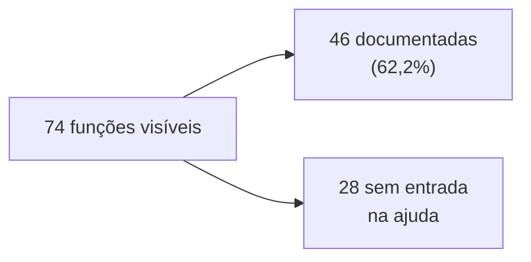

# CI-M7 · Cobertura da ajuda interna

**Nota 1**: o diálogo de ajuda (aberto por `?`) documenta 46 das 74 funções
com botão ou menu visível (62,2%). Cobre as ferramentas e as ações de edição,
mas não tem entrada para abrir, salvar e exportar, nem para a maior parte das
propriedades de estilo do painel.

!!! note "Depende do denominador"
    O recorte adotado é o das tarefas do grupo: ferramentas da barra e ações
    com botão ou menu visível. Com a lista das 17 funções frequentes da CI-M10,
    o valor seria 82,4% (nota 2). O diálogo é de atalhos, então funções sem
    atalho tendem a ficar de fora. A coleta ainda não foi revisada por outro
    integrante.

Registro completo:
[`CI-M7_cobertura-ajuda-interna.md`](https://github.com/FCTE-Qualidade-de-Software-1/2026-2_T02_ADA_LOVELACE/blob/main/evidencias/capacidade-interacao/CI-M7_cobertura-ajuda-interna.md).
