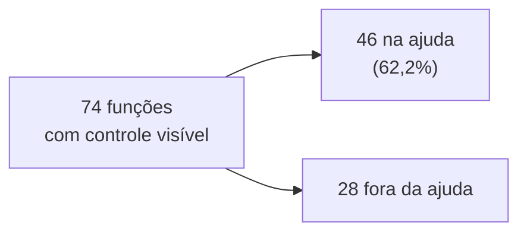

# CI-M7 · Cobertura da ajuda interna

**Nota 1**: o diálogo de ajuda (aberto por `?`) documenta 46 das 74 funções
com controle visível (62,2%). Cobre as ferramentas, o zoom e o histórico, mas
não as funções de arquivo nem boa parte do painel de estilo.

| Onde fica a função | Funções | Na ajuda |
| --- | ---: | ---: |
| Barra de ferramentas | 21 | 16 |
| Painel de propriedades | 35 | 19 |
| Rodapé (zoom e histórico) | 5 | 5 |
| Menu principal | 13 | 6 |
| **Total** | **74** | **46** |

!!! note "Denominador"
    O total segue o roteiro ("total de funções disponíveis"), com o recorte
    sugerido nas tarefas do grupo: ferramentas da barra e ações com botão ou
    menu visível. Com as 17 funções frequentes da [CI-M10](ci-m10.md), o valor
    seria 82,4% (nota 2).

A ajuda é uma lista de atalhos: não há tutorial guiado, e abrir, salvar e
exportar não aparecem nela.

Registro completo:
[`CI-M7_cobertura-ajuda-interna.md`](https://github.com/FCTE-Qualidade-de-Software-1/2026-2_T02_ADA_LOVELACE/blob/main/evidencias/capacidade-interacao/CI-M7_cobertura-ajuda-interna.md).
