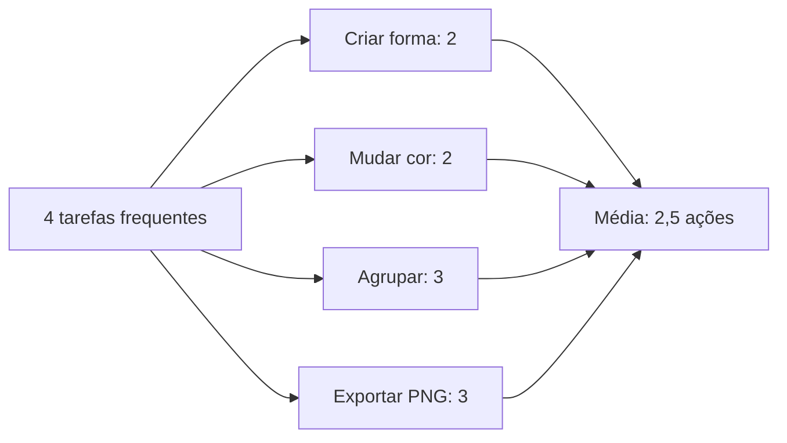
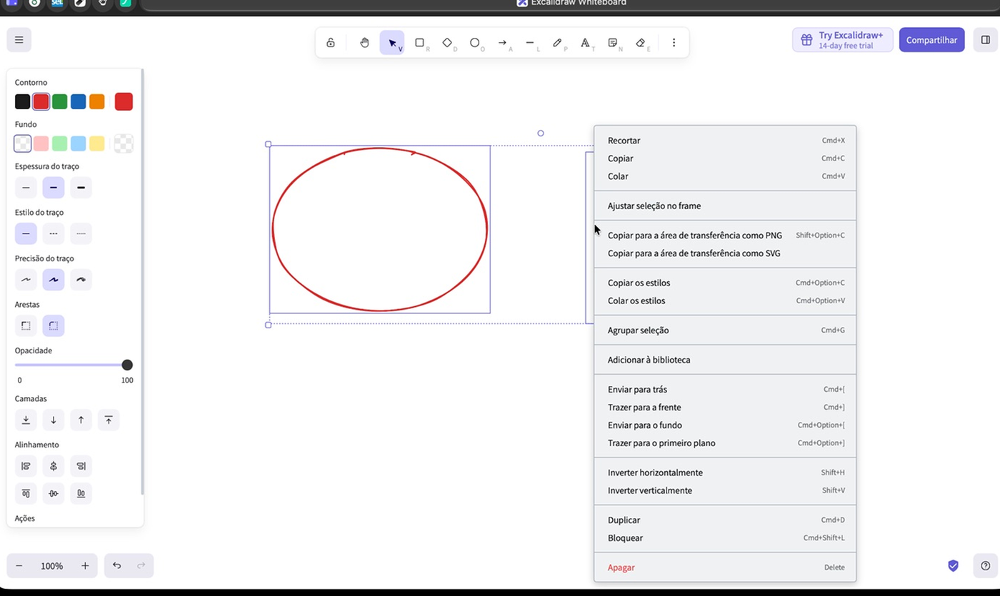
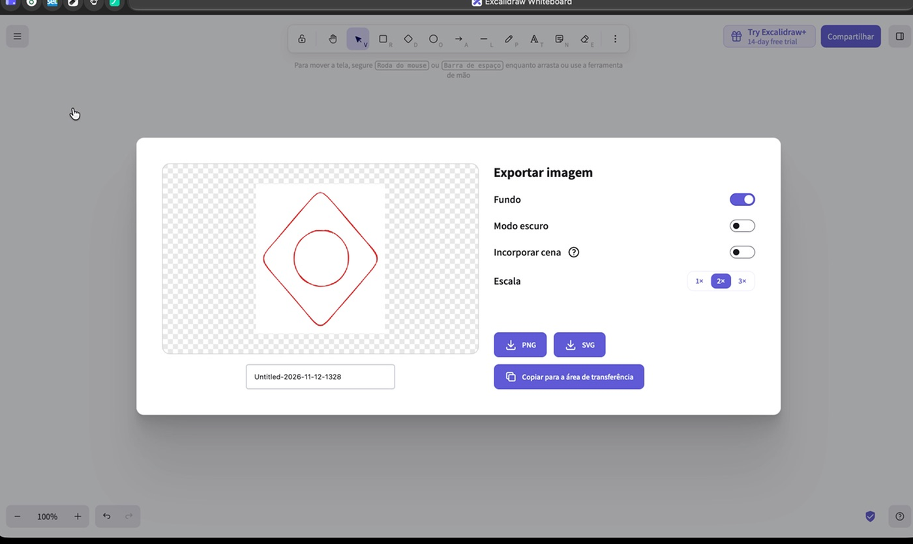

# CI-M9 · Ações por tarefa frequente

**Nota 2**: as quatro tarefas frequentes pedem, em média, 2,5 ações com o mouse,
sem atalhos de teclado (meta: até 3).

| Tarefa | Ações | Sequência |
| --- | :---: | --- |
| Criar forma | 2 | escolher o retângulo; desenhar |
| Mudar cor | 2 | selecionar a forma; clicar na cor |
| Agrupar elementos | 3 | selecionar por área; abrir o menu de contexto; Agrupar seleção |
| Exportar PNG | 3 | abrir o menu principal; Exportar imagem; PNG |

Cada tarefa foi feita duas vezes, com a mesma contagem. Não entram movimentos
do cursor nem a criação das formas de apoio.

## Evidências

=== "Agrupar"

    O menu de contexto, aberto sobre a seleção, tem "Agrupar seleção".

    

=== "Exportar PNG"

    O diálogo de exportação, aberto pelo menu principal, exporta em PNG com um
    clique.

    

Registro completo:
[`CI-M9_acoes-por-tarefa.md`](https://github.com/FCTE-Qualidade-de-Software-1/2026-2_T02_ADA_LOVELACE/blob/main/evidencias/capacidade-interacao/CI-M9/CI-M9_acoes-por-tarefa.md).
