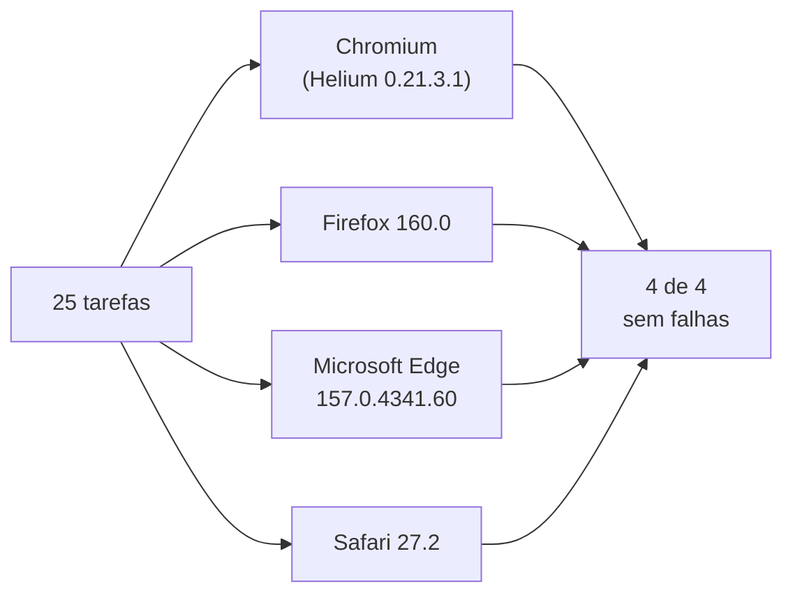
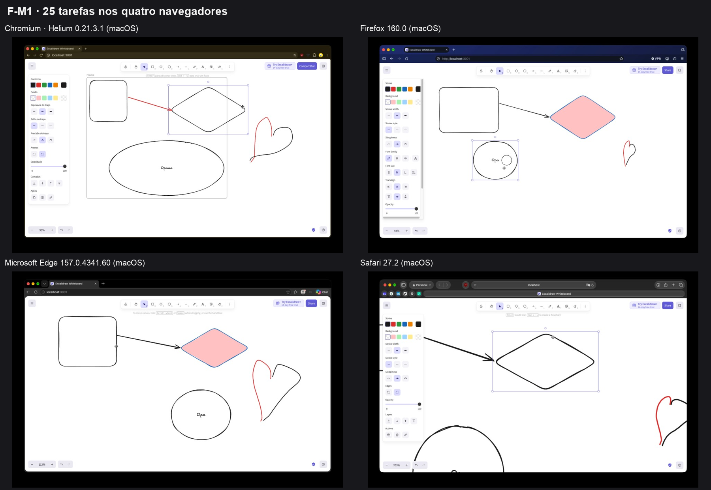
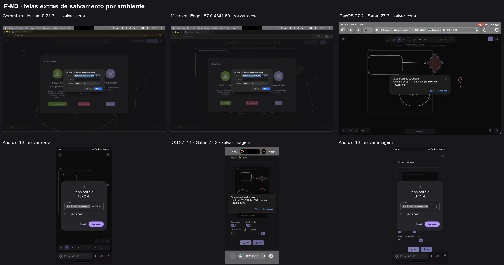

# F-M1 · Compatibilidade de navegadores

**Nota 2**: os quatro ambientes de navegador concluíram as 25 tarefas sem falhas
(100%). O Google Chrome não estava instalado; o teste usou o Helium 0.21.3.1,
baseado em Chromium. Firefox 160.0, Edge 157.0.4341.60 e Safari 27.2 foram
testados no macOS 27.2.1.

| Navegador | Motor | Sistema | Resultado |
| --- | --- | --- | --- |
| Chromium (Helium 0.21.3.1) | Chromium | macOS 27.2.1 | 25 de 25, sem falhas |
| Firefox 160.0 | Gecko | macOS 27.2.1 | 25 de 25, sem falhas |
| Microsoft Edge 157.0.4341.60 | Chromium | macOS 27.2.1 | 25 de 25, sem falhas |
| Safari 27.2 | WebKit | macOS 27.2.1 | 25 de 25, sem falhas |

!!! note "Chrome × Helium"
    O Google Chrome não estava instalado e o teste foi feito no Helium, um
    navegador baseado em Chromium. Os arquivos mantiveram o nome “Chrome” porque
    foi assim que a coleta foi rotulada. Se o Chrome proprietário for exigido
    literalmente, a contagem fica em 3 de 3 navegadores instalados (100%) e a
    nota não muda.

## Evidências

=== "As quatro sessões"

    O mesmo roteiro de 25 tarefas nos quatro navegadores. As diferenças de
    zoom e de painel são momentos distintos da gravação.

    

=== "Salvamento"

    No Chromium e no Edge, o Excalidraw mostra o modal “Salvar como…” e o
    navegador abre o diálogo nativo em seguida. O fluxo é uma diferença de
    plataforma, não uma falha de compatibilidade.

    

Registro completo:
[`F-M1_compatibilidade-navegadores_2026-11-14.md`](https://github.com/FCTE-Qualidade-de-Software-1/2026-2_T02_ADA_LOVELACE/blob/main/evidencias/flexibilidade/F-M1/F-M1_compatibilidade-navegadores_2026-11-14.md).
