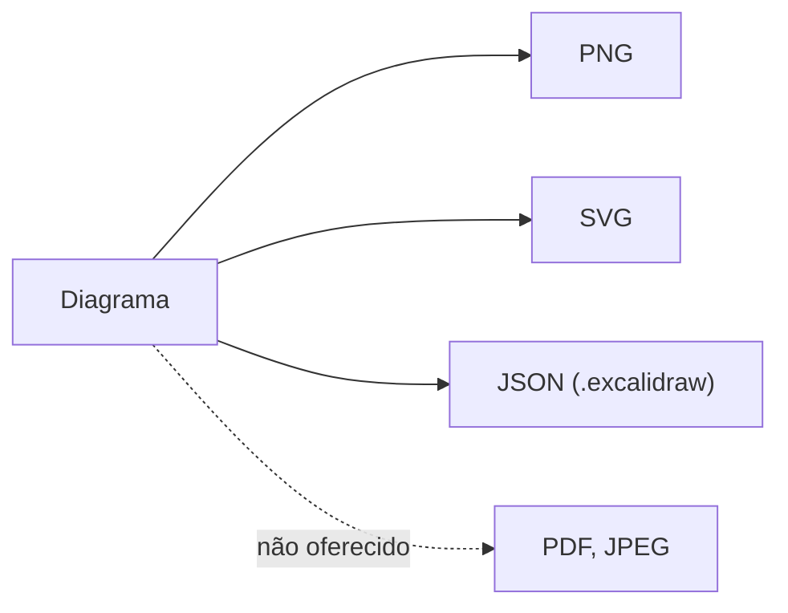
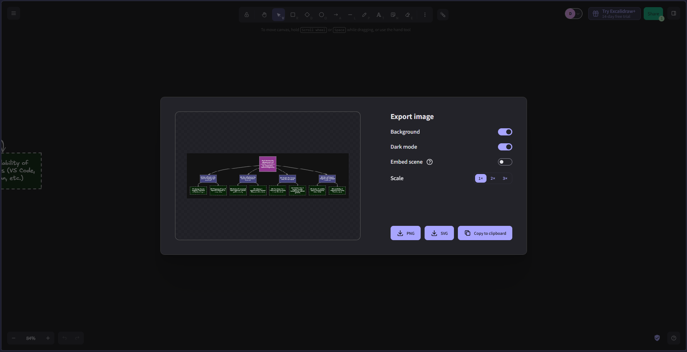

# F-M10 · Cobertura de formatos de exportação

**Nota 1**: o Excalidraw exporta 3 dos 5 formatos relevantes (60%). Os três
formatos abertos estão disponíveis, mas faltam PDF e JPEG, comuns em
ferramentas equivalentes.



| Formato | Exporta pela interface? |
| --- | :---: |
| PNG, SVG, JSON (`.excalidraw`) | Sim |
| PDF, JPEG | **Não** |

!!! note "Denominador a decidir em grupo"
    A lista de 5 formatos foi escolhida na coleta e ainda precisa ser decidida em
    grupo. Com só os 3 formatos citados na métrica, o resultado seria 100% (nota 2).

## Evidências

=== "Diálogo de exportação"

    O diálogo de imagem só oferece PNG, SVG e cópia para a área de transferência.

    

=== "Código"

    O tipo `ExportType` só aceita PNG e SVG além da área de transferência e do
    link (`scene/types.ts:155-160`):

    ```ts
    export type ExportType =
      | "png"
      | "clipboard"
      | "clipboard-svg"
      | "backend"
      | "svg";
    ```

As buscas por `application/pdf` e por formatos do draw.io, Miro, Visio e
Lucidchart não têm nenhuma ocorrência. O JPEG existe só na API da biblioteca
(`scene/export.ts:1296`), não no diálogo.

Registro completo:
[`F-M10_formatos-exportacao.md`](https://github.com/FCTE-Qualidade-de-Software-1/2026-2_T02_ADA_LOVELACE/blob/main/evidencias/flexibilidade/F-M10_formatos-exportacao.md).
