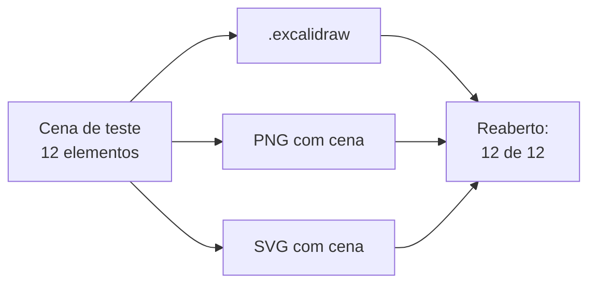
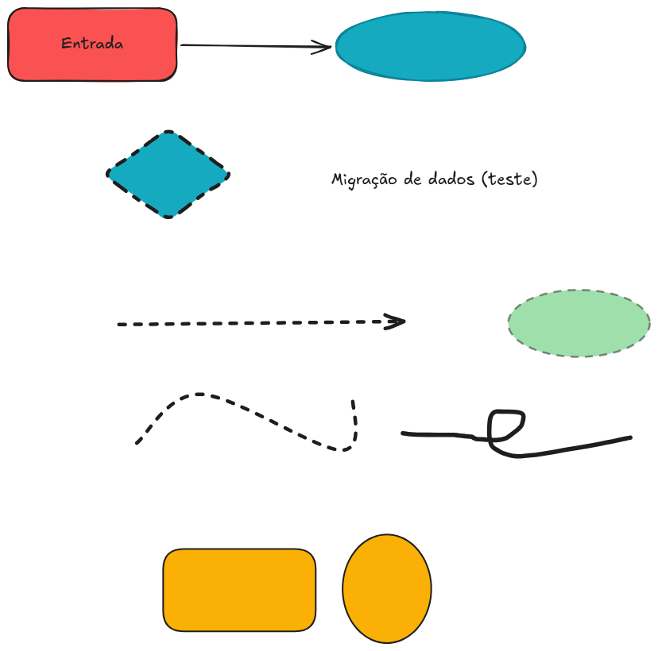

# F-M11 · Fidelidade de migração

**Nota 2**: os 12 elementos da cena de teste voltaram iguais depois de salvar
ou exportar e reabrir, nos três formatos que guardam a cena (100%).

| Formato | Preservados | Fidelidade |
| --- | :---: | :---: |
| `.excalidraw` (JSON) | 12 de 12 | 100% |
| PNG com "incorporar cena" | 12 de 12 | 100% |
| SVG com "incorporar cena" | 12 de 12 | 100% |

A comparação foi feita por script, elemento a elemento, em 34 atributos (tipo,
posição, tamanho, cores, texto, ligações das setas, grupos e outros).

!!! note "Limites"
    Só vale para PNG e SVG exportados com "incorporar cena". A cena não tinha
    imagens, frames nem embeds, e a migração para outra ferramenta não foi
    medida (ver a [F-M10](f-m10.md) e a [F-M12](f-m12.md)). Mede a ida e
    volta dentro do próprio Excalidraw, na mesma versão; não mede migração
    para outra versão.

## Evidências

A cena de teste, exportada em PNG com a cena incorporada:

Registro completo:
[`F-M11_fidelidade-migracao.md`](https://github.com/FCTE-Qualidade-de-Software-1/2026-2_T02_ADA_LOVELACE/blob/main/evidencias/flexibilidade/F-M11_fidelidade-migracao.md).

Arquivos de apoio: [arquivos de apoio](https://github.com/FCTE-Qualidade-de-Software-1/2026-2_T02_ADA_LOVELACE/tree/main/evidencias/flexibilidade/F-M11).
