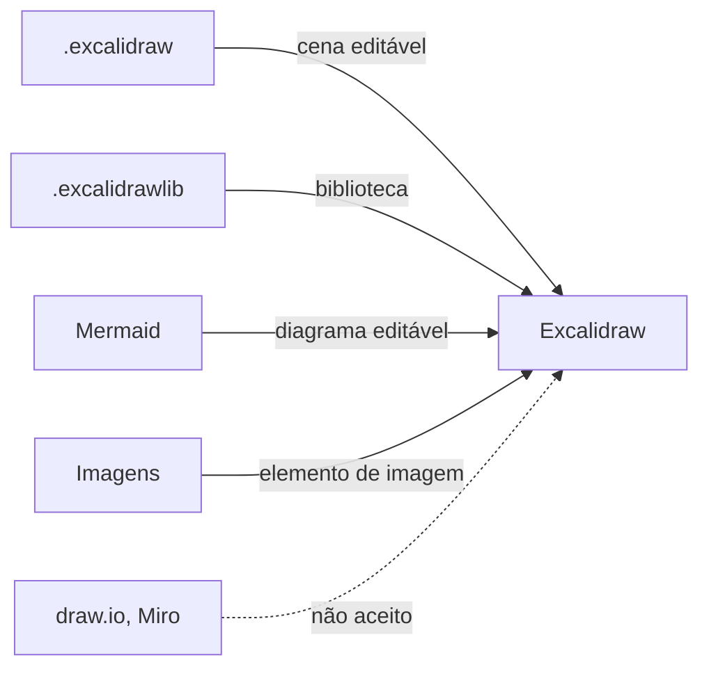
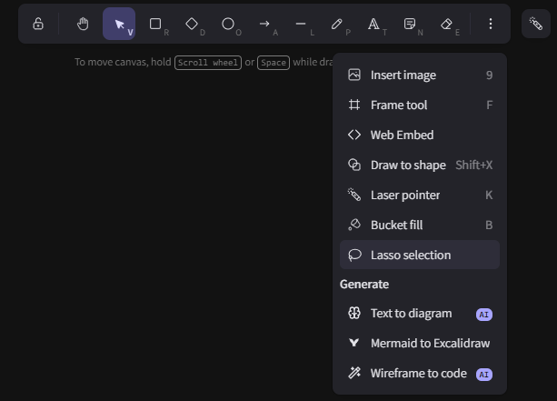

# F-M12 · Formatos de importação aceitos

**Nota 2**: o Excalidraw aceita os 4 formatos considerados na métrica
(`.excalidraw`, `.excalidrawlib`, Mermaid e imagens). Mas nenhum deles vem de
outra ferramenta de diagramação: um diagrama do draw.io ou do Miro só entra
como imagem, sem poder ser editado.



| Formato | Como entra |
| --- | --- |
| `.excalidraw` (JSON) | Cena editável |
| `.excalidrawlib` | Itens da biblioteca |
| Mermaid | Diagrama editável (fluxograma, sequência, classe, ER e estado) |
| Imagens (9 tipos) | Elemento de imagem; PNG e SVG com cena embutida abrem como cena |

## Evidências

=== "Menu"

    Inserir imagem e converter Mermaid ficam no menu de ferramentas.

    

=== "Abrir arquivo"

    Ao abrir um arquivo, só cena ou biblioteca são aceitas; o resto dá erro
    (`data/blob.ts:185-191`):

    ```ts
    } else if (isValidLibrary(data)) {
      return {
        type: MIME_TYPES.excalidrawlib,
        data,
      };
    }
    throw new Error("Error: invalid file");
    ```

=== "Imagens"

    Tipos aceitos na inserção de imagem (`common/src/constants.ts:299-309`):

    ```ts
    export const IMAGE_MIME_TYPES = {
      svg: "image/svg+xml",
      png: "image/png",
      jpg: "image/jpeg",
      gif: "image/gif",
      webp: "image/webp",
      bmp: "image/bmp",
      ico: "image/x-icon",
      avif: "image/avif",
      jfif: "image/jfif",
    } as const;
    ```

=== "Outras ferramentas"

    ```text
    git grep -n -I -i "drawio\|mxfile\|mxGraph\|miro\|\.vsdx\|lucid"  -> nenhuma ocorrência
    ```

Registro completo:
[`F-M12_formatos-importacao.md`](https://github.com/FCTE-Qualidade-de-Software-1/2026-2_T02_ADA_LOVELACE/blob/main/evidencias/flexibilidade/F-M12_formatos-importacao.md).
