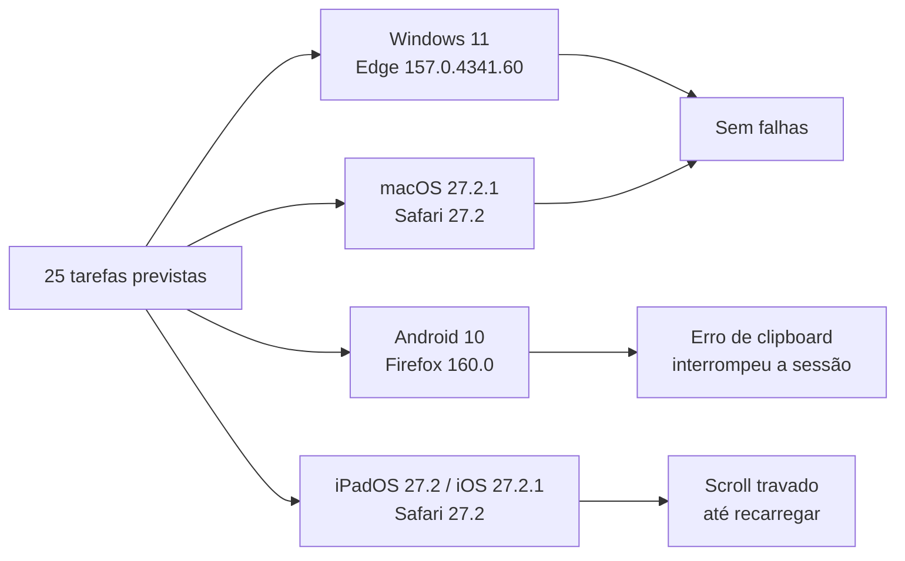
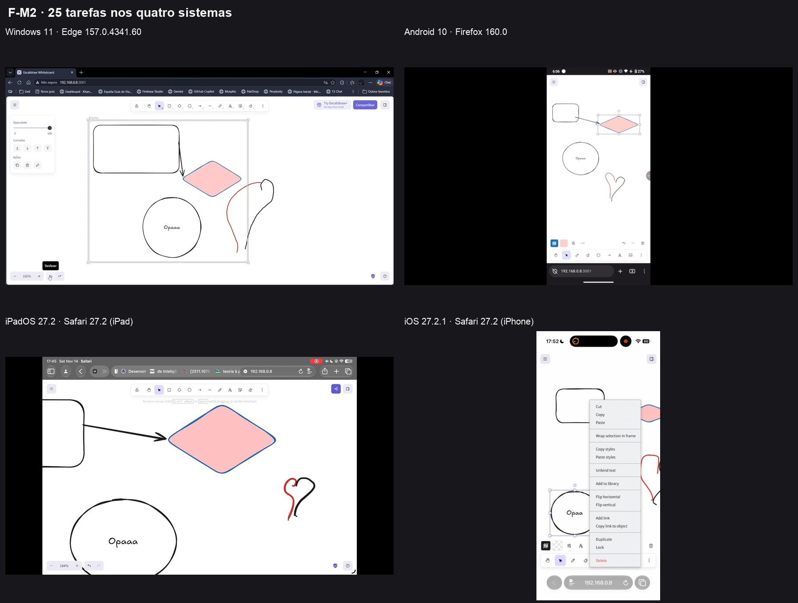
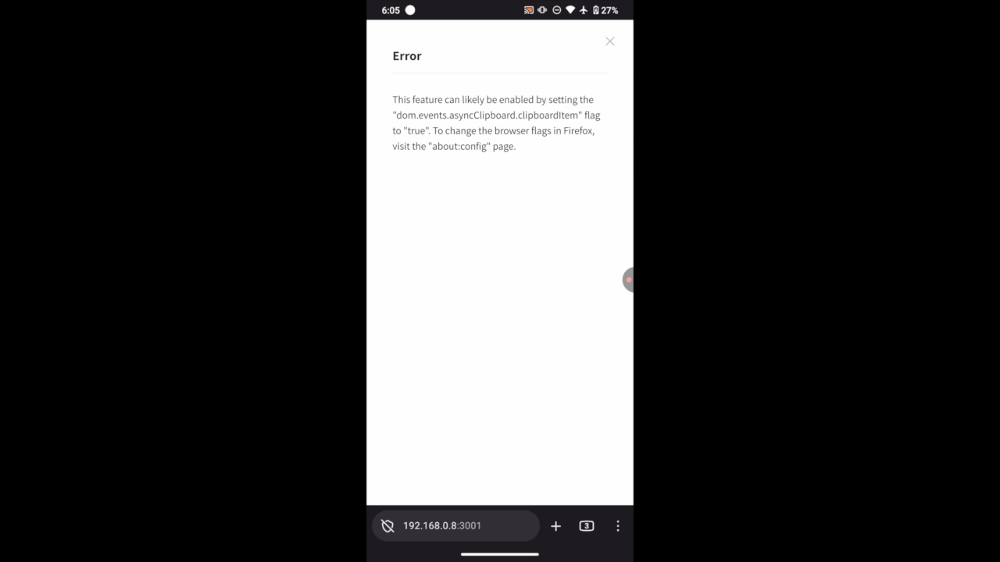

# F-M2 · Compatibilidade de sistemas operacionais

**Nota 0**: 2 dos 4 sistemas testados (50%) concluíram as tarefas disponíveis sem
falhas (24 de 25 no mobile, porque a trava de ferramenta não existe lá).
Windows 11 com Edge 157.0.4341.60 e macOS 27.2.1 passaram. No Android 10, o
Firefox 160.0 interrompeu a sessão com um erro de clipboard e parte da cena foi
refeita. No iPad com iPadOS 27.2, a tela não rolava e só voltou ao normal depois
de recarregar o site. O Linux não estava disponível.

| Sistema | Navegador | Tarefas (25 previstas) | Resultado |
| --- | --- | :-: | --- |
| Windows 11 | Microsoft Edge 157.0.4341.60 | 25 de 25 | Sem falhas |
| macOS 27.2.1 | Safari 27.2, Chromium (Helium 0.21.3.1), Firefox 160.0 e Edge 157.0.4341.60 | 25 de 25 | Sem falhas |
| Android 10 | Firefox 160.0 | 24 de 25 (1 não disponível) | **Com falha**: erro de clipboard e retrabalho |
| iPadOS 27.2 / iOS 27.2.1 | Safari 27.2 | 24 de 25 (1 não disponível) | **Com falha**: scroll travado no iPad |
| Linux | — | — | Não testado |

!!! warning "Todas as tarefas disponíveis passaram; a falha é de estabilidade"
    Os quatro sistemas concluíram as tarefas disponíveis. No Android 10, no
    iPadOS 27.2 e no iOS 27.2.1, a tarefa 25 (trava de ferramenta) não existe e
    foi registrada como não disponível; isso não é falha. O que derruba a nota é
    a interrupção que obrigou a recarregar e refazer parte do trabalho. O
    critério da métrica é “sistemas sem falhas”, não “tarefas concluídas”.

## Evidências

=== "Os quatro sistemas"

    O mesmo roteiro de 25 tarefas em Windows, Android, iPad e iPhone.

    

=== "Erro no Android"

    Em 1:20 do vídeo do Android, o Firefox exibe a mensagem sobre a flag
    `dom.events.asyncClipboard.clipboardItem`. A sessão foi interrompida e a
    adição que estava sendo feita no Excalidraw foi refeita.

    

Registro completo:
[`F-M2_compatibilidade-sistemas_2026-11-14.md`](https://github.com/FCTE-Qualidade-de-Software-1/2026-2_T02_ADA_LOVELACE/blob/main/evidencias/flexibilidade/F-M2/F-M2_compatibilidade-sistemas_2026-11-14.md).
