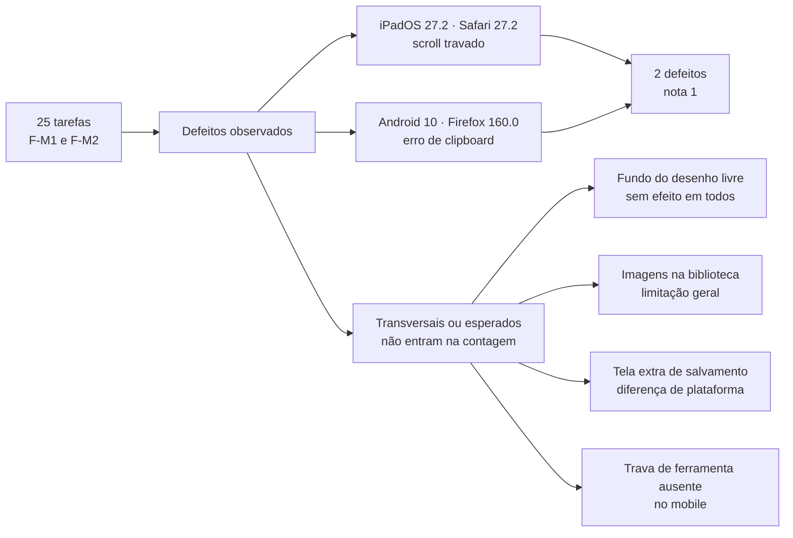
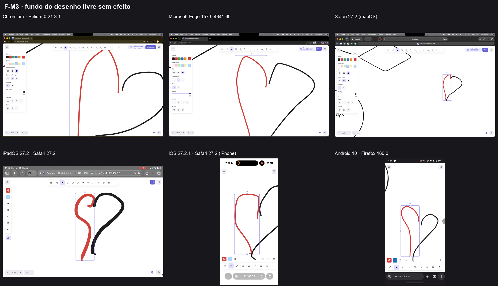
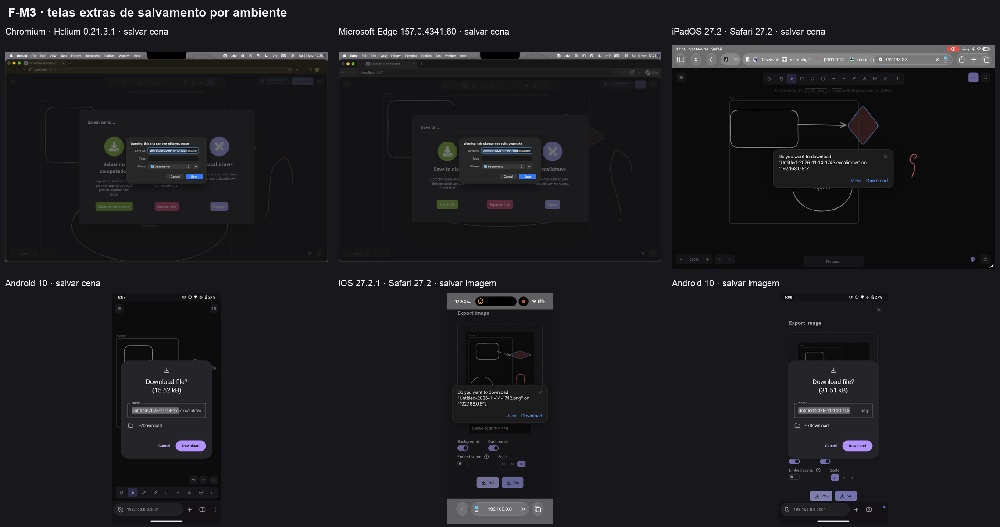
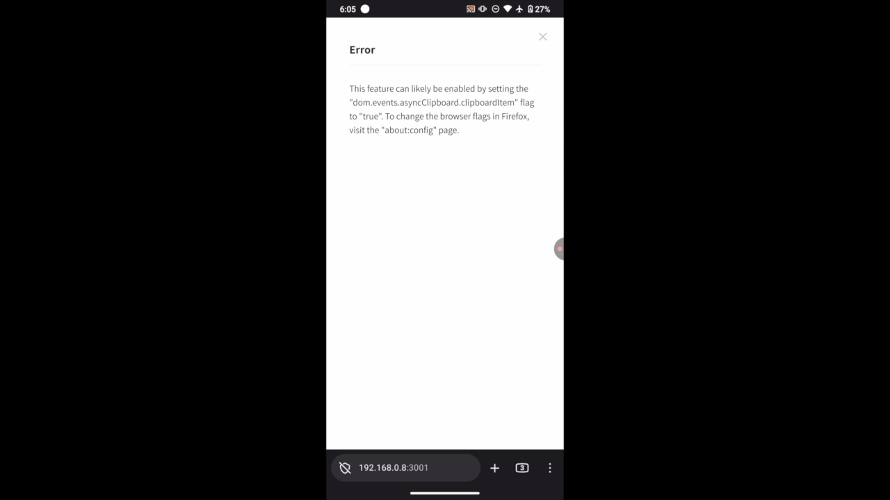

# F-M3 · Defeitos específicos de ambiente

**Nota 1**: foram encontrados 2 defeitos que aparecem em um ambiente e não nos
outros: o scroll travado no iPad com Safari e o erro de clipboard no Android 10
com Firefox 160.0. Pela regra da métrica, de 1 a 3 defeitos específicos valem
nota 1.

| Defeito | Ambiente | Categoria | Entra na contagem? |
| --- | --- | --- | :-: |
| Scroll travado até recarregar o site | iPadOS 27.2 · Safari 27.2 | Renderização / interação | **Sim** |
| Erro de clipboard e interrupção da sessão | Android 10 · Firefox 160.0 | Atalho / clipboard | **Sim** |
| Fundo do desenho livre sem efeito | Todos os ambientes | Renderização / UI | Não: é transversal |
| Imagens não podem ir para a biblioteca | Todos os ambientes | Biblioteca | Não: é limitação geral |
| Tela extra antes do download | Desktop e mobile | Fluxo de salvamento | Não: é diferença de plataforma |
| Trava de ferramenta ausente | Android 10, iPadOS 27.2 e iOS 27.2.1 | Funcionalidade / UI | Não: é ausência de função no mobile |

!!! note "O que não é defeito"
    A tela extra de salvamento mostra apenas o caminho que cada plataforma
    oferece para entregar o arquivo ao sistema. O “background bug” aparece em
    todos os ambientes, então também não é específico de ambiente. A ausência da
    trava de ferramenta no mobile é diferença de funcionalidade, não de
    renderização, fonte ou atalho. Os três casos estão documentados abaixo para
    não se perderem, mas ficam fora da contagem.

## Evidências

=== "Fundo do desenho livre"

    O controle de fundo aparece para desenho livre, mas o preenchimento só é
    gerado quando o traço forma um laço fechado. Em traços abertos, a cor
    escolhida não tem efeito. Como acontece em todos os ambientes, não entra na
    contagem da F-M3.

    

=== "Telas de salvamento"

    Cada plataforma mostra uma tela extra diferente antes de entregar o arquivo.
    É o comportamento esperado do sistema operacional, não uma falha do
    Excalidraw.

    

=== "Erro no Android"

    Em 1:20 do vídeo do Android 10, o Firefox 160.0 exibe a mensagem sobre a flag
    `dom.events.asyncClipboard.clipboardItem`. A sessão foi interrompida e parte
    da cena foi refeita.

    

Registro completo:
[`F-M3_defeitos-ambiente_2026-11-14.md`](https://github.com/FCTE-Qualidade-de-Software-1/2026-2_T02_ADA_LOVELACE/blob/main/evidencias/flexibilidade/F-M3/F-M3_defeitos-ambiente_2026-11-14.md).
