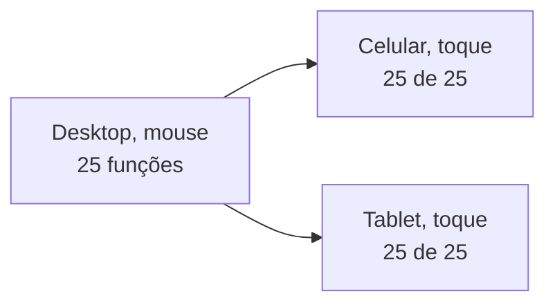
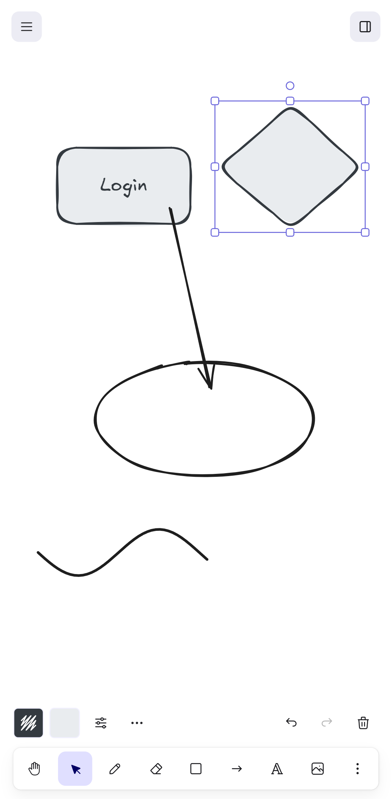
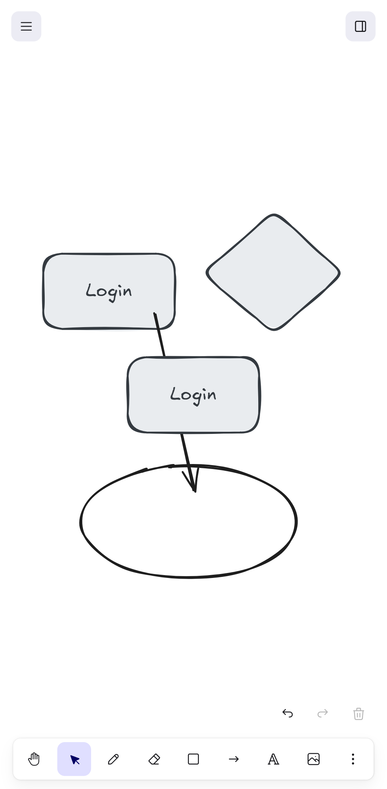

# F-M4 · Cobertura funcional em dispositivos móveis

**Nota 2**: as 25 funções feitas com mouse no desktop também foram feitas só com
toque, no celular (Pixel 7 emulado) e no tablet (iPad emulado), 100% nos dois.

| Modo | Entrada | Funções | Resultado |
| --- | --- | --- | --- |
| Desktop (1366 × 768) | mouse | 25 de 25 | controle (denominador) |
| Celular (412 × 839) | toque | 25 de 25 | **100%** |
| Tablet (810 × 1080) | toque | 25 de 25 | **100%** |

No celular, o zoom e a trava de ferramenta não têm botão (ver a
[F-M6](f-m6.md)), mas funcionam pela pinça e pelo menu de preferências.
Contando só o mesmo botão do desktop, o celular ficaria com 23 de 25 (92%),
ainda nota 2.

!!! note "Recorte"
    A lista não inclui as funções que dependem de servidor nem atalhos e
    modificadores de teclado (Shift+clique, Alt+arrastar). A coleta foi por
    emulação no Chrome, não em aparelhos reais.

## Evidências

=== "Toque longo"

    O toque longo abre o menu de contexto, que no desktop é o botão direito: o
    estilo do retângulo foi copiado para o losango.

    { width="300" }

=== "Biblioteca"

    Elemento salvo na biblioteca e inserido de novo, só com toque.

    { width="300" }

Registro completo:
[`F-M4_cobertura-mobile.md`](https://github.com/FCTE-Qualidade-de-Software-1/2026-2_T02_ADA_LOVELACE/blob/main/evidencias/flexibilidade/F-M4_cobertura-mobile.md).
