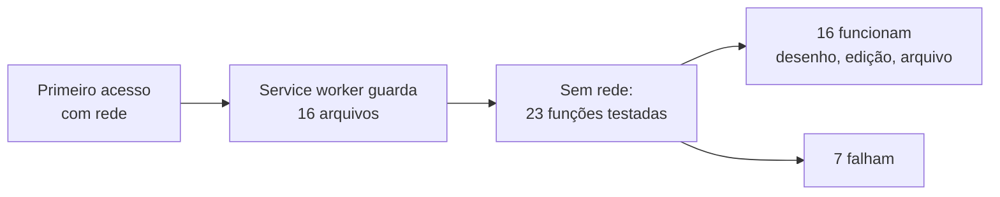
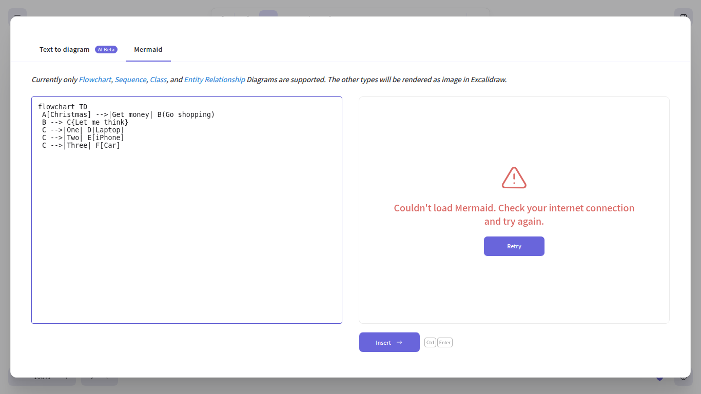
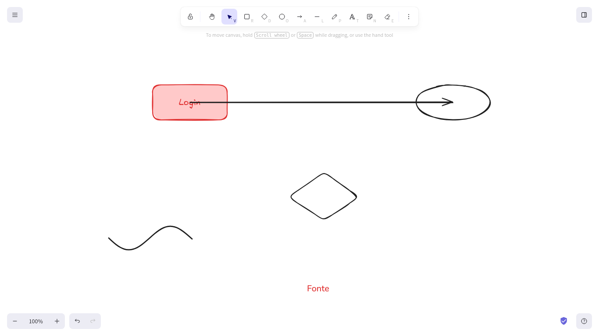

# F-M5 · Cobertura funcional offline

**Nota 1**: sem rede, 16 de 23 funções funcionaram (69,6%). O editor funciona
inteiro offline; falham as funções que dependem de servidor e três que dependem
de arquivos não guardados no primeiro acesso.

| Grupo | Sem rede | O que falhou |
| --- | :---: | --- |
| Desenho e edição (formas, seta, texto, desenho livre, cores, desfazer, agrupar) | 7 de 7 | — |
| Arquivo e imagem (salvar, abrir, PNG, SVG, inserir imagem, biblioteca) | 5 de 6 | SVG sai sem a fonte embutida |
| Interface (recarregar, cena preservada, tema, idioma, fonte) | 4 de 5 | Troca para português não acontece |
| Mermaid | 0 de 1 | "Couldn't load Mermaid" |
| Dependem de servidor (colaboração, link, IA, bibliotecas públicas) | 0 de 4 | Botão de compartilhar some; IA e site não carregam |

Com rede, as 21 funções testadas passaram. Só com as 19 que não dependem de
servidor, o valor seria 84,2% (nota 2).

!!! note "Primeiro acesso"
    O teste abriu o app uma vez com rede, como um visitante novo. Idioma,
    Mermaid e o código que embute a fonte no SVG só ficam guardados se forem
    usados uma vez com rede.

## Evidências

=== "Mermaid"

    O diálogo do Mermaid não carrega sem rede.

    

=== "Compartilhar"

    Sem rede, o botão de compartilhar some (`excalidraw-app/App.tsx:824-826`),
    e com ele a colaboração e o link compartilhável.

    

Registro completo:
[`F-M5_cobertura-offline.md`](https://github.com/FCTE-Qualidade-de-Software-1/2026-2_T02_ADA_LOVELACE/blob/main/evidencias/flexibilidade/F-M5_cobertura-offline.md).
