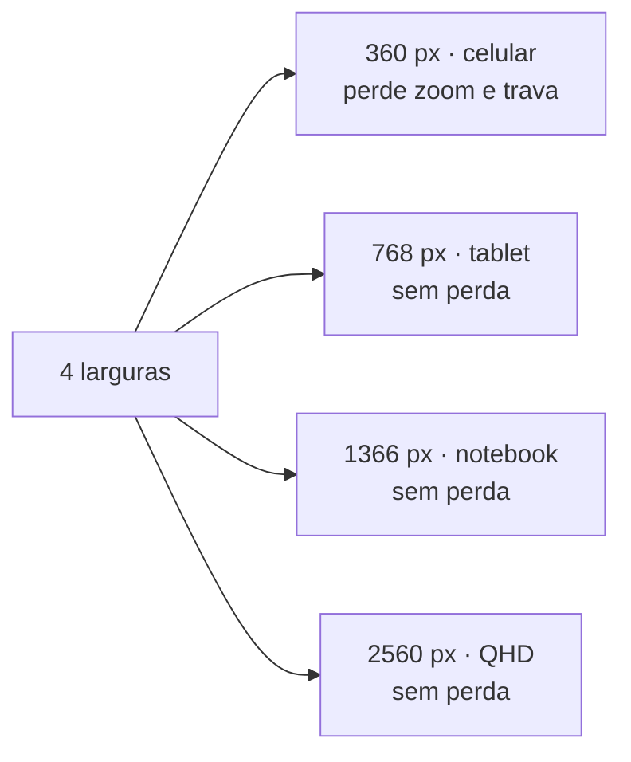
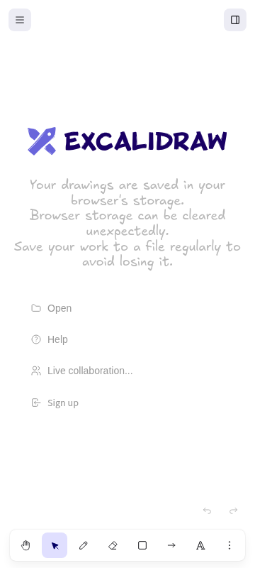
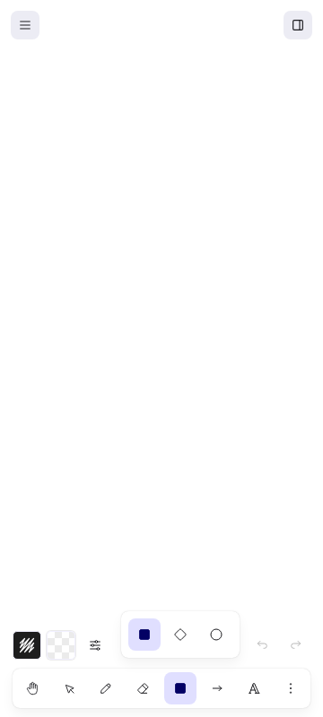
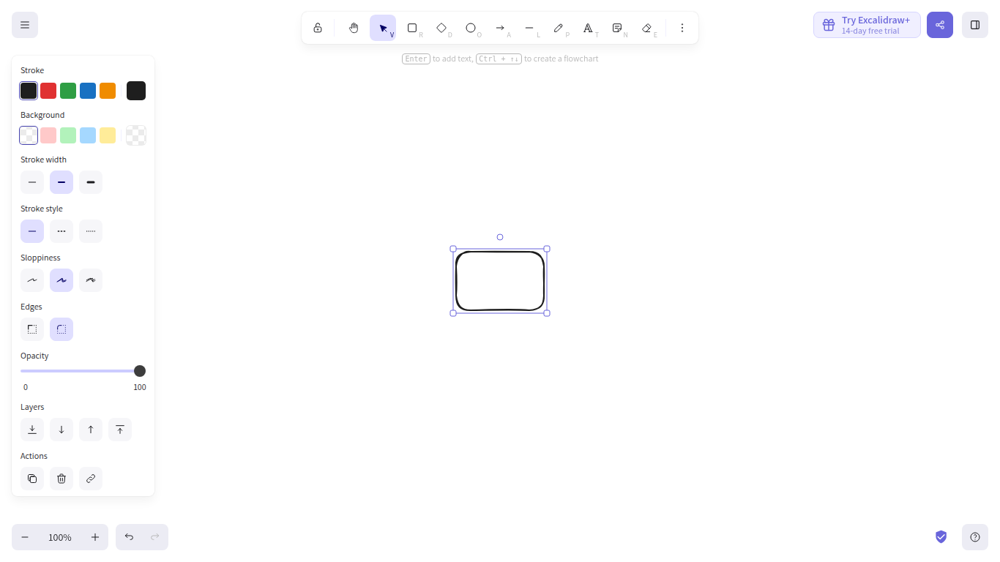

# F-M6 · Resoluções sem perda de elementos

**Nota 1**: 3 de 4 larguras sem perda. Nenhum controle fica cortado, mas em
360 px o layout de celular tira os botões de zoom e de trava de ferramenta.
Nenhuma largura apresentou rolagem horizontal.

| Janela (px) | Layout | Sem perda? | Controles ausentes | Função continua? |
| --- | --- | :---: | --- | --- |
| 360 × 800 | celular | **Não** | zoom, trava de ferramenta, selo de criptografia | Sim: zoom por Ctrl + =, trava pela tecla Q |
| 768 × 1024 | tablet | Sim | — | — |
| 1366 × 768 | desktop | Sim | — | — |
| 2560 × 1440 | desktop | Sim | — | — |

!!! note "Perda de controle, não de função"
    A métrica conta elementos da interface, por isso 360 px fica como Não.
    Contando só funções, seriam 4 de 4 (nota 2). O selo de criptografia é
    um link informativo. A medição usou só o Chrome, em inglês, com a janela
    redimensionada, sem emular toque.

## Evidências

=== "360 px"

    No celular, a barra vai para baixo e não há botões de zoom.

    { width="300" }

=== "Menus agrupados"

    Losango e elipse passam para o menu do botão do retângulo.

    { width="300" }

=== "1366 px"

    No desktop, zoom, desfazer e painel de estilo ficam à vista.

    

Registro completo:
[`F-M6_resolucoes.md`](https://github.com/FCTE-Qualidade-de-Software-1/2026-2_T02_ADA_LOVELACE/blob/main/evidencias/flexibilidade/F-M6_resolucoes.md).

Arquivos de apoio: [arquivos de apoio](https://github.com/FCTE-Qualidade-de-Software-1/2026-2_T02_ADA_LOVELACE/tree/main/evidencias/flexibilidade/F-M6).
