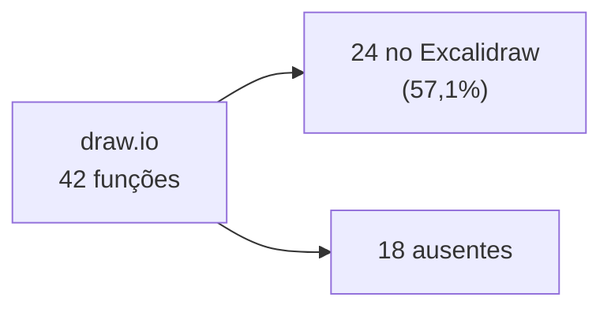

# F-M7 · Inclusão funcional

**Nota 0**: o Excalidraw tem 24 das 42 funções do draw.io (57,1%). Cobre as
funções básicas de diagramação, mas não as avançadas.

| Presentes no Excalidraw | Ausentes |
| --- | --- |
| Conectar formas, rótulos, estilos de forma, seta e texto, exportação, biblioteca, Mermaid, colaboração em tempo real, modo escuro, links, desenho livre | Tabelas, swimlanes, camadas, layout automático, modelos, metadados e tags, fórmulas, importação de CSV, SQL e de arquivos de outras ferramentas, entre outras |

!!! note "Leituras alternativas"
    Quatro itens admitem outra classificação (busca de formas, temas do
    editor, propriedades da forma e formas personalizadas). O resultado varia
    de 52,4% a 61,9%, sempre abaixo de 70%: a nota continua 0.

Achado: para quem migra do draw.io, priorizar tabelas, swimlanes e importação
de arquivos `.drawio`.

Registro completo:
[`F-M7_inclusao-funcional.md`](https://github.com/FCTE-Qualidade-de-Software-1/2026-2_T02_ADA_LOVELACE/blob/main/evidencias/flexibilidade/F-M7_inclusao-funcional.md).
