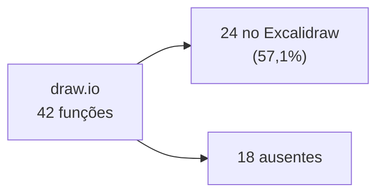

# F-M7 · Inclusão funcional

**Nota 0**: das 42 funções da página oficial de funções do draw.io (seções de
uso do editor), 24 existem no Excalidraw (57,1%). O Excalidraw cobre as funções
básicas de diagramação, como formas, conectores, texto, estilos e exportação,
mas não tem as avançadas do draw.io.

| Presentes (24) | Ausentes (18) |
| --- | --- |
| Colaboração, conectores e pontos de passagem, rótulos, estilos de forma, seta, preenchimento e texto, busca na biblioteca (limitada), IA, atalhos, quadro online, painéis, idioma, importar e exportar, modo escuro, cores adaptativas, grade, links, desenho livre, formas e bibliotecas personalizadas, Mermaid | Tabelas, swimlanes, modelos, temas do editor, formatos de outras ferramentas, layout automático, camadas, tags, propriedades e metadados de forma, placeholders, traduções, tooltips, texto HTML, fórmulas, CSV, SQL, paletas e configuração |

!!! note "Itens ambíguos"
    Quatro itens admitem outra leitura (busca de formas, temas do editor,
    propriedades de forma e formas personalizadas). Com a leitura menos e a mais
    favorável, o resultado vai de 52,4% a 61,9%, sempre abaixo de 70%, e a nota
    não muda. A medição verifica se a função existe no código e na interface,
    não a qualidade nem a facilidade de uso.

Achado: para quem migra do draw.io, priorizar tabelas, swimlanes e importação
de arquivos `.drawio`.

Registro completo:
[`F-M7_inclusao-funcional.md`](https://github.com/FCTE-Qualidade-de-Software-1/2026-2_T02_ADA_LOVELACE/blob/main/evidencias/flexibilidade/F-M7_inclusao-funcional.md).
