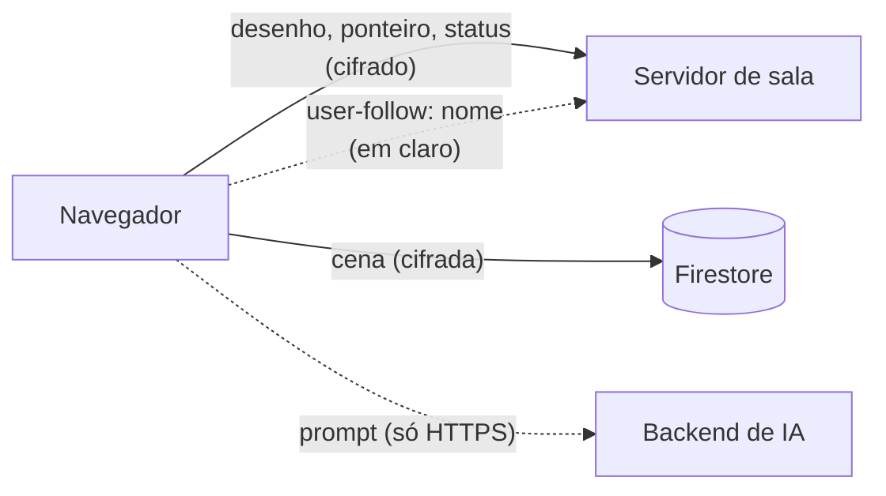
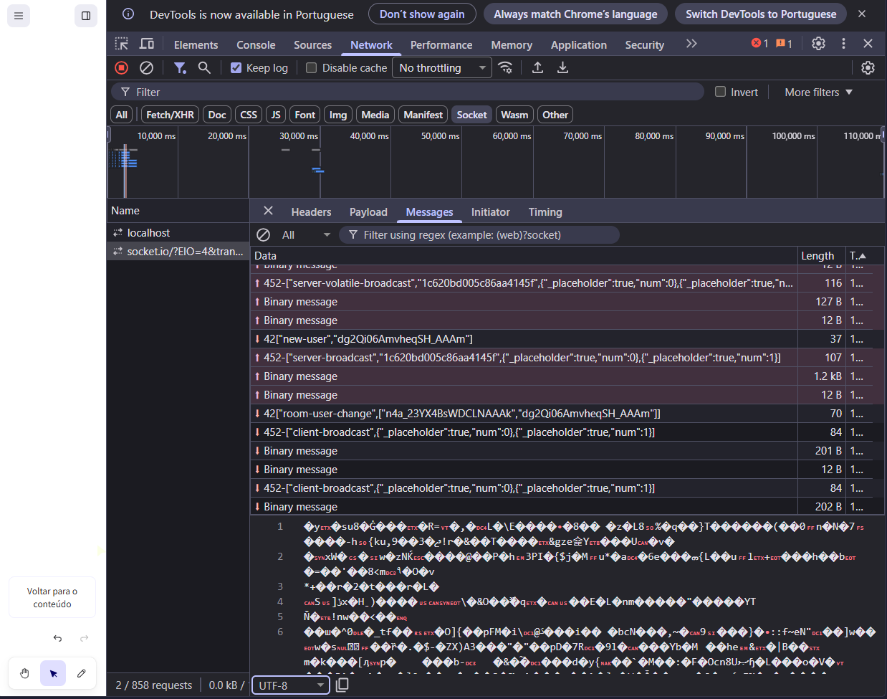
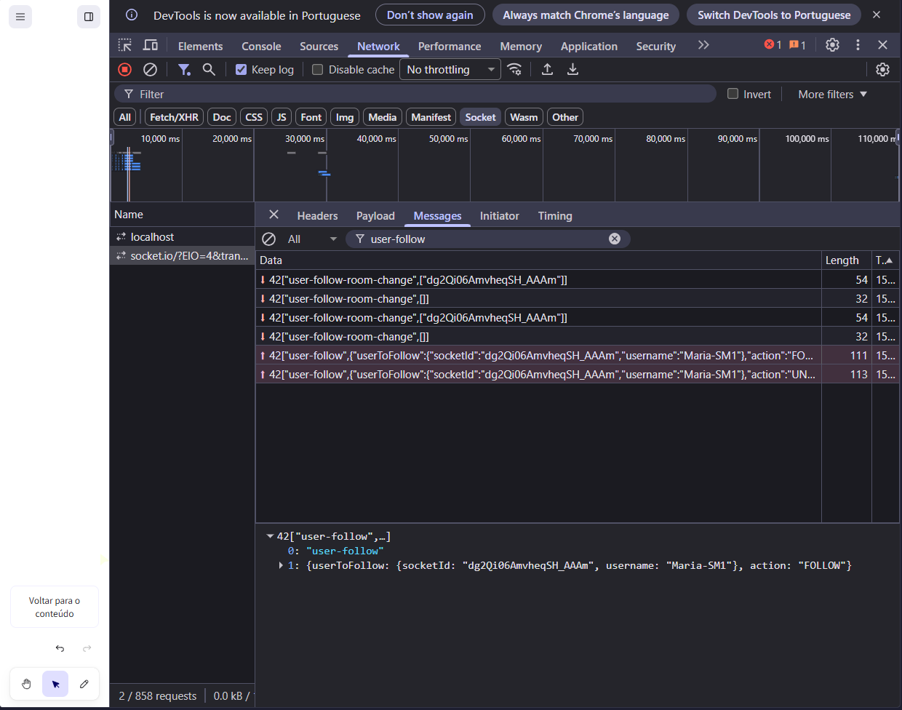
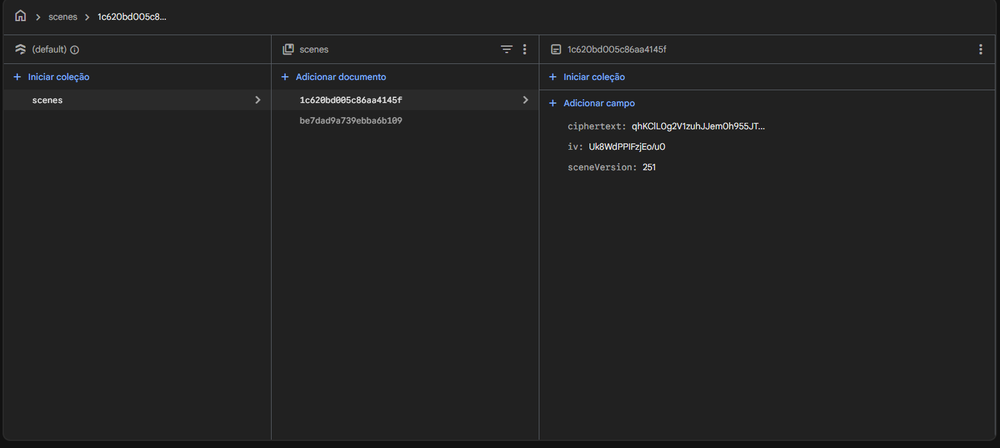
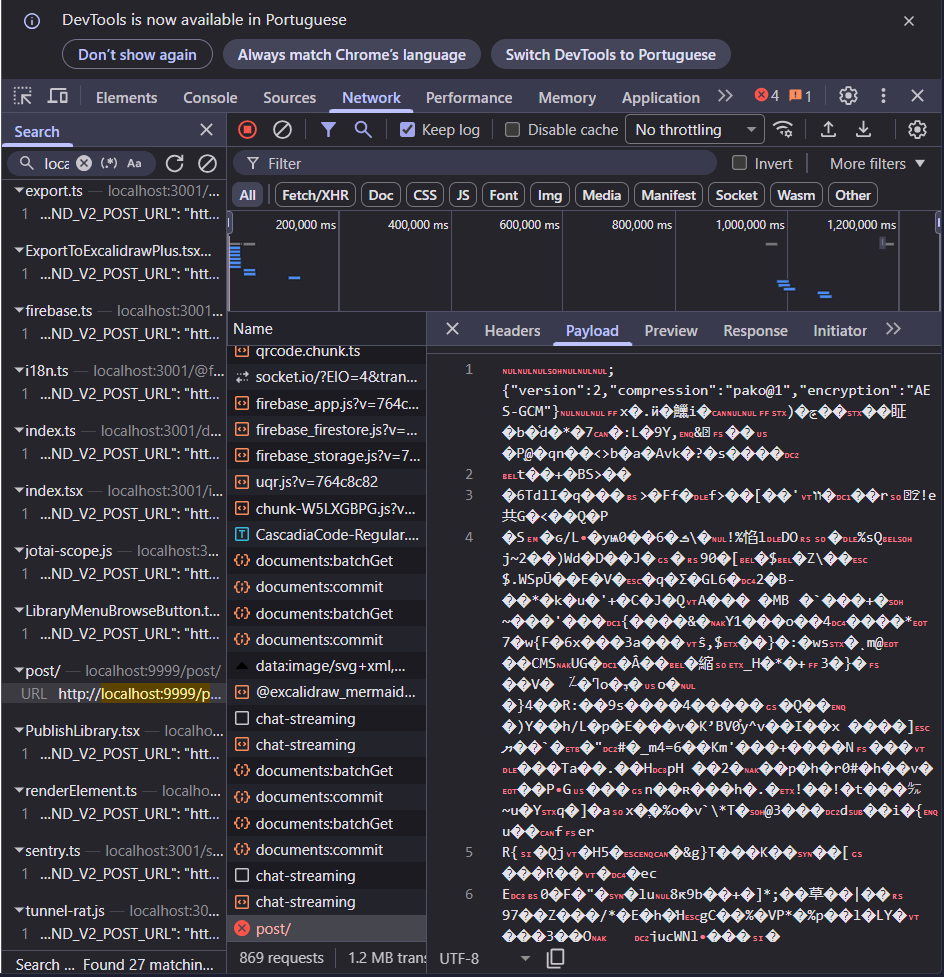
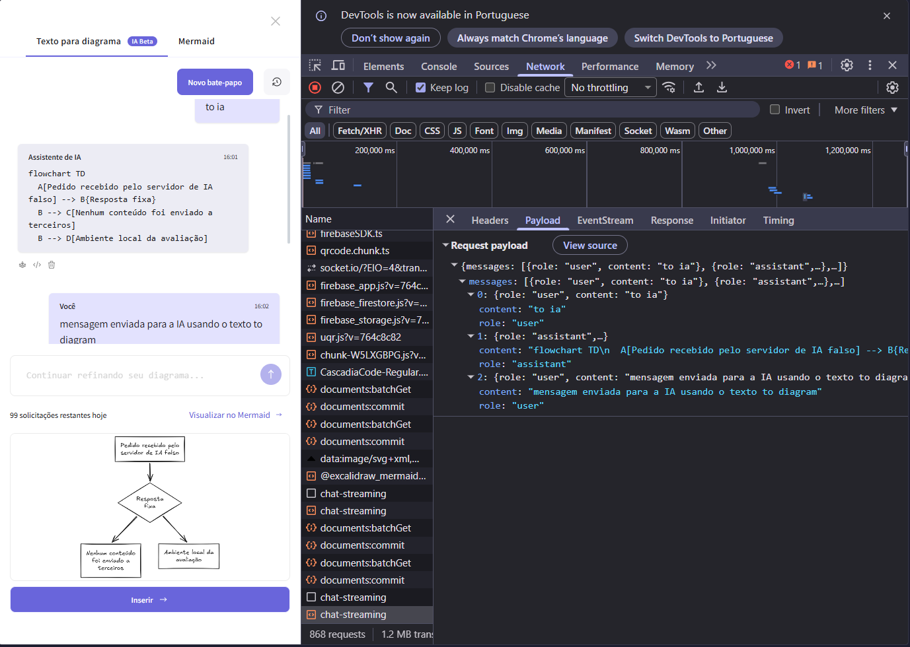

# S-M1 · Mensagens de colaboração cifradas

**Nota 0**: 5 de 6 tipos de evento com dado do usuário saem cifrados (83,3%).
O desenho, o ponteiro e o status vão cifrados com AES-GCM, mas o `user-follow`
envia o nome do participante em claro ao servidor de sala.

| Evento | Cifrado? |
| --- | :---: |
| `SCENE_INIT`, `SCENE_UPDATE`, `MOUSE_LOCATION`, `IDLE_STATUS`, `USER_VISIBLE_SCENE_BOUNDS` | Sim |
| `user-follow` (`Portal.tsx:250-254`) | **Não** |

Contando por quantidade, foram 2.360 de 2.373 eventos na captura (99,5%). Esse
número é só observação: a nota usa a contagem por tipo de evento. O envio à IA
fica fora da proporção e é registrado como achado à parte.

## Evidências

=== "Desenho cifrado"

    Frame `server-broadcast` de 1,2 kB: o conteúdo é ilegível.

    

=== "Nome em claro"

    Frame `user-follow` com `"username":"Maria-SM1"` legível.

    

=== "Firestore"

    O documento da sala guarda só `ciphertext`, `iv` e `sceneVersion`.

    

=== "Link #json"

    Só o cabeçalho de formato vai em claro; o resto é binário.

    

=== "IA"

    O chat vai em JSON legível, protegido só pelo HTTPS.

    

Registro completo, com HAR e buscas no código:
[`evidencias/seguranca/S-M1`](https://github.com/FCTE-Qualidade-de-Software-1/2026-2_T02_ADA_LOVELACE/tree/main/evidencias/seguranca/S-M1).
