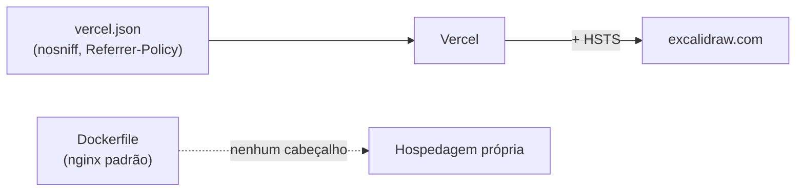
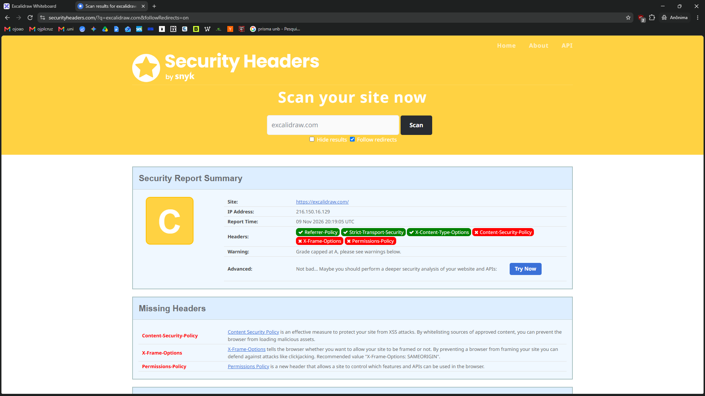
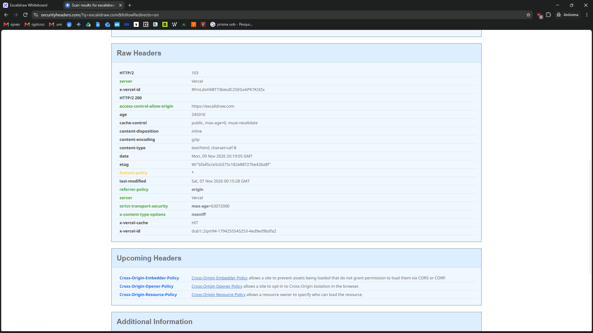

# S-M13 · Cabeçalhos de segurança HTTP

**Nota 1**: o securityheaders.com dá nota **C** ao `excalidraw.com`. A resposta
traz 3 dos 6 cabeçalhos avaliados; faltam CSP, X-Frame-Options e
Permissions-Policy.



| Cabeçalho | Na resposta? |
| --- | :---: |
| Strict-Transport-Security | Sim (vem da Vercel) |
| X-Content-Type-Options | Sim |
| Referrer-Policy | Sim |
| Content-Security-Policy | **Não** |
| X-Frame-Options | **Não** |
| Permissions-Policy | **Não** (só `Feature-Policy: *`, obsoleto) |

## Evidências

=== "Nota C"

    Relatório de 2026-11-09 20:19:05 UTC.

    

=== "Cabeçalhos brutos"

    

=== "curl"

    Requisição `HEAD` de 2026-11-04 13:19:46 UTC:

    ```text
    $ curl -sI https://excalidraw.com
    HTTP/1.1 200 OK
    Access-Control-Allow-Origin: https://excalidraw.com
    Feature-Policy: *
    Referrer-Policy: origin
    Server: Vercel
    Strict-Transport-Security: max-age=63072000
    X-Content-Type-Options: nosniff
    X-Vercel-Cache: HIT
    ```

No repositório, as buscas por `Content-Security-Policy`, `X-Frame-Options`,
`frame-ancestors`, `Permissions-Policy`, `http-equiv` e `add_header` não têm
nenhuma ocorrência.

Registro completo:
[`evidencias/seguranca/S-M13`](https://github.com/FCTE-Qualidade-de-Software-1/2026-2_T02_ADA_LOVELACE/tree/main/evidencias/seguranca/S-M13).

## Contexto da consolidação

| Item | Registro |
| --- | --- |
| Objetivo e questão GQM | O2 · S-Q6 ([roteiro](../../analise/roteiro.md)) |
| Versão de referência | Excalidraw [`e7b534668a60add7f725531f3c9abf32508c7b4e`](https://github.com/excalidraw/excalidraw/commit/e7b534668a60add7f725531f3c9abf32508c7b4e); ressalvas de correspondência abaixo |
| Valor medido | 3 de 6 cabeçalhos (nota C) |
| Pontuação | **1/2** |
| Origem | [PR #51](https://github.com/FCTE-Qualidade-de-Software-1/2026-2_T02_ADA_LOVELACE/pull/51), integrado na main |

**Procedimento resumido:** Inspeção da configuração versionada, resposta HEAD de 04/11 e relatório securityheaders.com de 09/11/2026.

**Resultado e justificativa:** A nota C do serviço corresponde a 1; faltam CSP, X-Frame-Options e Permissions-Policy.

**Limitações:** Resposta pública e configuração de hospedagem não comprovam que o deploy era o SHA oficial. HEAD único, servido de cache; não generalizar à hospedagem própria. Revisão cruzada não preenchida.

**Evidência original:** [S-M13_cabecalhos-http.md](https://github.com/FCTE-Qualidade-de-Software-1/2026-2_T02_ADA_LOVELACE/blob/c9ac9610b92474af82cc9ad3e67dc53bfa3490d4/evidencias/seguranca/S-M13/S-M13_cabecalhos-http.md), com dados, procedimento completo e arquivos de apoio. Esta página consolida a coleta existente; não registra nova medição ou aprovação humana.
