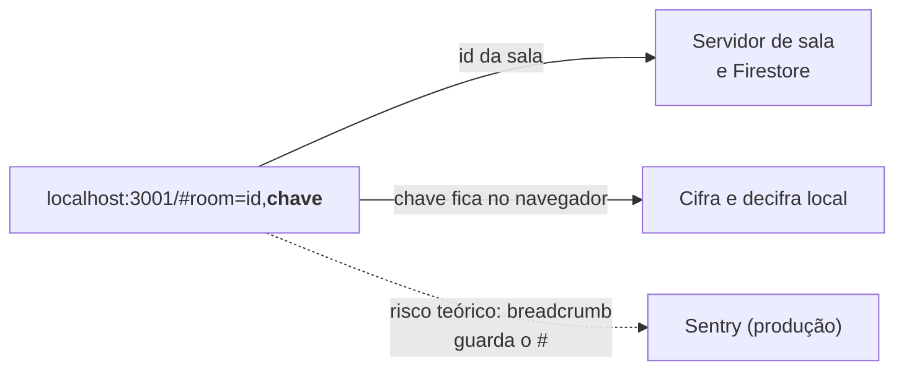

# S-M2 · Chave enviada ao servidor

**Nota 2**: a chave da sala, que fica no fragmento `#` do link, não aparece em
nenhuma requisição nem em nenhum frame do socket. O navegador não envia o `#`,
e nenhum trecho do código o repassa.



## Evidências

Busca pela chave `4PEvIf6AAXyLIDijom8zMw` no HAR completo da sessão da
[S-M1](s-m1.md):

```text
grep -c '4PEvIf6AAXyLIDijom8zMw' localhost.har  -> 0
frames binários decodificados: 4720 | chave em binário/postData/cabeçalhos: 0
Referer distintos: [ 'http://localhost:3001/' ]
```

As 21 leituras de `location.hash` e `location.href` no código são todas de uso
local. Para abrir um link `#json`, o app manda ao backend só o ID
(`data/index.ts:207`).

!!! warning "Risco teórico: Sentry"
    Em produção, o breadcrumb de navegação do Sentry 9.0.1 guarda o caminho com o `#`
    (`@sentry/core` `url.js:28`), e o `beforeSend` só limpa `request.url`
    (`sentry.ts:39-42`). Como o Sentry fica desligado em localhost, isso não foi
    confirmado em execução.

Registro completo:
[`evidencias/seguranca/S-M2`](https://github.com/FCTE-Qualidade-de-Software-1/2026-2_T02_ADA_LOVELACE/tree/main/evidencias/seguranca/S-M2).
