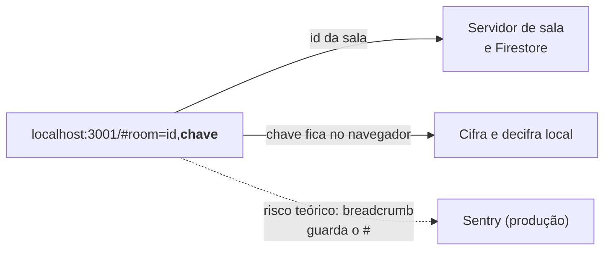

# S-M2 · Chave enviada ao servidor

**Nota 2**: a chave da sala, que fica no fragmento `#` do link, não aparece em
nenhuma requisição nem em nenhum frame do socket. O navegador não envia o `#`,
e nenhum trecho do código o repassa.



## Evidências

O **HAR** (*HTTP Archive*) é o arquivo que o DevTools do navegador exporta com
tudo o que passou pela aba Network durante a sessão: URLs, cabeçalhos, corpos
das requisições e frames do WebSocket. Se a chave saísse do navegador, ela
estaria nesse arquivo.

Busca pela chave `4PEvIf6AAXyLIDijom8zMw` no HAR completo da sessão da
[S-M1](s-m1.md):

```text
grep -c '4PEvIf6AAXyLIDijom8zMw' localhost.har  -> 0
frames binários decodificados: 4720 | chave em binário/postData/cabeçalhos: 0
Referer distintos: [ 'http://localhost:3001/' ]
```

As 21 leituras de `location.hash` e `location.href` no código são todas de uso
local. Para abrir um link `#json`, o app manda ao backend só o ID
(`data/index.ts:207`).

!!! warning "Risco teórico: Sentry"
    Em produção, o breadcrumb de navegação do Sentry 9.0.1 guarda o caminho com o `#`
    (`@sentry/core` `url.js:28`), e o `beforeSend` só limpa `request.url`
    (`sentry.ts:39-42`). Como o Sentry fica desligado em localhost, isso não foi
    confirmado em execução.

Registro completo:
[`evidencias/seguranca/S-M2`](https://github.com/FCTE-Qualidade-de-Software-1/2026-2_T02_ADA_LOVELACE/tree/main/evidencias/seguranca/S-M2).

## Contexto da consolidação

| Item | Registro |
| --- | --- |
| Objetivo e questão GQM | O1 · S-Q1 ([roteiro](../../analise/roteiro.md)) |
| Versão de referência | Excalidraw [`e7b534668a60add7f725531f3c9abf32508c7b4e`](https://github.com/excalidraw/excalidraw/commit/e7b534668a60add7f725531f3c9abf32508c7b4e); ressalvas de correspondência abaixo |
| Valor medido | Não (0 ocorrências) |
| Pontuação | **2/2** |
| Origem | [PR #81](https://github.com/FCTE-Qualidade-de-Software-1/2026-2_T02_ADA_LOVELACE/pull/81), integrado na main |

**Procedimento resumido:** Busca da chave na captura da S-M1 e leitura dos fluxos de URL, rede e Sentry.

**Resultado e justificativa:** Nenhuma ocorrência da chave nas requisições e frames capturados. A resposta Não recebe 2.

**Limitações:** Sentry desligado em localhost: possível inclusão do fragmento em breadcrumb é risco teórico, sem confirmação em produção. Revisão cruzada não preenchida.

**Evidência original:** [S-M2_chave-enviada-servidor.md](https://github.com/FCTE-Qualidade-de-Software-1/2026-2_T02_ADA_LOVELACE/blob/c9ac9610b92474af82cc9ad3e67dc53bfa3490d4/evidencias/seguranca/S-M2/S-M2_chave-enviada-servidor.md), com dados, procedimento completo e arquivos de apoio. Esta página consolida a coleta existente; não registra nova medição ou aprovação humana.
