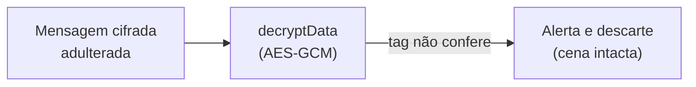

# S-M5 · Taxa de detecção de adulteração

**Nota 2**: as 221 mensagens de colaboração adulteradas foram rejeitadas: 200
num teste automatizado e 21 enviadas pelo socket entre duas janelas na
instância local. Cada uma gerou um erro na decifragem AES-GCM e foi descartada
sem alterar a cena. Ponto de atenção: cada mensagem inválida abre um alerta
que bloqueia a tela.

Registro completo:
[`evidencias/seguranca/S-M5`](https://github.com/FCTE-Qualidade-de-Software-1/2026-2_T02_ADA_LOVELACE/tree/main/evidencias/seguranca/S-M5).
