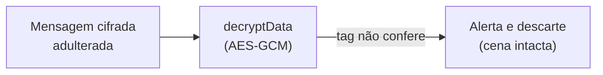

# S-M5 · Taxa de detecção de adulteração

**Nota 2**: as 221 mensagens de colaboração adulteradas foram rejeitadas: 200
num teste automatizado e 21 enviadas pelo socket entre duas janelas na
instância local. Cada uma gerou um erro na decifragem AES-GCM e foi descartada
sem alterar a cena. Ponto de atenção: cada mensagem inválida abre um alerta
que bloqueia a tela.

Registro completo:
[`evidencias/seguranca/S-M5`](https://github.com/FCTE-Qualidade-de-Software-1/2026-2_T02_ADA_LOVELACE/tree/main/evidencias/seguranca/S-M5).

## Contexto da consolidação

| Item | Registro |
| --- | --- |
| Objetivo e questão GQM | O1 · S-Q3 ([roteiro](../../analise/roteiro.md)) |
| Versão de referência | Excalidraw [`e7b534668a60add7f725531f3c9abf32508c7b4e`](https://github.com/excalidraw/excalidraw/commit/e7b534668a60add7f725531f3c9abf32508c7b4e); ressalvas de correspondência abaixo |
| Valor medido | 221 de 221 rejeitadas (100%) |
| Pontuação | **2/2** |
| Origem | [PR #102](https://github.com/FCTE-Qualidade-de-Software-1/2026-2_T02_ADA_LOVELACE/pull/102), integrado na main |

**Procedimento resumido:** 200 adulterações em teste automatizado e 21 pelo socket entre duas janelas locais.

**Resultado e justificativa:** As 221 adulterações foram rejeitadas sem mudar a cena; 100% corresponde a 2.

**Limitações:** Replay de mensagem válida não integra a taxa; foi aceito pela cifra e descartado pela reconciliação no caso testado. Alertas bloqueantes afetam interação. Revisão cruzada não preenchida.

**Evidência original:** [S-M5_deteccao-adulteracao.md](https://github.com/FCTE-Qualidade-de-Software-1/2026-2_T02_ADA_LOVELACE/blob/c9ac9610b92474af82cc9ad3e67dc53bfa3490d4/evidencias/seguranca/S-M5/S-M5_deteccao-adulteracao.md), com dados, procedimento completo e arquivos de apoio. Esta página consolida a coleta existente; não registra nova medição ou aprovação humana.
