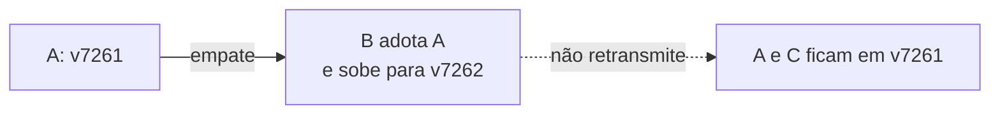

# S-M6 · Inconsistências após edições simultâneas

**Nota 1**: em 2 de 8 rodadas com três participantes editando o mesmo elemento,
eles terminaram com versões diferentes. Numa delas, a diferença persistiu
2 min sem novas edições. Quem perde o desempate sobe a versão sozinho
(`bumpElementVersions`, `Collab.tsx:790`) e não a retransmite.

Registro completo:
[`evidencias/seguranca/S-M6`](https://github.com/FCTE-Qualidade-de-Software-1/2026-2_T02_ADA_LOVELACE/tree/main/evidencias/seguranca/S-M6).
