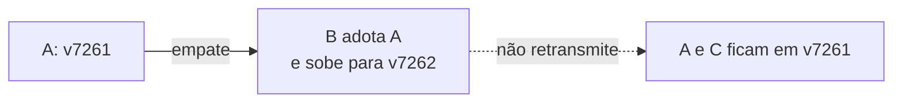

# S-M6 · Inconsistências após edições simultâneas

**Nota 1**: em 2 de 8 rodadas com três participantes editando o mesmo elemento,
eles terminaram com versões diferentes. Numa delas, a diferença persistiu
2 min sem novas edições. Quem perde o desempate sobe a versão sozinho
(`bumpElementVersions`, `Collab.tsx:790`). Se isso acontece depois da última
ressincronização dessa janela, a versão não chega aos outros, e uma edição
posterior pode se perder.

Registro completo:
[`evidencias/seguranca/S-M6`](https://github.com/FCTE-Qualidade-de-Software-1/2026-2_T02_ADA_LOVELACE/tree/main/evidencias/seguranca/S-M6).

## Contexto da consolidação

| Item | Registro |
| --- | --- |
| Objetivo e questão GQM | O1 · S-Q3 ([roteiro](../../analise/roteiro.md)) |
| Versão de referência | Excalidraw [`e7b534668a60add7f725531f3c9abf32508c7b4e`](https://github.com/excalidraw/excalidraw/commit/e7b534668a60add7f725531f3c9abf32508c7b4e); ressalvas de correspondência abaixo |
| Valor medido | 2 em 8 rodadas |
| Pontuação | **1/2** |
| Origem | [PR #102](https://github.com/FCTE-Qualidade-de-Software-1/2026-2_T02_ADA_LOVELACE/pull/102), integrado na main |

**Procedimento resumido:** Oito rodadas concorrentes com três janelas; comparação após 30 segundos e, em parte das rodadas, após dois minutos.

**Resultado e justificativa:** Duas rodadas terminaram com versões divergentes; a faixa de uma a duas inconsistências recebe 1.

**Limitações:** Teste local com concorrência controlada; não estima frequência para todos os usuários. Divergência temporária foi separada da persistente. Revisão cruzada não preenchida.

**Evidência original:** [S-M6_edicao-simultanea.md](https://github.com/FCTE-Qualidade-de-Software-1/2026-2_T02_ADA_LOVELACE/blob/c9ac9610b92474af82cc9ad3e67dc53bfa3490d4/evidencias/seguranca/S-M6/S-M6_edicao-simultanea.md), com dados, procedimento completo e arquivos de apoio. Esta página consolida a coleta existente; não registra nova medição ou aprovação humana.
